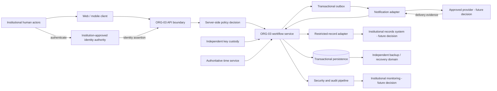
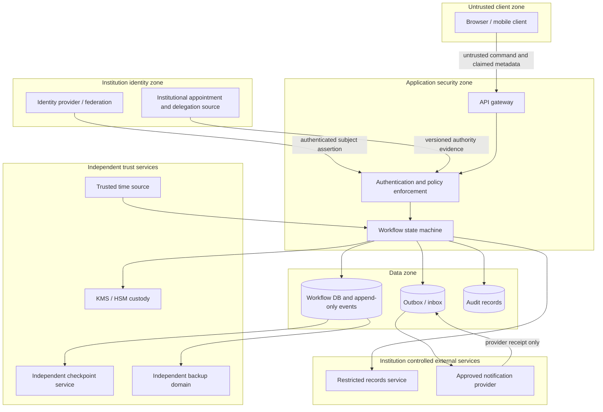
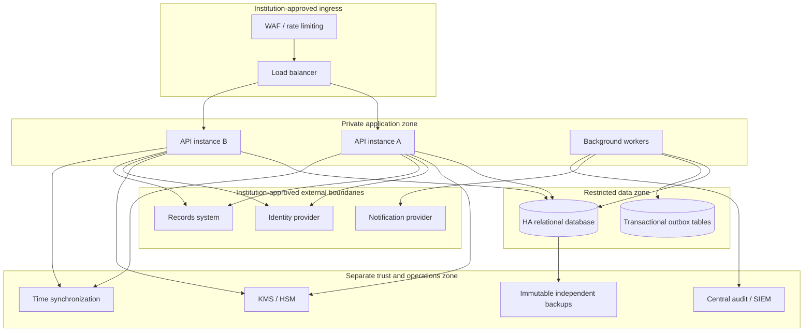

# ORG-03 A1 Architecture Diagrams

**Document ID:** EKHC-ORG03-A1-ARCH-003  
**Status:** Conceptual draft — subject to institutional evidence and Owner approval  
**Baseline:** Synthetic A3 commit `fca11fd4d975aa55e2bd2f7e975c832802eb7bf1`

These diagrams express logical boundaries, not deployed infrastructure. They do not imply that any provider, institutional directory, records service, KMS/HSM or hosting environment has been selected or connected.

## 1. System context



## 2. Trust boundaries and data flows



## 3. Conceptual deployment zones



This is a logical target only. Network segmentation, trust routes, data residency, tenancy, redundancy and administrator access remain decisions for the institution.

## 4. Acknowledgement and escalation sequence

```mermaid
sequenceDiagram
  participant Actor as Authorized actor
  participant API as ORG-03 API
  participant Policy as Authority and policy service
  participant DB as Transactional store
  participant Worker as Outbox worker
  participant Provider as Notification provider
  participant Responder as Assigned responder
  Actor->>API: Submit workflow command
  API->>Policy: Authenticate and authorize
  Policy-->>API: Decision plus evidence reference
  API->>DB: Atomic event + aggregate + idempotency + outbox
  DB-->>API: Commit confirmed
  API-->>Actor: Stable command result
  Worker->>DB: Claim outbox item
  Worker->>Provider: Send minimal notification
  Provider-->>Worker: Provider receipt
  Worker->>DB: Record provider receipt separately
  Responder->>API: Authenticated acknowledgement
  API->>Policy: Revalidate current authority and scope
  Policy-->>API: Authorization decision
  API->>DB: Append human acknowledgement event
  Note over DB: Delivery receipt is not human acknowledgement; acknowledgement is not closure
```

## 5. Diagram controls and unresolved items

- Client data is untrusted until validated and authorized server-side.
- Identity assertions and appointment/delegation evidence are separate inputs.
- KMS/HSM, time, checkpoint, backup and audit services must have explicit trust and administrator boundaries.
- Provider receipt is not human acknowledgement.
- Restricted-record access has its own authorization and audit boundary.
- The database/outbox atomicity and independent checkpoint protocol require a detailed design.
- No component shown here is proof of institutional availability or approval.

**Status:** conceptual diagrams prepared; deployment-specific topology and institutional trust paths remain UNRESOLVED.
