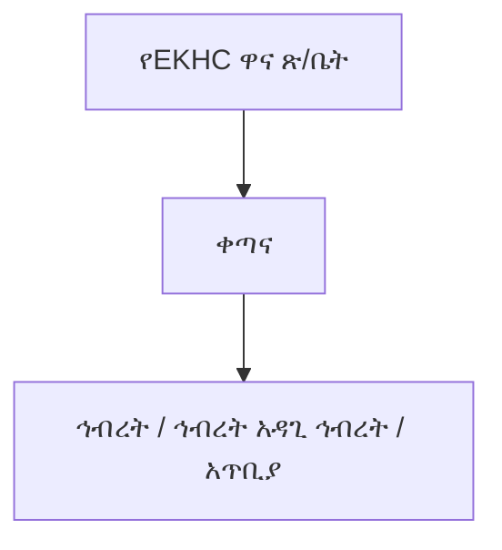
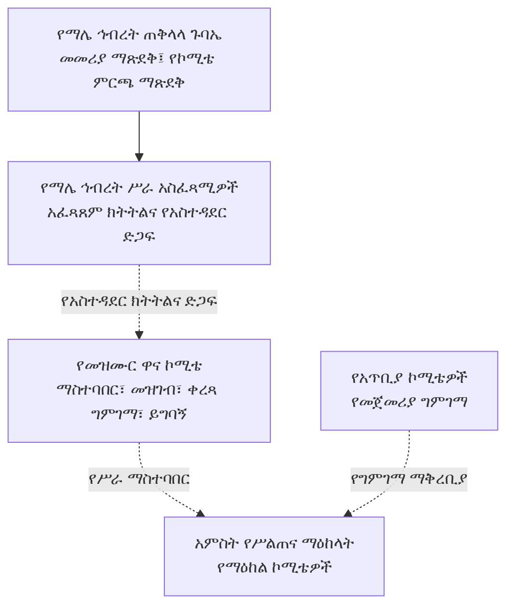
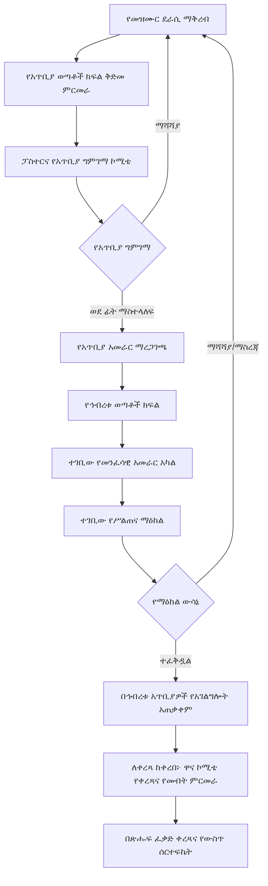

# የማሌ ቃለ ሕይወት ኅብረት የመዝሙር ግምገማና የአገልግሎት አጠቃቀም መመሪያ

**የሰነዱ ሁኔታ፦ ለማሌ ኅብረት ሥራ አስፈጻሚዎች ምርመራ፣ አስተያየትና ምክረ ሐሳብ የቀረበ ረቂቅ (NOT APPROVED)**  
**ስሪት፦ 1.0 (ቋሚ መለያ፤ ያለ ባለቤቱ ግልጽ ፈቃድ አይቀየርም) | የሰነድ ቁጥር፦ ማቃሕ/መዝ/001**  
**የሥራ ቋንቋዎች፦ ማሌኛና አማርኛ**  
**የዚህ ረቂቅ ቀጣይ ሂደት፦ ለኅብረቱ ሥራ አስፈጻሚዎች ቀርቦ አስተያየት እንዲሰጡበት፤ የመጨረሻ ማጽደቅና ማሻሻል ሥልጣን፦ የማሌ ቃለ ሕይወት ጠቅላላ ጉባኤ**

> **የሥልጣን ወሰን፦** ይህ ለማሌ ቃለ ሕይወት ኅብረት የተዘጋጀ የኅብረቱ መመሪያ ነው። የኢትዮጵያ ቃለ ሕይወት ቤተ ክርስቲያን (EKHC) መተዳደሪያ ደንብ፣ መሠረተ እምነት ወይም የአምልኮ መጽሐፍ አይደለም፤ እነዚህንም አይተካም። ከእነሱ ጋር የሚጋጭ ነገር ካለ በEKHC መተዳደሪያ ደንብ የተወሰነው ተቋማዊ ሥርዓትና ተገቢው ሥልጣን ያለው አካል ውሳኔ ይበልጣል።

---

## ምዕራፍ 1፡ አጠቃላይ ድንጋጌዎች

### አንቀጽ 1፡ መግቢያና ዓላማ
መዝሙር መሠረተ እምነት፣ የመንፈሳዊ ሕንጸት፣ የምስጋናና የአምልኮ አገልግሎት አካል ነው። ስለዚህ በማሌ ቃለ ሕይወት አጥቢያዎች የሚጠቀሙባቸው መዝሙሮች በመጽሐፍ ቅዱሳዊ ትምህርት፣ በቋንቋ፣ በሙዚቃ፣ በአምልኮ ተገቢነትና በደራሲዎችና በሌሎች መብት ባለቤቶች መብት መሠረት እንዲገመገሙ ይህ መመሪያ ተዘጋጅቷል። ዓላማው ግልጽና ፍትሐዊ ሂደት ማቋቋም፣ የመዝሙር ጥራትን ማረጋገጥ፣ የማሌኛና የአማርኛን እኩል ክብር መጠበቅ፣ የደራሲዎችንና የሌሎች መብት ባለቤቶችን መብት ማስጠበቅና የተፈቀዱ መዝሙሮችን በኅብረቱ አጥቢያዎች ማስተባበር ነው።

### አንቀጽ 2፡ የመሠረታዊ ሰነዶች ሥልጣን፣ ተግባርና ተዋረድ
1. **መጽሐፍ ቅዱስ፦** የእምነት፣ የትምህርት፣ የአምልኮና የክርስቲያናዊ ኑሮ ከፍተኛ መንፈሳዊ መሠረት ነው። የመዝሙር ግጥምና መልዕክት ከመጽሐፍ ቅዱስ ጋር መጣጣም አለበት።
2. **የኢትዮጵያ ቃለ ሕይወት ቤተ ክርስቲያን (EKHC) መተዳደሪያ ደንብ፦** የቤተ ክርስቲያኑን ሕጋዊ/ተቋማዊ መዋቅር፣ የሥልጣን ምንጮችን፣ የጉባኤዎችን፣ የአመራሮችንና የአስተዳደር አካላትን ሥልጣንና ኃላፊነት ይወስናል። ይህ መመሪያ እነዚህን ሥልጣኖች አይቀይርም፣ አይጨምርም፣ አይተካምም።
3. **የEKHC መሠረተ እምነት፦** የቤተ ክርስቲያኑን የተቀበሉ የእምነት አስተምህሮዎችና የሥነ መለኮት መርሆዎች ይገልጻል። የመዝሙር መልዕክት ከመጽሐፍ ቅዱስና ከዚህ መሠረተ እምነት ጋር መጣጣም አለበት።
4. **የEKHC ስርዓተ መጽሐፍ፦** የአምልኮና የቤተ ክርስቲያን አገልግሎት ሥርዓት፣ አቀራረብና ተግባራዊ አፈጻጸም ይመራል። የመዝሙር አጠቃቀም ከስርዓተ መጽሐፉና ከተፈቀደው የአምልኮ ሥርዓት ጋር መጣጣም አለበት።
5. **ይህ የኅብረቱ መመሪያ፦** ከላይ የተጠቀሱትን መሠረታዊ ሰነዶችና የበላይ አካላት ሥልጣን በመጠበቅ፣ በማሌ ቃለ ሕይወት ኅብረት ውስጥ የመዝሙር ማቅረብ፣ ግምገማ፣ የአገልግሎት ፈቃድ፣ ቀረጻ ማስተባበርና መዝገብ አያያዝ ሂደቶችን ብቻ ይደነግጋል።
6. እነዚህ ሰነዶች ተለያዩ ተግባራትና የሥልጣን ምንጮች አሏቸው፤ በአንድ የተቀላቀለ የሕግ ዝርዝር አይተረጎሙም። የመጽሐፍ ቅዱስ መንፈሳዊ ቀዳሚነትና በEKHC መተዳደሪያ ደንብ የተወሰነው ተቋማዊ ሥልጣን በየተግባራቸው ይከበራሉ። ግጭት ወይም ጥርጣሬ ሲኖር ኮሚቴ በራሱ የበላይ ውሳኔ አይሰጥም፤ ጉዳዩን ለተገቢው የEKHC ሥልጣን ያለው አካል ያቀርባል።
7. የማሌ ኅብረት ጠቅላላ ጉባኤ ይህን የኅብረቱ መመሪያ በኅብረቱ የሥልጣን ወሰን ውስጥ ያጸድቃል፤ ይህ ማጽደቅ የEKHC የበላይ ሰነዶችን ወይም የበላይ አካላትን ሥልጣን አይተካም።

### አንቀጽ 3፡ ተፈጻሚነትና ትርጓሜ
1. ይህ መመሪያ በማሌ ቃለ ሕይወት ኅብረት ሥር ባሉ አጥቢያዎች፣ በወጣቶች ክፍሎች፣ በመዝሙር ቡድኖችና በዚህ መመሪያ የተቋቋሙ ኮሚቴዎች ላይ ይፈጸማል።
2. “ጠቅላላ ጉባኤ” ማለት የማሌ ቃለ ሕይወት ጠቅላላ ጉባኤ ነው፤ የብሔራዊው EKHC ጠቅላላ ጉባኤ አይደለም።
3. “የሥልጠና ማዕከል/ክላስተር” ማለት ለሥልጠና፣ ለውይይት፣ ለአገልግሎትና ለሥራ ማስተባበር የተደራጀ ቡድን ነው፤ በመተዳደሪያ ደንቡ የተወሰነ የአስተዳደር ቀጣና አይደለም።
4. “ዋና ኮሚቴ” የኅብረቱ የመዝሙር ግምገማና አስተባባሪ ኮሚቴ ነው። “የማዕከል ኮሚቴ” በየሥልጠና ማዕከሉ የሚሠራ ኮሚቴ ነው። “የአጥቢያ ኮሚቴ” የመጀመሪያ ግምገማ የሚያካሂድ ኮሚቴ ነው።
5. የዚህ መመሪያ የአገልግሎት ፈቃድ በኅብረቱ ውስጥ ያሉ አጥቢያዎችን ብቻ ይመለከታል፤ ከኅብረቱ ውጭ ያሉ አካላትን አያስገድድም።

### አንቀጽ 4፡ ቃላትና ትርጓሜዎች
በዚህ መመሪያ ውስጥ ከዚህ በታች ያሉት ቃላት በሚከተለው ትርጉም ይጠቀማሉ። የመጽሐፍ ቅዱሳዊ ትርጉማቸው ከቴክኒካዊ/ሙዚቃዊ ትርጉማቸው ጋር ተያይዞ ይታያል፤ ቴክኒካዊ ትርጉሙ ግን የመጽሐፍ ቅዱስን ትምህርት አይተካም።

1. **መዝሙር፦** የምስጋና፣ የአምልኮ፣ የጸሎት፣ የእምነት እውነት ወይም የመንፈሳዊ ምላሽ መልዕክትን በቃልና በዜማ የሚገልጽ የመዘመር ሥራ ነው። በመጽሐፍ ቅዱስ የመዝሙርና የመንፈሳዊ ዝማሬ አጠቃቀም (መዝሙረ ዳዊት፤ ቆላስይስ 3፥16፤ ኤፌሶን 5፥19) የእምነት ማኅበረሰብን ለማነጽ የሚያገለግል መንፈሳዊ ዝማሬ ነው። በቴክኒክ ደረጃ ግጥም፣ ዜማ፣ ምትና የሙዚቃ አደረጃጀት ያለው ሥራ ነው።
2. **ዜማ፦** የድምፆች ከፍታና ዝቅታ፣ ቆይታና ቅደም ተከተል ተደራጅቶ የሚፈጥረው የሚታወቅ የድምፅ መስመር (melody) ነው። ዜማው የግጥሙን ትርጉም ለማጉላትና ለመዘመር ይረዳል።
3. **ሙዚቃ መሣሪያ፦** ድምፅን በመንቀጥቀጥ፣ በመንፋት፣ በመታ ወይም በኤሌክትሮኒክ መንገድ የሚያመነጭና የሙዚቃ ክፍልን የሚደግፍ መሣሪያ ነው፤ ለምሳሌ ኪቦርድ፣ ጊታርና ከበሮ።
4. **የሙዚቃ መሣሪያ ተጫዋች፦** መሣሪያን በብቃት የሚጫወት፣ የዜማና የምት አደረጃጀትን የሚጠብቅና የዘማሪዎችን ዝማሬ የሚደግፍ አገልጋይ ነው።
5. **ዘማሪ፦** በግል ወይም ከሌሎች ጋር በመሆን መዝሙርን በድምፅ የሚያቀርብ ሰው ነው። ዘማሪነት የአምልኮና የማኅበረሰብ አገልግሎት ነው።
6. **ሶሎ ዘማሪ፦** አንድ ዘማሪ ዋናውን የድምፅ መስመር ብቻውን የሚያቀርብበት አቀራረብ ነው፤ ሌሎች ድምፆች ወይም መሣሪያዎች ሊደግፉት ይችላሉ።
7. **ዱዌት፦** ሁለት ዘማሪዎች የድምፅ ክፍሎችን በመካፈል አንድን መዝሙር በጋራ የሚያቀርቡበት አቀራረብ ነው።
8. **ትሪዮ፦** ሦስት ዘማሪዎች የድምፅ ክፍሎችን በመካፈል በጋራ የሚዘምሩበት አቀራረብ ነው።
9. **ኳይር/መዘምራን ቡድን፦** ብዙ ዘማሪዎች በተደራጀ የድምፅ ክፍል፣ በአንድነትና በመሪነት የሚዘምሩበት ቡድን ነው። አንድ ድምፅ ወይም ብዙ የድምፅ ክፍሎች ሊኖሩት ይችላሉ።
10. **የመዝሙር ደራሲ፦** የመዝሙሩን ግጥም የጻፈ ሰው ነው።
11. **የዜማ ደራሲ/አቀናባሪ፦** የመዝሙሩን ዜማ የደረሰ ወይም የሙዚቃ ክፍሎቹን ያደራጀ ሰው ነው። የግጥም ደራሲና የዜማ ደራሲ አንድ ሰው ሊሆኑ ይችላሉ፤ ካልሆኑ ሁለቱም ይጠቀሳሉ።
12. **የመዝሙር አራሚ/ገምጋሚ ኮሚቴ፦** በተሰጠው ሥልጣን መሠረት የመዝሙሩን መጽሐፍ ቅዱሳዊ፣ ቋንቋዊ፣ ሙዚቃዊና የመብት ጉዳዮች የሚመረምር አካል ነው። “አራሚ” ማለት የደራሲውን ሥራ የሚወስድ ሳይሆን ግምገማና ምክር የሚሰጥ ማለት ነው።
13. **የመዝሙር ስሪት፦** በተወሰነ ቀን የተዘጋጀ የግጥም፣ ዜማ ወይም ቅጂ የተለየ ሁኔታ ነው፤ እያንዳንዱ ማሻሻያ ቀንና መለያ ይኖረዋል።
14. **የአገልግሎት ፈቃድ፦** መዝሙሩ በኅብረቱ አጥቢያዎች በአምልኮ ጊዜ እንዲዘመር የሚሰጥ የውስጥ ፈቃድ ነው፤ የቅጂ መብትን ወይም የቀረጻ ፈቃድን አይተካም።
15. **የግምገማ ውሳኔ፦** ኮሚቴው በማስረጃና በመመሪያው መስፈርት መሠረት የሚያወጣው የተመዘገበ ውጤት ነው።
16. **የጥቅም ግጭት፦** የኮሚቴ አባል የግል፣ የቤተሰብ፣ የገንዘብ፣ የዝምድና ወይም ሌላ ግንኙነት በገለልተኛ ውሳኔው ላይ ተጽዕኖ ሊያሳድር የሚችልበት ሁኔታ ነው።
17. **የደራሲና የመብት ባለቤት ፈቃድ፦** የመዝሙር ደራሲ፣ የዜማ ደራሲ ወይም ሌላ መብት ባለቤት በተወሰነ ዓላማና ወሰን ሥራው እንዲጠቀምበት በጽሑፍ የሚሰጠው ፈቃድ ነው።

---

### አንቀጽ 5፡ መርሆዎች
የግምገማ ሥራ በመጽሐፍ ቅዱሳዊነት፣ በእውነተኛነት፣ በፍትሐዊነት፣ በግልጽነት፣ በተጠያቂነት፣ በአድልዎ አለማድረግ፣ በደራሲ መብት አክብሮትና በጥቅም ግጭት መከላከል ይመራል። ማሌኛና አማርኛ እኩል ክብርና የግምገማ ደረጃ ያላቸው ቋንቋዎች ናቸው።

### አንቀጽ 6፡ የአስተዳደር መዋቅርና ክላስተሮች
1. በEKHC መተዳደሪያ ደንብ የተወሰነው መዋቅር በራሱ መተዳደሪያ ደንብ የተወሰነ ነው። የተቋሙ መዋቅር ዋና ጽ/ቤት፣ ቀጣና፣ ከዚያም ኅብረት፣ ኅብረት አዳጊ ኅብረት ወይም አጥቢያ የሚለውን የተለያዩ የአስተዳደር ደረጃዎች ያካትታል።
2. በማሌ ቃለ ሕይወት ያሉት አምስት ክላስተሮች ለሥልጠናና ለመዝሙር ግምገማ ብቻ የተደራጁ ናቸው። ክላስተሮች ቀጣና አይደሉም፤ የተቋቋመውን የአስተዳደር ሥርዓት አይተኩም።
3. እያንዳንዱ ክላስተር በአጠቃላይ 10–20 አጥቢያዎችን ሊያካትት ይችላል፤ ትክክለኛው የአጥቢያ ዝርዝርና የማዕከል ክፍፍል በኅብረቱ በጽሑፍ ይረጋገጣል።

---

## ምዕራፍ 2፡ የግምገማ ኮሚቴዎች

### አንቀጽ 7፡ የኮሚቴ ዓይነቶችና ብዛት
1. የአጥቢያ ኮሚቴ፦ 7–9 አባላት።
2. የሥልጠና ማዕከል ኮሚቴ፦ 5–7 አባላት።
3. የኅብረቱ ዋና ኮሚቴ፦ 7–9 አባላት።
4. በኮሚቴ ውስጥ መንፈሳዊ፣ ቋንቋዊ፣ ሙዚቃዊና የአገልግሎት ልምድ በተመጣጣኝ ሁኔታ እንዲካተት ይደረጋል።

### አንቀጽ 8፡ የአባላት ብቃት፣ ሹመትና የሥራ ዘመን
1. አባል የአጥቢያ አባልነትና መልካም አቋም ያለው፣ በመንፈሳዊ ብስለትና በሥነ ምግባር የታመነ፣ በቋንቋ/ሥነ መለኮት/ሙዚቃ ብቃት ወይም በአገልግሎት ልምድ የሚያበረክት፣ የጥቅም ግጭትን የሚገልጽና መመሪያውን ለመከተል ፈቃደኛ መሆን አለበት።
2. የአጥቢያ ኮሚቴ በአጥቢያው ፓስተር ይጠራል፤ ፓስተሩም ሰብሳቢ ይሆናል።
3. **የሥልጠና ማዕከል ኮሚቴዎች አባላት በማሌ ኅብረት ይመረጣሉ፤ ምርጫቸውም በማሌ ኅብረት ጠቅላላ ጉባኤ ይጸድቃል።**
4. **የኅብረቱ ዋና ኮሚቴ አባላትም በማሌ ኅብረት ይመረጣሉ፤ ምርጫቸውም በማሌ ኅብረት ጠቅላላ ጉባኤ ይጸድቃል።** እጩዎች ከማዕከል ኮሚቴ አባላት ወይም በማዕከላት የተመረጡ ብቁ ተወካዮች መካከል ሊመጡ ይችላሉ።
5. የዋና ኮሚቴ ሰብሳቢ የኅብረቱ **ም/ዋ/ፀሐፊ** ይሆናል፤ ይህ የመደብ ስያሜና ሥልጣን በኅብረቱ ኦፊሴላዊ መዋቅር መሠረት ከማጽደቅ በፊት ይረጋገጣል።
6. የአባላት የሥራ ዘመን ሦስት ዓመት ነው። በየሦስት ዓመቱ የአፈጻጸምና የብቃት ግምገማ ይደረጋል፤ ሹመት እንደ ግምገማውና እንደ ሹመት ሥልጣን ውሳኔ ሊታደስ ይችላል።

### የአስተዳደርና የግምገማ መዋቅር ማሳያ
በEKHC መተዳደሪያ ደንብ የተወሰነው መዋቅር ከማሌ ኅብረት የመዝሙር ግምገማ አደረጃጀት የተለየ ነው።

**ሀ. በEKHC መተዳደሪያ ደንብ የተወሰነው የአስተዳደር አደረጃጀት**

**ለ. የማሌ ኅብረት የመዝሙር ግምገማ አደረጃጀት**

ይህ የሥራ ማስተባበሪያ አደረጃጀት የEKHC በመተዳደሪያ ደንቡ የተወሰነ የአስተዳደር ተዋረድን አይተካም። ክላስተሮች የሥልጠናና የግምገማ ማዕከላት ናቸው፤ ቀጣናዎች አይደሉም። ኮሚቴዎች በተሰጣቸው ውክልና ውስጥ ብቻ ይሠራሉ።

### አንቀጽ 9፡ የኮሚቴ ሥልጣንና ተግባር
1. **የአጥቢያ ኮሚቴ፦** የመጀመሪያ ግምገማ ያካሂዳል፤ የመጽሐፍ ቅዱስ ማጣቀሻን፣ የቋንቋ ጥራትን፣ ዜማንና የመብት መረጃን ይፈትሻል፤ ማሻሻያ ምክር በጽሑፍ ይሰጣል፤ ሚስጥርን ይጠብቃል፤ ውሳኔና ቃለ ጉባኤ ይመዘግባል። የደራሲውን ሥራ አይወስድም።
2. **የሥልጠና ማዕከል ኮሚቴ፦** የተላኩ መዝሙሮችን በተመዘነ መስፈርት ይገመግማል፤ የአገልግሎት ፈቃድ ይሰጣል፤ ውሳኔውን በጽሑፍ ይመዘግባል፤ በኅብረቱ ሁሉም አጥቢያዎች የሚፈጸም ፈቃድ ወይም እገዳ በተገቢው ሂደት ይወስናል፤ ለዋና ኮሚቴ ሪፖርት ያቀርባል።
3. **ዋና ኮሚቴ፦** የማዕከላትን ሥራ ያስተባብራል፤ የግምገማ መስፈርትን ያስተገብራል፤ ማዕከላዊ መዝገብ ይይዛል፤ ለቀረጻ የሚቀርቡ መዝሙሮችን ይመረምራል፤ ይግባኝ ይወስናል፤ ከባድ ጉድለት ሲኖር ዳግም ግምገማ ያካሂዳል፤ የኮሚቴዎችን አፈጻጸም ይከታተላል።
4. **የኮሚቴ አባላት የጋራ ግዴታ፦** በገለልተኝነት መሥራት፣ ሰውን ሳይሆን ሥራን መገምገም፣ ጥቅም ግጭትን ማሳወቅ፣ ሚስጥርን መጠበቅ፣ የደራሲን መብት ማክበርና ውሳኔን በምክንያት ማቅረብ ነው።
5. **የኮሚቴዎች መብት፦** ለግምገማ የሚያስፈልጉ ሰነዶችንና ማብራሪያዎችን መጠየቅ፣ ባለሙያ ምክር ማግኘት፣ ስብሰባ ማደራጀትና በተሰጣቸው ሥልጣን ውስጥ ውሳኔ መስጠት ናቸው።
6. ሁሉም ኮሚቴዎች በተሰጣቸው ውክልና ውስጥ ብቻ ይሠራሉ፤ የኅብረቱን ወይም የEKHCን ሌላ ሕጋዊ ሥልጣን አይወስዱም።

### አንቀጽ 10፡ ምልዓተ ጉባኤ፣ ውሳኔና ጥቅም ግጭት
1. የኮሚቴ ምልዓተ ጉባኤ ከጠቅላላ አባላቱ 2/3 ነው።
2. ውሳኔ በመጀመሪያ በመግባባት ይፈለጋል፤ ካልተቻለ በተገኙና ድምፅ በመስጠት ብቁ በሆኑ አባላት ብዙኃን ድምፅ ይወሰናል። ድምፅ እኩል ከሆነ ጉዳዩ ወደ ቀጣይ ስብሰባ ወይም ወደ ዋና ኮሚቴ ይተላለፋል።
3. በመዝሙሩ፣ በደራሲው፣ በቀረጻ አካል ወይም በውጤቱ ላይ ቀጥተኛ/ተዘዋዋሪ ጥቅም ያለው አባል ጥቅሙን ይገልጻልና ከውይይትና ከውሳኔ ይታቀባል።
4. የስብሰባ ቀን፣ ተሳታፊዎች፣ የተመረመሩ ማስረጃዎች፣ የጥቅም ግጭት መግለጫዎችና ውሳኔዎች በቃለ ጉባኤ ይመዘገባሉ።

---

## ምዕራፍ 3፡ የመዝሙር ማቅረቢያና ግምገማ ሂደት

### አንቀጽ 11፡ የመዝሙር ደራሲ/ዘማሪ ብቁነትና ማቅረቢያ
1. መዝሙር የሚያቀርብ የመዝሙር ደራሲ/ዘማሪ ከአንድ አጥቢያ ጋር የተያያዘ፣ በአጥቢያው አገልግሎት በንቃት የሚሳተፍና ከአጥቢያው መዘምራን/የመዝሙር ቡድን ጋር የተቀናጀ መሆን አለበት።
2. ደራሲው የግጥም ጽሑፍ፣ ዜማ፣ የድምፅ ወይም የሙዚቃ ቅጂ፣ የደራሲዎችና አቀናባሪዎች ስምና የአስተዋጽኦ መግለጫ፣ የተጠቀሙባቸው ሌሎች ሥራዎች ፈቃድ/ምንጭ እና የመገኛ መረጃ ያቀርባል።
3. ደራሲው መዝሙሩን ለአጥቢያው ወጣቶች ክፍል ያቀርባል። ወጣቶች ክፍሉ ደራሲውን ያነጋግራል፣ ስለ መዝሙሩ መነሻና ዓላማ መረጃ ይሰበስባል፣ የመጀመሪያ ምርመራ አድርጎ ለፓስተሩ ያስተላልፋል።

### የመዝሙር ማቅረቢያና የግምገማ የሥራ ፍሰት
የመዝሙር ሂደት ከማቅረብ እስከ አገልግሎት ፈቃድ ድረስ በሚከተለው ቅደም ተከተል ይካሄዳል።

**የውሳኔ መንገድ፦** በእያንዳንዱ ደረጃ ውሳኔው ወደ ቀጣይ ደረጃ ማስተላለፍ፣ ማሻሻያ ጠይቆ መመለስ፣ ተጨማሪ ማስረጃ መጠየቅ፣ በምክንያት መከልከል ወይም ለተገቢው ሥልጣን ያለው አካል ማስተላለፍ ነው። የጊዜ ገደብ ወይም የስብሰባ መጠናቀቅ ብቻ ፈቃድ አያመጣም።

### አንቀጽ 12፡ የአጥቢያ ግምገማና ማስተላለፍ
1. ፓስተሩ የአጥቢያ ኮሚቴን ይጠራልና ስብሰባውን ይመራል።
2. ኮሚቴው ግጥም፣ ዜማ፣ የሙዚቃ ቅጂ፣ ትርጉም፣ የመጽሐፍ ቅዱስ መሠረትና የመብት ሁኔታ ይመረምራል። ማስተካከያ ካስፈለገ በጽሑፍ የተገለጸ ምክር ይሰጣል።
3. ገምጋሚዎች በደራሲው ፈንታ ግጥም ወይም ዜማ አይጽፉም፤ የደራሲነት መብት አይወስዱም። ማስተካከያውን የሚያደርገው ደራሲው ብቻ ነው፤ አዲሱን ስሪት እንደገና ያቀርባል።
4. የአጥቢያ ኮሚቴ ምክሩን ለአጥቢያው አመራር ያቀርባል። አመራሩ ከተስማማ የማስተላለፊያ ደብዳቤ/ሰርተፍኬት በማዘጋጀት ለኅብረቱ ወጣቶች ክፍል ይልካል።
5. የአጥቢያ ማረጋገጫ በኅብረቱ ሁሉ የአገልግሎት ፈቃድ እንደተሰጠ አይቆጠርም።

### አንቀጽ 13፡ የኅብረት ማስተላለፍና የማዕከል ግምገማ
1. የኅብረቱ ወጣቶች ክፍል የሰነድ ሙሉነትን ይፈትሻልና ለተገቢው የመንፈሳዊ አመራር አካል ያስተላልፋል። የመንፈሳዊ አመራሩ ትክክለኛ የመደብ ስምና የማስተላለፍ ሥልጣን ከማጽደቅ በፊት በኅብረቱ ኦፊሴላዊ መዋቅር ይረጋገጣል።
2. መዝሙሩ የሚቀርበው አጥቢያ በሚገኝበት ክላስተር የማዕከል ኮሚቴ ይመራል።
3. የግምገማ ስብሰባ ከዓርብ ከሰዓት ጀምሮ እስከ እሁድ የአምልኮ ጊዜ ድረስ ይካሄዳል። የሚቀርቡ ዘማሪዎች ብዛትና ለእያንዳንዱ የሚሰጠው ጊዜ በኮሚቴውና በአቅራቢዎች በቅድሚያ ይስማማሉ።
4. እስከ እሁድ ያልተገመገመ መዝሙር ወደ ቀጣይ ስብሰባ ይተላለፋል። የጊዜ እጥረት ብቻ ምክንያት መዝሙር በራሱ ፈቃድ አይጸድቅም።
5. የማዕከል ኮሚቴ የግምገማ ውሳኔውን በጽሑፍ ይሰጣል። ውሳኔው “ተፈቅዷል”፣ “ከማስተካከያ በኋላ ይቅረብ”፣ “ተጨማሪ ማስረጃ ያስፈልጋል” ወይም “አልተፈቀደም” ከሚሉት አንዱ ይሆናል።
6. የማዕከል ኮሚቴ የሰጠው የአገልግሎት ፈቃድ በማሌ ቃለ ሕይወት ኅብረት ውስጥ ባሉ ሁሉም አጥቢያዎች ተፈጻሚ ይሆናል። ይህ ፈቃድ የቅጂ፣ የቀረጻ፣ የህትመት፣ የስርጭት ወይም የትርጉም መብትን በራሱ አያስተላልፍም።

### አንቀጽ 14፡ የግምገማ መስፈርቶች
1. **መጽሐፍ ቅዱሳዊና ሥነ መለኮታዊ፦** መዝሙሩ ከመጽሐፍ ቅዱስና ከEKHC መሠረተ እምነት ጋር መጣጣሙ፤ ስለ እግዚአብሔር፣ ስለ ክርስቶስ፣ ስለ መንፈስ ቅዱስ፣ ስለ ድነት፣ ጸጋ፣ ንስሐና ቅድስና የሚያቀርበው ትርጉም፤ ጥቅስ ካለ ትክክለኛነቱና አውዱ።
2. **ቋንቋ፦** ግጥሙ ግልጽ፣ ተፈጥሯዊ፣ ሰዋሰዋዊና ለአምልኮ ተገቢ መሆኑ፤ ትርጉም ከሆነ ከዋናው ጽሑፍ ጋር ታማኝነቱ። የአካባቢ አጠራርና የቃላት ልዩነት በባለሙያ ምክር ይመረመራል።
3. **ሙዚቃ፦** ዜማው ከግጥሙ መልዕክት ጋር መጣጣሙ፣ የድምፅ ክልሉ፣ የመዘመር ቀላልነት፣ ለጉባኤ ዝማሬ ተገቢነቱና የሙዚቃ ጥራቱ።
4. **መብትና ሥነ ምግባር፦** የደራሲነት መግለጫ ትክክለኛነት፣ የሌሎች ሥራ ያለፈቃድ አለመጠቀም፣ የሰውን ክብር የሚጎዳ ወይም አድልዎ የሚያስፋፋ ይዘት አለመኖሩ።
5. የግምገማ ውጤት በእነዚህ መስፈርቶች ላይ የተመሠረተና በጽሑፍ የተነገረ መሆን አለበት።

---

## ምዕራፍ 4፡ የዘማሪ ሥነ ምግባር፣ እገዳና ይግባኝ

### አንቀጽ 15፡ የዘማሪ፣ የመዝሙር ደራሲና የሙዚቃ ተሳታፊዎች መብትና ግዴታ
1. **የዘማሪ ባህርይ፦** ዘማሪ በመንፈሳዊ ብስለት፣ በትሕትና፣ በታማኝነት፣ በተግባቦት፣ በቡድን መንፈስና በአክብሮት የሚያገለግል መሆን ይጠበቅበታል። የመድረክ ታይነትን ከአምልኮ ዓላማ በላይ አያደርግም።
2. **የዘማሪ ተግባርና ኃላፊነት፦** መዝሙሩን በትክክለኛ ግጥምና ዜማ ማቅረብ፤ ለልምምድና ለአገልግሎት በሰዓቱ መገኘት፤ የአምልኮ መሪንና የኮሚቴ ውሳኔን ማክበር፤ የሌሎችን ድምፅና አስተዋጽኦ ማክበር፤ የተፈቀደውን ስሪት ብቻ መጠቀም፤ ያልተፈቀደ ለውጥ ካደረገ ለኮሚቴው ማሳወቅ።
3. **የዘማሪ መብት፦** በአክብሮት መያዝ፤ የተሰጠውን የግምገማ ውሳኔና ምክንያት በጽሑፍ ማግኘት፤ ስለ ክስ ወይም ጥያቄ ምላሽ መስጠት፤ ትክክለኛ የስም አጠራርና የአስተዋጽኦ ክሬዲት ማግኘት፤ በውሳኔ ላይ በተወሰነው ጊዜ ይግባኝ ማቅረብ፤ የግል መረጃው በሕጋዊና በተገቢ ዓላማ ብቻ እንዲጠቀምበት መጠየቅ ናቸው።
4. **የመዝሙር ደራሲና የዜማ ደራሲ ግዴታ፦** የራሳቸውንና የሌሎችን አስተዋጽኦ በትክክል መግለጽ፤ የተጠቀሙበትን ምንጭ ማሳወቅ፤ የሌላ ሰው ሥራ ሲጠቀሙ ፈቃድ ማቅረብ፤ የተለያዩ የግጥምና የዜማ መብቶችን መለየት።
5. **የሙዚቃ መሣሪያ ተጫዋች ኃላፊነት፦** መሣሪያውን በደህንነት መጠቀምና መጠበቅ፤ ከዘማሪዎች ጋር በልምምድ መስማማት፤ የዜማን፣ የምትንና የድምፅ መጠንን መጠበቅ፤ የዘማሪውን ድምፅ በማይሸፍን መልኩ ማገዝ፤ ያልተፈቀደ የሙዚቃ ለውጥ አለማድረግ።
6. **የኳይር አባልና መሪ ኃላፊነት፦** በተመደበው የድምፅ ክፍል መዘመር፤ በልምምድ መሳተፍ፤ የቡድን አንድነትንና ሥነ ሥርዓትን መጠበቅ። መሪው የድምፅ ክፍፍል፣ የልምምድ መርሐ ግብርና የአቀራረብ ቅንጅት ያደርጋል፤ የአጥቢያውን አመራር የአምልኮ መመሪያ ያከብራል።
7. ሁሉም ዘማሪዎችና የሙዚቃ ተሳታፊዎች በግምገማ ሂደት በአክብሮት ይሳተፋሉ፤ ማስተካከያን በደራሲው ፈቃድና ውሳኔ ብቻ ያደርጋሉ፤ የአገልግሎት ፈቃድን ከቀረጻና ከቅጂ መብት ፈቃድ ጋር አያምታቱም።

### አንቀጽ 16፡ የዘማሪ አገልግሎት እገዳ
1. በከባድ የሥነ ምግባር ጥሰት፣ በተደጋጋሚ የመመሪያ መጣስ፣ በሌላ ሰው ሥራ ላይ ያለፈቃድ የደራሲነት ጥያቄ ወይም በግምገማ ላይ ጫና/ማስፈራራት ሲኖር የማዕከል ኮሚቴ በጠቅላላ ጉባኤ በጸደቀ ግልጽ ውክልናና በEKHC የበላይ ሰነዶች የተፈቀደው ወሰን ውስጥ ብቻ ዘማሪን ከመዝሙር አገልግሎት ለጊዜው ሊያግድ ይችላል። ይህ ውክልና ካልተረጋገጠ ኮሚቴው እገዳ አይወስንም፤ ምክረ ሐሳብ ብቻ ለሥልጣን ያለው አካል ያቀርባል።
2. እገዳ ከመወሰኑ በፊት ዘማሪው ክሱን እንዲያውቅና ምላሽ እንዲሰጥ ተመጣጣኝ ዕድል ይሰጠዋል። አስቸኳይ የጥበቃ ሁኔታ ካለ ጊዜያዊ እርምጃ ሊወሰድ ይችላል፤ ከዚያም በኋላ ፈጣን ምርመራ ይደረጋል።
3. የእገዳ ውሳኔ ምክንያት፣ ወሰን፣ በማንኛውም የኅብረቱ አጥቢያ ላይ ያለው ተፈጻሚነት፣ የጀማሪና የማብቂያ ቀን፣ የመመለሻ ሁኔታና የይግባኝ መብት በጽሑፍ ይገልጻል።
4. የማዕከል ኮሚቴ በጠቅላላ ጉባኤ በጸደቀው ውክልናና በEKHC መተዳደሪያ ደንብ የተፈቀደው ወሰን ውስጥ ብቻ የሰጠው እገዳ በኅብረቱ ሥር ባሉ ሁሉም አጥቢያዎች የዘማሪውን የመዝሙር አገልግሎት ይመለከታል። እገዳው በራሱ የአባልነትን ወይም ሌላ የአገልግሎት ሚናን አያቋርጥም።
5. እገዳ ተመጣጣኝ፣ ጊዜያዊና በየጊዜው የሚገመገም መሆን አለበት።

### አንቀጽ 17፡ ይግባኝ
1. በማዕከል ኮሚቴ ውሳኔ የተጎዳ የመዝሙር ደራሲ/ዘማሪ የጽሑፍ ውሳኔውን ከተቀበለ በ30 ቀናት ውስጥ ለዋና ኮሚቴ ይግባኝ ማቅረብ ይችላል።
2. ይግባኙ የተቃውሞ ምክንያት፣ የተጠየቀው መፍትሔና የሚደግፉ ማስረጃዎችን ይይዛል።
3. ዋና ኮሚቴው ውሳኔውን ሊያጸና፣ ሊያሻሽል፣ ሊሽር ወይም ጉዳዩን ለአዲስ ግምገማ ሊመልስ ይችላል። የመጀመሪያውን ውሳኔ የሰጡ አባላት በይግባኙ ውሳኔ ላይ አይሳተፉም።
4. የእምነት ወይም የሥነ መለኮት ከባድ ክርክር ካለ ጉዳዩ ለተገቢው የEKHC መንፈሳዊ/ሥነ መለኮታዊ ሥልጣን ያለው አካል ሊቀርብ ይችላል።

---

## ምዕራፍ 5፡ ቀረጻ፣ የቅጂ መብትና ሰነድ አያያዝ

### አንቀጽ 18፡ ለቀረጻ የሚቀርቡ መዝሙሮች
1. **የኅብረቱ የፖሊሲ ሐሳብ፦** ለአገልግሎት ብቁ የሆነ እያንዳንዱ መዝሙር በተደራጀ መዝገብ እንዲጠበቅና ለቀረጻ ተገቢነቱ እንዲመረመር ይመከራል። ሁሉንም መዝሙሮች መቅረጽ እንደ ግዴታ የሚወስነው የማሌ ቃለ ሕይወት ጠቅላላ ጉባኤ በግልጽ ማጽደቅ ብቻ ነው።
2. ለቀረጻ የሚቀርብ መዝሙር በዋና ኮሚቴ እንደገና ይገመገማል። የግጥምና የዜማ ባለቤትነት፣ የተሳታፊዎች ፈቃድ፣ የቀረጻ ዝግጅት፣ የሙዚቃ ጥራትና የስርጭት ዕቅድ ይመረመራሉ።
3. የቅጂ መብት ፈቃድና የቀረጻ ፈቃድ በጽሑፍ ከተገኙ በፊት ቀረጻ አይጀመርም።
4. ዋና ኮሚቴው ከተፈቀደው የቀረጻ ስሪት ጋር የጽሑፍ ፈቃድ፣ የደራሲ መግለጫና የስሪት መለያ ይመዘግባል።

### አንቀጽ 19፡ የደራሲና የመብት ባለቤት መብትና ፈቃድ
1. የግጥም ደራሲ በግጥሙ ላይ ያለውን መብት ይጠብቃል፤ የዜማ ደራሲም በዜማው ላይ ያለውን መብት ይጠብቃል። በጋራ የተፈጠረ ሥራ የእያንዳንዱ አስተዋጽኦ በግልጽ ይመዘገባል።
2. የኮሚቴ ማጽደቅ የባለቤትነት መብትን ወደ ኅብረቱ አያስተላልፍም።
3. ቀረጻ፣ ማተም፣ ማባዛት፣ ማሰራጨት፣ በዲጂታል መድረክ ማቅረብ፣ መተርጎም ወይም ማሻሻል ከሚመለከታቸው መብት ባለቤቶች በጽሑፍ ፈቃድ ይፈጸማል።
4. በቀረጻ ወይም በሕትመት ላይ የደራሲዎችና አቀናባሪዎች ስምና የተስማሙበት የምስጋና መግለጫ በትክክል ይጠቀሳል።
5. ኅብረቱ የውስጥ የመብትና የፈቃድ ማረጋገጫ ሊሰጥ ይችላል። ይህ ሰነድ የመንግሥት ወይም የሕግ የቅጂ መብት ምዝገባን አይተካም፤ ምዝገባ ሕጋዊ ግዴታ መሆኑንም በራሱ አያውጅም።

### አንቀጽ 20፡ የውስጥ ሰርተፍኬቶችና የአገልግሎት ፈቃድ
1. በዋና ኮሚቴ የቀረጻ ግምገማና የመብት ማስረጃ ከተረጋገጠ በኋላ ኅብረቱ የውስጥ የመብት/ፈቃድ ማረጋገጫና የአገልግሎት ፈቃድ ሊያወጣ ይችላል።
2. ሰርተፍኬቱ የመዝሙሩን ርዕስ፣ የደራሲዎችና አቀናባሪዎች ስም፣ የግጥም/ዜማ ስሪት፣ የፈቃድ ወሰን፣ የተፈቀዱ አጠቃቀሞች፣ ቀን፣ የውሳኔ ቁጥርና የፈረመውን ሥልጣን ያሳያል።
3. የውስጥ ሰርተፍኬት ከሕጋዊ የደራሲነት መብት ወይም ከሌላ የመንግሥት ምዝገባ ጋር አይተካከልም።

### አንቀጽ 21፡ መዝገብ፣ ግላዊነትና የመረጃ ደህንነት
1. ዋና ኮሚቴ የተቀበሉ መዝሙሮችን፣ የተከለከሉ/የተመለሱ ማቅረቢያዎችን፣ የግምገማ ውሳኔዎችን፣ የፈቃድ ሰነዶችን፣ የቀረጻ ስሪቶችንና የይግባኝ ውጤቶችን በማዕከላዊ መዝገብ ይይዛል።
2. የዘማሪዎች ስም፣ የግንኙነት መረጃ፣ የሕይወት ታሪክ፣ ፎቶ፣ ድምፅና ቪዲዮ በሥራው ዓላማ ብቻ ይሰበሰባሉ፤ ያልተፈለገ መረጃ አይሰበሰብም።
3. መረጃው በሥራው የሚያስፈልጋቸው ሥልጣን ያላቸው ሰዎች ብቻ ያገኙታል፤ በደህንነት ይጠበቃል፤ የማቆያ ጊዜው ይወሰናል።
4. የግል መረጃ ለሌላ ዓላማ ከመጠቀም ወይም ከማሰራጨት በፊት ተገቢ ፈቃድና ሕጋዊ መሠረት ይኖራል።

---

## ምዕራፍ 6፡ የገንዘብ ድጋፍና የወጪ አያያዝ

### አንቀጽ 22፡ የወጪ ኃላፊነት
1. የዋና ኮሚቴ ሌሎች መደበኛ ሥራዎች ወጪ በኅብረቱ/በዲስትሪክቱ የተፈቀደ በጀት ይሸፈናል።
2. ለቀረጻ የሚቀርብ መዝሙር የዋና ኮሚቴ ልዩ የቀረጻ ግምገማ ወጪ በደራሲው/ዘማሪውና በስፖንሰር ሊሸፈን ይችላል፤ ይህ ክፍያ በውሳኔ ላይ ተጽዕኖ አያሳድርም።
3. የማዕከል ግምገማ ወጪ ላይ የሚቀርብ የአጥቢያ መዋጮ በኅብረቱ በግልጽ ማጽደቅ ይወሰናል፤ አጥቢያው ለሚታዩት የአባላቱ ግምገማ ወጪ የሚያበረክተው መዋጮ የሚመለከተው የጉባኤ ውሳኔ ከተሰጠ በኋላ ብቻ ነው።
4. የአጥቢያ ኮሚቴ መጀመሪያ የሥራ ማስጀመሪያና የሻይ/ቡና ወጪ በአጥቢያው ይሸፈናል።
5. በዚህ መመሪያ ቋሚ የክፍያ መጠን፣ የቀን አበል ወይም የግዴታ ክፍያ አይወሰንም። ማንኛውም የወጪ መጠን በተለየ በጀት/ውሳኔ ይጸድቃል።
6. ሁሉም ገቢና ወጪ በደረሰኝ ይመዘገባል፤ የገንዘብ ክፍያ ለመዝሙር ማጽደቅ፣ ለእገዳ ማንሳት ወይም ለውሳኔ መግዛት አይፈቀድም።

---

## ምዕራፍ 7፡ አፈጻጸም፣ ክትትልና ማሻሻያ

### አንቀጽ 23፡ ክትትልና ሪፖርት
1. የማሌ ኅብረት ሥራ አስፈጻሚዎች የዚህን መመሪያ አፈጻጸም በኅብረቱ የተቋማዊ ሥልጣን ወሰን ውስጥ ይከታተላሉ፣ የኮሚቴዎችን የሥራ ሪፖርት ይቀበላሉና አስፈላጊውን የአስተዳደር ድጋፍ ያደርጋሉ።
2. ክትትሉ የግምገማ ጊዜ፣ የተቀበሉ መዝሙሮች፣ የተመለሱ ማቅረቢያዎች፣ የተፈቀዱ መዝሙሮች፣ የቅጂ መብት ማስረጃዎች፣ የይግባኝ ጉዳዮችና የገንዘብ አያያዝ ያካትታል።
3. ኮሚቴዎች በየዓመቱ ለኅብረቱ ሪፖርት ያቀርባሉ።

### አንቀጽ 24፡ የመመሪያው ማጽደቅና ማሻሻያ
1. ይህን መመሪያ የሚያጸድቀውና የሚያሻሽለው **የማሌ ቃለ ሕይወት ጠቅላላ ጉባኤ** ብቻ ነው።
2. የማሌ ኅብረት ሥራ አስፈጻሚዎች አፈጻጸሙን ይከታተላሉ፤ በሥልጣናቸው ውስጥ የሚያስፈልጉ የአፈጻጸም ማብራሪያዎችን ሊያወጡ ይችላሉ፤ የጉባኤውን ማጽደቅ ወይም ማሻሻል ግን አይተኩም።
3. ኮሚቴዎች በጠቅላላ ጉባኤ በጸደቀውና ከEKHC የበላይ ሰነዶች ጋር በሚጣጣም ውክልና ውስጥ ብቻ ይሠራሉ።
4. ከEKHC መተዳደሪያ ደንብ ጋር የሚጋጭ ነገር ከተገኘ ለተገቢው የEKHC ሥልጣን ያለው አካል ማብራሪያ ይጠየቃል፤ ይህ መመሪያ በራሱ የብሔራዊ ሥርዓት ማሻሻያ አያደርግም።

### አንቀጽ 25፡ የሥራ መጀመሪያ
ይህ መመሪያ በየማሌ ቃለ ሕይወት ጠቅላላ ጉባኤ ከጸደቀበት ቀን ጀምሮ ተፈጻሚ ይሆናል። ከማጽደቁ በፊት የረቂቅ ሰነድ ብቻ ነው፤ ለአገልግሎት ፈቃድ ወይም ለዘማሪ እገዳ ብቻውን መሠረት አይሆንም።

---

## አባሪ ሀ፡ አምስቱ የሥልጠና ማዕከላት

በማሌ ቃለ ሕይወት ኅብረት የሚከተሉት አምስት የሥልጠና ማዕከላት አሉ። እነዚህ ለሥልጠናና ለመዝሙር ግምገማ የተደራጁ ክላስተሮች ናቸው፤ ቀጣና ወይም በመተዳደሪያ ደንቡ የተወሰነ የተለየ የአስተዳደር ደረጃ አይደሉም። የእያንዳንዱ ማዕከል አጥቢያ ዝርዝር በኅብረቱ ይረጋገጣል።

| ተ.ቁ | የማዕከሉ ስም | የሚያካትታቸው አጥቢያዎች | የኮሚቴ አባላት |
|---|---|---|---|
| 1 | በኔታ አካባቢ ስልጠና ማዕከል | በኅብረቱ የሚረጋገጥ | 5–7 |
| 2 | ኮይቤ አካባቢ ስልጠና ማዕከል | በኅብረቱ የሚረጋገጥ | 5–7 |
| 3 | ባላ አካባቢ ስልጠና ማዕከል | በኅብረቱ የሚረጋገጥ | 5–7 |
| 4 | ዶይሶ አካባቢ ስልጠና ማዕከል | በኅብረቱ የሚረጋገጥ | 5–7 |
| 5 | ካርዞ አካባቢ ስልጠና ማዕከል | በኅብረቱ የሚረጋገጥ | 5–7 |

## አባሪ ለ፡ የመዝሙር ማቅረቢያ ቅጽ

- የመዝሙሩ ርዕስ፦ ____________________
- የግጥም ደራሲ፦ ____________________
- የዜማ ደራሲ፦ ____________________
- ሌሎች አስተዋጽኦ አድራጊዎች፦ ____________________
- የሚቀርብበት ቋንቋ፦ ማሌኛ / አማርኛ / ሌላ፦ ______
- የአጥቢያ ስም፦ ____________________
- የሥልጠና ማዕከል፦ ____________________
- የመዝሙሩ መነሻና ዓላማ፦ ____________________
- የመጽሐፍ ቅዱስ ማጣቀሻዎች፦ ____________________
- የሌላ ሰው ሥራ/ዜማ ተጠቅሟል? አዎ / አይ / ዝርዝር፦ ______
- የቀረጻ/ስርጭት ፈቃድ ሁኔታ፦ ____________________
- የደራሲ ፊርማና ቀን፦ ____________________

## አባሪ ሐ፡ የግምገማ ውሳኔ ቅጽ

- የመዝሙሩ ርዕስና የስሪት ቁጥር፦ ____________________
- የገምጋሚ ኮሚቴ፦ አጥቢያ / ማዕከል / ዋና
- የስብሰባ ቀን፦ ____________________
- ምልዓተ ጉባኤ ተሟልቷል? አዎ / አይ
- የመጽሐፍ ቅዱስና ሥነ መለኮት ግምገማ፦ ____________________
- የቋንቋ ግምገማ፦ ____________________
- የሙዚቃ ግምገማ፦ ____________________
- የመብት ማስረጃ ግምገማ፦ ____________________
- የጥቅም ግጭት መግለጫ፦ ____________________
- ውሳኔ፦ ተፈቅዷል / ከማስተካከያ በኋላ / ተጨማሪ ማስረጃ / አልተፈቀደም
- የውሳኔ ምክንያትና የሚፈለጉ ማስተካከያዎች፦ ____________________
- የይግባኝ መብት፦ በ30 ቀናት ውስጥ ለዋና ኮሚቴ
- የሰብሳቢ ስም/ፊርማ፦ ____________________

## አባሪ መ፡ የዘማሪ እገዳ ውሳኔ ቅጽ

- የዘማሪ ስም፦ ____________________
- የተነሳው ጉዳይ፦ ____________________
- ለዘማሪው የተሰጠ የምላሽ ዕድልና ምላሽ፦ ____________________
- የውሳኔ ምክንያት፦ ____________________
- የእገዳ ወሰን፦ በኅብረቱ ሁሉም አጥቢያዎች የመዝሙር አገልግሎት
- የጀማሪ ቀን፦ ______ የማብቂያ/የግምገማ ቀን፦ ______
- የመመለሻ ሁኔታ፦ ____________________
- የይግባኝ መብት፦ በ30 ቀናት ውስጥ ለዋና ኮሚቴ
- የኮሚቴ ውሳኔ ቁጥርና ፊርማ፦ ____________________

## አባሪ ሠ፡ የጠቅላላ ጉባኤ ማጽደቂያ መዝገብ

- የጉባኤ ቀን፦ ____________________
- የስብሰባ ቁጥር፦ ____________________
- የማጽደቅ ውሳኔ ቁጥር፦ ____________________
- የተደረጉ ማሻሻያዎች፦ ____________________
- የሥራ መጀመሪያ ቀን፦ ____________________
- የጉባኤ ሰብሳቢ ስምና ፊርማ፦ ____________________
- የጉባኤ ጸሐፊ ስምና ፊርማ፦ ____________________
- የኅብረቱ ማህተም፦ ____________________

---

## ከማጽደቅ በፊት የግድ የሚረጋገጡ ነጥቦች

1. የEKHC መተዳደሪያ ደንብና የማሌ ኅብረት የተፈቀደ መዋቅር ጋር የሥልጣን ተስማሚነት።
2. “ም/ዋ/ፀሐፊ” የሚለው የዋና ኮሚቴ ሰብሳቢ መደብ ትክክለኛ መደባዊ ስያሜና ሥልጣን።
3. የመንፈሳዊ አመራር ክፍል ትክክለኛ ስያሜና የማስተላለፍ ሥልጣን።
4. አምስቱ የሥልጠና ማዕከላት ስሞችና የአጥቢያ ዝርዝሮቻቸው።
5. ለማዕከል ግምገማ የአጥቢያ መዋጮና ለቀረጻ የሚደረግ የወጪ ድጋፍ የገንዘብ ሥርዓት።
6. ሁሉም ብቁ መዝሙሮች መቅረጽ ግዴታ እንዲሆን የታሰበው ፖሊሲ በጠቅላላ ጉባኤ በግልጽ መጽደቅ።
7. የቅጂ መብት፣ የግል መረጃና የቀረጻ ፈቃድ አንቀጾች ከሚመለከተው የኢትዮጵያ ሕግ ጋር መጣጣማቸው።

## የአፈጻጸም መጀመሪያ ሰነዶችና የቁጥጥር መዝገቦች
መመሪያው ከጸደቀ በኋላ ዋና ኮሚቴው ቢያንስ የሚከተሉትን የቁጥጥር መዝገቦች ያዘጋጃል፦
1. የአጥቢያዎችና የሥልጠና ማዕከላት የተፈቀደ ዝርዝር፤
2. የኮሚቴ አባላት፣ የምርጫና የጉባኤ ማጽደቅ ማስረጃ፤
3. የመዝሙር ማቅረቢያ፣ የግምገማ፣ የውሳኔ፣ የይግባኝና የእገዳ መዝገብ፤
4. የደራሲነት፣ የመብት ባለቤትነት፣ የቀረጻና የስርጭት ፈቃድ መዝገብ፤
5. የተፈቀዱ መዝሙሮች ዝርዝር፣ የስሪት ቁጥርና የአገልግሎት ፈቃድ ማረጋገጫ፤
6. የገንዘብ ገቢና ወጪ መዝገብ፣ በጀትና ደረሰኞች።

 ይህ ሰነድ በመጀመሪያ ለማሌ ኅብረት ሥራ አስፈጻሚዎች ምርመራ፣ አስተያየትና ምክረ ሐሳብ እንዲሰጡበት የቀረበ ነው፤ ለጠቅላላ ጉባኤ በቀጥታ የቀረበ አይደለም። ከሥራ አስፈጻሚዎች ግምገማ በኋላ በተገቢው ሂደት ለጠቅላላ ጉባኤ ሊቀርብ ይችላል። ይህ ረቂቅ እስኪጸድቅ ድረስ የሥራ መመሪያ አይደለም። የማሌ ኅብረት ሥራ አስፈጻሚዎች አፈጻጸሙን ይከታተላሉ፤ ኮሚቴዎችም በተሰጣቸው ውክልና ውስጥ ብቻ ይሠራሉ።
