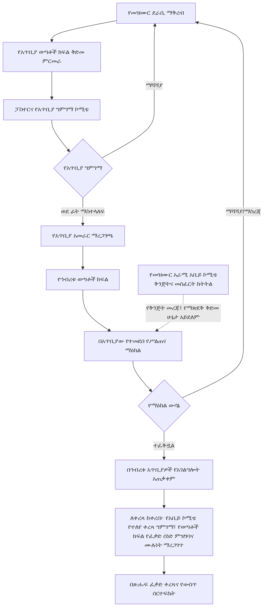

# የማሌ ቃለ ሕይወት አጥቢያ ቤተ ክርስቲያናት ኅብረት የመዝሙር ደራሲነት፣ የግጥምና የዜማ ዝግጅት፣ የሙዚቃ አቀናበር፣ የቅጂ መብት፣ ቀረጻ፣ ሕትመት፣ ስርጭትና የአገልግሎት አጠቃቀም መመሪያ

**የሰነዱ ሁኔታ፦ ለማሌ አጥቢያ ቤተ ክርስቲያናት ኅብረት ሥራ አስፈጻሚዎች ምርመራ፣ አስተያየትና ምክረ ሐሳብ የቀረበ ረቂቅ (NOT APPROVED)**  
**ስሪት፦ 1.0 (ቋሚ መለያ፤ ያለ ባለቤቱ ግልጽ ፈቃድ አይቀየርም) | የሰነድ ቁጥር፦ ማቃሕ/መዝ/001**  
**የሰነዱ የማዘጋጃ ቋንቋ፦ አማርኛ። የግምገማ ቋንቋዎች፦ ማሌኛ፣ አማርኛና ሌሎች ማንኛውም ቋንቋዎች።**  
**የዚህ ረቂቅ ቀጣይ ሂደት፦ ለኅብረቱ ሥራ አስፈጻሚዎች ቀርቦ አስተያየት እንዲሰጡበት፤ የመጨረሻ ማጽደቅና ማሻሻል ሥልጣን፦ የማሌ ቃለ ሕይወት አጥቢያ ቤተ ክርስቲያናት ኅብረት ጠቅላላ ጉባኤ**

> **የሥልጣን ወሰን፦** ይህ ለማሌ ቃለ ሕይወት አጥቢያ ቤተ ክርስቲያናት ኅብረት የተዘጋጀ የኅብረቱ መመሪያ ነው። የኢትዮጵያ ቃለ ሕይወት ቤተ ክርስቲያን መተዳደሪያ ደንብ፣ የእምነት አቋም ወይም ስርዓተ መጽሐፍ አይደለም፤ እነዚህንም አይተካም። ከእነሱ ጋር የሚጋጭ ነገር ካለ በኢትዮጵያ ቃለ ሕይወት ቤተ ክርስቲያን መተዳደሪያ ደንብ የተወሰነው ተቋማዊ ሥርዓትና ተገቢው ሥልጣን ያለው አካል ውሳኔ ይበልጣል።

---

## ምዕራፍ 1፡ አጠቃላይ ድንጋጌዎች

### አንቀጽ 1፡ መግቢያና ዓላማ
መዝሙር የእምነት ምስክርነት፣ የመንፈሳዊ ሕንጸት፣ የምስጋናና የአምልኮ አገልግሎት አካል ነው። ስለዚህ በማሌ ቃለ ሕይወት አጥቢያዎች የሚጠቀሙባቸው መዝሙሮች በመጽሐፍ ቅዱሳዊ ትምህርት፣ በቋንቋ፣ በሙዚቃ፣ በአምልኮ ተገቢነትና በደራሲዎችና በሌሎች መብት ባለቤቶች መብት መሠረት እንዲገመገሙ ይህ መመሪያ ተዘጋጅቷል። ዓላማው ግልጽና ፍትሐዊ ሂደት ማቋቋም፣ የመዝሙር ጥራትን ማረጋገጥ፣ ማንኛውም ቋንቋ ያለው መዝሙር በእኩል መርህ እንዲቀርብና እንዲገመገም ማድረግ፣ የደራሲዎችንና የሌሎች መብት ባለቤቶችን መብት ማስጠበቅና የተፈቀዱ መዝሙሮችን በኅብረቱ አጥቢያዎች ማስተባበር ነው።

### አንቀጽ 2፡ የመሠረታዊ ሰነዶች ሥልጣን፣ ተግባርና ተዋረድ
1. **መጽሐፍ ቅዱስ፦** የእምነት፣ የትምህርት፣ የአምልኮና የክርስቲያናዊ ኑሮ ከፍተኛ መንፈሳዊ መሠረት ነው። የመዝሙር ግጥምና መልዕክት ከመጽሐፍ ቅዱስ ጋር መጣጣም አለበት።
2. **የኢትዮጵያ ቃለ ሕይወት ቤተ ክርስቲያን መተዳደሪያ ደንብ፦** የቤተ ክርስቲያኑን ሕጋዊ/ተቋማዊ መዋቅር፣ የሥልጣን ምንጮችን፣ የጉባኤዎችን፣ የአመራሮችንና የአስተዳደር አካላትን ሥልጣንና ኃላፊነት ይወስናል። ይህ መመሪያ እነዚህን ሥልጣኖች አይቀይርም፣ አይጨምርም፣ አይተካምም።
3. **የኢትዮጵያ ቃለ ሕይወት ቤተ ክርስቲያን የእምነት አቋም፦** የቤተ ክርስቲያኑን የተቀበሉ የእምነት አስተምህሮዎችና የሥነ መለኮት መርሆዎች ይገልጻል። የመዝሙር መልዕክት ከመጽሐፍ ቅዱስና ከዚህ የእምነት አቋም ጋር መጣጣም አለበት።
4. **የኢትዮጵያ ቃለ ሕይወት ቤተ ክርስቲያን ስርዓተ መጽሐፍ፦** የቤተ ክርስቲያን አምልኮና አገልግሎት ሥርዓት፣ አቀራረብና ተግባራዊ አፈጻጸም ይመራል። የመዝሙር አጠቃቀም ከስርዓተ መጽሐፉና ከተፈቀደው የአምልኮ ሥርዓት ጋር መጣጣም አለበት።
5. **ይህ የኅብረቱ መመሪያ፦** ከላይ የተጠቀሱትን መሠረታዊ ሰነዶችና የበላይ አካላት ሥልጣን በመጠበቅ፣ በማሌ ቃለ ሕይወት አጥቢያ ቤተ ክርስቲያናት ኅብረት ውስጥ የመዝሙር ማቅረብ፣ ግምገማ፣ የአገልግሎት ፈቃድ፣ ቀረጻ ማስተባበርና መዝገብ አያያዝ ሂደቶችን ብቻ ይደነግጋል።
6. እነዚህ ሰነዶች ተለያዩ ተግባራትና የሥልጣን ምንጮች አሏቸው፤ በአንድ የተቀላቀለ የሕግ ዝርዝር አይተረጎሙም። የመጽሐፍ ቅዱስ መንፈሳዊ ቀዳሚነትና በኢትዮጵያ ቃለ ሕይወት ቤተ ክርስቲያን መተዳደሪያ ደንብ የተወሰነው ተቋማዊ ሥልጣን በየተግባራቸው ይከበራሉ። ግጭት ወይም ጥርጣሬ ሲኖር ኮሚቴ በራሱ የበላይ ውሳኔ አይሰጥም፤ ጉዳዩን ለተገቢው የኢትዮጵያ ቃለ ሕይወት ቤተ ክርስቲያን ሥልጣን ያለው አካል ያቀርባል።
7. የማሌ አጥቢያ ቤተ ክርስቲያናት ኅብረት ጠቅላላ ጉባኤ ይህን የኅብረቱ መመሪያ በኅብረቱ የሥልጣን ወሰን ውስጥ ያጸድቃል፤ ይህ ማጽደቅ የኢትዮጵያ ቃለ ሕይወት ቤተ ክርስቲያን የበላይ ሰነዶችን ወይም የበላይ አካላትን ሥልጣን አይተካም።

### አንቀጽ 3፡ ተፈጻሚነት
1. ይህ መመሪያ በማሌ አጥቢያ ቤተ ክርስቲያናት ኅብረት ሥር ባሉ አጥቢያዎች፣ በአጥቢያና በኅብረቱ ወጣቶች ክፍል፣ በመዝሙር ቡድኖች፣ በዘማሪዎች፣ በግጥምና ዜማ ደራሲዎች፣ በሙዚቃ ተሳታፊዎች እና በዚህ መመሪያ መሠረት በተሰየሙ የአጥቢያና የሥልጠና ማዕከል ገምጋሚ ኮሚቴዎች ላይ ይፈጸማል።
2. መመሪያው በኅብረቱ አጥቢያዎች ውስጥ ለአምልኮና ለሌሎች የቤተ ክርስቲያን አገልግሎቶች የሚቀርቡ መዝሙሮችን፣ የመዝሙር ግጥምን፣ ዜማን፣ የሙዚቃ ዝግጅትን፣ ቀረጻን፣ ቅጂን፣ ማባዛትን፣ ሕትመትን፣ ዲጂታልና ሌሎች የስርጭት ዘዴዎችን እና የአገልግሎት አጠቃቀምን ይመለከታል።
3. ይህ መመሪያ ከማሌ አጥቢያ ቤተ ክርስቲያናት ኅብረት ውጭ ያሉ ቤተ ክርስቲያናትን፣ ድርጅቶችን ወይም ግለሰቦችን አያስገድድም፤ የእነርሱን የተለየ ሥልጣን ወይም መብት አይገድብም።
4. መመሪያው በማሌ አጥቢያ ቤተ ክርስቲያናት ኅብረት ጠቅላላ ጉባኤ ከጸደቀበት ቀን ጀምሮ ይፈጸማል። ከዚያ በፊት ያሉ ድርጊቶችን በኋላ ተመልሶ ለመቅጣት ወይም የተሰጡ ፈቃዶችን በራስ-ሰር ለመሻር አይጠቀምም፤ ነገር ግን ከሕግ፣ ከመብት ጥበቃና ከቀጣይ አጠቃቀም ግዴታዎች የሚመነጩ ጉዳዮች በተገቢው ሥልጣን ይመረመራሉ።
5. “ማሌ አጥቢያ ቤተ ክርስቲያናት ኅብረት ጠቅላላ ጉባኤ” በዚህ መመሪያ ውስጥ ሲጠቀስ በሙሉ ስሙ “የማሌ ቃለ ሕይወት አጥቢያ ቤተ ክርስቲያናት ኅብረት ጠቅላላ ጉባኤ” የሚባለውን የማሌ አጥቢያ ቤተ ክርስቲያናት ኅብረት ጠቅላላ ጉባኤ ያመለክታል፤ የኢትዮጵያ ቃለ ሕይወት ቤተ ክርስቲያን ብሔራዊ ጠቅላላ ጉባኤን አያመለክትም።
6. የሥልጠና ማዕከላት/የሥልጠና ማዕከላት የሥልጠናና የግምገማ ሥራ ማስተባበሪያ ክፍሎች ናቸው፤ በመተዳደሪያ ደንቡ የተወሰኑ የአስተዳደር ቀጣናዎች አይደሉም።

### አንቀጽ 4፡ የድንጋጌዎች አተረጓጎም መርሆዎች
1. ይህ መመሪያ በአማርኛ ተዘጋጅቷል። የመመሪያው ድንጋጌዎች በአማርኛ ጽሑፍና በአንቀጹ አውድ ይተረጎማሉ፤ የሚቀርቡ መዝሙሮች ግን በማሌኛ፣ በአማርኛ ወይም በማንኛውም ሌላ ቋንቋ ሊሆኑ ይችላሉ። የመዝሙሩ ትርጉምና ቋንቋዊ ትክክለኛነት በዚያን ቋንቋ ብቃት ባለው ገምጋሚ ይመረመራል።
2. ትርጓሜው ከመጽሐፍ ቅዱስ፣ ከኢትዮጵያ ቃለ ሕይወት ቤተ ክርስቲያን መተዳደሪያ ደንብ፣ የእምነት አቋምና ስርዓተ መጽሐፍ ጋር ተስማሚ መሆን አለበት።
3. የትርጉም ጥርጣሬ በኮሚቴ ላይ ሲነሳ ኮሚቴው በራሱ ትርጓሜ አዲስ ሥልጣን አይፈጥርም፤ ጉዳዩን በምክንያት ለማሌ አጥቢያ ቤተ ክርስቲያናት ኅብረት ሥራ አስፈጻሚዎች ያቀርባል። የመተዳደሪያ ደንብ፣ የእምነት አስተምህሮ ወይም የአምልኮ ሥርዓት ጉዳይ ከሆነ ለተገቢው የኢትዮጵያ ቃለ ሕይወት ቤተ ክርስቲያን ሥልጣን ያለው አካል ይተላለፋል።
4. የትርጓሜ ሥልጣን የመመሪያውን የጸደቀ ይዘት ለመተግበር እንጂ አንቀጽን ለመሻር፣ ለመጨመር፣ የሥልጣን ወሰንን ለማስፋት ወይም የማሌ አጥቢያ ቤተ ክርስቲያናት ኅብረት ጠቅላላ ጉባኤን ውሳኔ ለመተካት አይውልም።
5. በአማርኛ የመመሪያ ጽሑፍና በሌላ ቋንቋ ትርጉም መካከል የትርጉም ልዩነት ከተፈጠረ ሁለቱም ጽሑፎች በጋራ ይመረመራሉ፤ ለጊዜያዊ አፈጻጸም ጉዳዩ ወደ ሥራ አስፈጻሚዎች ይቀርባል፣ የመመሪያውን ይዘት የሚቀይር ማሻሻያ ግን በማሌ አጥቢያ ቤተ ክርስቲያናት ኅብረት ጠቅላላ ጉባኤ ብቻ ይጸድቃል።

### አንቀጽ 5፡ በመመሪያው ውስጥ የተጠቀሱ ቃላት ትርጓሜ
በዚህ መመሪያ ውስጥ ከዚህ በታች ያሉት ቃላት በሚከተለው ትርጉም ይጠቀማሉ። የመጽሐፍ ቅዱሳዊ ትርጉማቸው ከቴክኒካዊ/ሙዚቃዊ ትርጉማቸው ጋር ተያይዞ ይታያል፤ ቴክኒካዊ ትርጉሙ ግን የመጽሐፍ ቅዱስን ትምህርት አይተካም።

1. **መዝሙር፦** የምስጋና፣ የአምልኮ፣ የጸሎት፣ የእምነት እውነት ወይም የመንፈሳዊ ምላሽ መልዕክትን በቃልና በዜማ የሚገልጽ የመዘመር ሥራ ነው። በመጽሐፍ ቅዱስ የመዝሙርና የመንፈሳዊ ዝማሬ አጠቃቀም (መዝሙረ ዳዊት፤ ቆላስይስ 3፥16፤ ኤፌሶን 5፥19) የእምነት ማኅበረሰብን ለማነጽ የሚያገለግል መንፈሳዊ ዝማሬ ነው። በቴክኒክ ደረጃ ግጥም፣ ዜማ፣ ምትና የሙዚቃ አደረጃጀት ያለው ሥራ ነው።
2. **ዜማ፦** የድምፆች ከፍታና ዝቅታ፣ ቆይታና ቅደም ተከተል ተደራጅቶ የሚፈጥረው የሚታወቅ የድምፅ መስመር (melody) ነው። ዜማው የግጥሙን ትርጉም ለማጉላትና ለመዘመር ይረዳል።
3. **ሙዚቃ መሣሪያ፦** ድምፅን በመንቀጥቀጥ፣ በመንፋት፣ በመታ ወይም በኤሌክትሮኒክ መንገድ የሚያመነጭና የሙዚቃ ክፍልን የሚደግፍ መሣሪያ ነው፤ ለምሳሌ ኪቦርድ፣ ጊታርና ከበሮ።
4. **የሙዚቃ መሣሪያ ተጫዋች፦** መሣሪያን በብቃት የሚጫወት፣ የዜማና የምት አደረጃጀትን የሚጠብቅና የዘማሪዎችን ዝማሬ የሚደግፍ አገልጋይ ነው።
5. **ዘማሪ፦** በግል ወይም ከሌሎች ጋር በመሆን መዝሙርን በድምፅ የሚያቀርብ ሰው ነው። ዘማሪነት የአምልኮና የማኅበረሰብ አገልግሎት ነው።
6. **ሶሎ ዘማሪ፦** አንድ ዘማሪ ዋናውን የድምፅ መስመር ብቻውን የሚያቀርብበት አቀራረብ ነው፤ ሌሎች ድምፆች ወይም መሣሪያዎች ሊደግፉት ይችላሉ።
7. **ዱዌት፦** ሁለት ዘማሪዎች የድምፅ ክፍሎችን በመካፈል አንድን መዝሙር በጋራ የሚያቀርቡበት አቀራረብ ነው።
8. **ትሪዮ፦** ሦስት ዘማሪዎች የድምፅ ክፍሎችን በመካፈል በጋራ የሚዘምሩበት አቀራረብ ነው።
9. **ኳይር/መዘምራን ቡድን፦** ብዙ ዘማሪዎች በተደራጀ የድምፅ ክፍል፣ በአንድነትና በመሪነት የሚዘምሩበት ቡድን ነው። አንድ ድምፅ ወይም ብዙ የድምፅ ክፍሎች ሊኖሩት ይችላሉ።
10. **የግጥም ደራሲ፦** የመዝሙሩን ግጥም የጻፈና የግጥሙን የደራሲነት መብት የያዘ ወይም በሕጋዊ ሁኔታ የተላለፈለት ሰው ነው።
11. **የዜማ ደራሲ፦** የመዝሙሩን ዜማ የደረሰ ወይም የፈጠረ ሰው ነው።
12. **አቀናባሪ፦** የሙዚቃ ክፍሎችን፣ የድምፅ ክፍፍልን፣ የመሣሪያ አጠቃቀምንና የሙዚቃ አደረጃጀትን ያዘጋጀ ሰው ነው። አቀናባሪው የዜማ ደራሲው ሊሆን ይችላል፤ ካልሆነ የየራሳቸው አስተዋጽኦና መብት በተለይ ይመዘገባል።
13. **የመዝሙር አራሚ/ገምጋሚ ኮሚቴ፦** በተሰጠው ሥልጣን መሠረት የመዝሙሩን መጽሐፍ ቅዱሳዊ፣ ቋንቋዊ፣ ሙዚቃዊና የመብት ጉዳዮች የሚመረምር አካል ነው። “አራሚ” ማለት የደራሲውን ሥራ የሚወስድ ሳይሆን ግምገማና ምክር የሚሰጥ ማለት ነው።
14. **የመዝሙር ስሪት፦** በተወሰነ ቀን የተዘጋጀ የግጥም፣ ዜማ ወይም ቅጂ የተለየ ሁኔታ ነው፤ እያንዳንዱ ማሻሻያ ቀንና መለያ ይኖረዋል።
15. **የአገልግሎት ፈቃድ፦** መዝሙሩ በኅብረቱ አጥቢያዎች በአምልኮ ጊዜ እንዲዘመር የሚሰጥ የውስጥ ፈቃድ ነው፤ የቅጂ መብትን ወይም የቀረጻ ፈቃድን አይተካም።
16. **የግምገማ ውሳኔ፦** ኮሚቴው በማስረጃና በመመሪያው መስፈርት መሠረት የሚያወጣው የተመዘገበ ውጤት ነው።
17. **የጥቅም ግጭት፦** የኮሚቴ አባል የግል፣ የቤተሰብ፣ የገንዘብ፣ የዝምድና ወይም ሌላ ግንኙነት በገለልተኛ ውሳኔው ላይ ተጽዕኖ ሊያሳድር የሚችልበት ሁኔታ ነው።
18. **የደራሲና የመብት ባለቤት ፈቃድ፦** የግጥም ደራሲ፣ የዜማ ደራሲ፣ አቀናባሪ ወይም ሌላ መብት ባለቤት ሥራው ለተወሰነ ዓላማ፣ ጊዜና ወሰን እንዲጠቀምበት በጽሑፍ የሚሰጠው ፈቃድ ነው።
19. **አምልኮ፦** አማኞች ለእግዚአብሔር የሚያቀርቡት የምስጋና፣ የጸሎት፣ የክብርና የመታዘዝ መንፈሳዊ አገልግሎት ነው። በዚህ መመሪያ ውስጥ በቤተ ክርስቲያን የጋራ አምልኮ ውስጥ የሚቀርቡ መዝሙሮችንና ተያያዥ አገልግሎቶችን ያመለክታል።
20. **ስርዓተ መጽሐፍ፦** በዚህ መመሪያ ውስጥ የኢትዮጵያ ቃለ ሕይወት ቤተ ክርስቲያን የአምልኮና የቤተ ክርስቲያን አገልግሎት ሥርዓትን የሚመራውን ኦፊሴላዊ ሰነድ ያመለክታል። ትርጉሙ የሰነዱን ይፋዊ ስያሜና ይዘት አይቀይርም።
21. **አጥቢያ ቤተ ክርስቲያን (አጥቢያ)፦** በቤተ ክርስቲያኑ የተቋቋመና በተፈቀደው መዋቅር ውስጥ የሚሠራ የአካባቢ ጉባኤ ነው።
22. **አጥቢያ ቤተ ክርስቲያናት ኅብረት (ኅብረት)፦** በተፈቀደው የቤተ ክርስቲያን መዋቅር መሠረት በአንድ የአስተዳደር ወሰን የተደራጁ አጥቢያ ቤተ ክርስቲያናት ማኅበር ነው።
23. **ቀጣና፦** በኢትዮጵያ ቃለ ሕይወት ቤተ ክርስቲያን የተፈቀደ መዋቅር ውስጥ ያለ የአስተዳደር ደረጃ ነው። ቀጣና እና አጥቢያ ቤተ ክርስቲያናት ኅብረት የተለያዩ የመዋቅር ደረጃዎች ናቸው።
24. **የሥልጠና ማዕከል፦** በማሌ አጥቢያ ቤተ ክርስቲያናት ኅብረት ውስጥ ለሥልጠና፣ ለውይይት፣ ለአገልግሎት ቅንጅትና ለመዝሙር ግምገማ የተደራጀ የሥራ ማስተባበሪያ ክፍል ነው፤ ኦፊሴላዊ የአስተዳደር ቀጣና ወይም ከመተዳደሪያ ደንቡ የተገኘ አዲስ ተቋም አይደለም።
25. **ቀረጻ፦** የድምፅን ወይም የድምፅና ምስልን አፈጻጸም በመሣሪያ ወይም በዲጂታል መንገድ መመዝገብ ነው።
26. **ቅጂ/ማባዛት፦** የመዝሙር ግጥምን፣ ዜማን፣ የድምፅ ቅጂን ወይም ሌላ የተጠበቀ ሥራን በወረቀት፣ በድምፅ፣ በዲጂታል ወይም በሌላ መንገድ እንደገና ማምረት ነው።
27. **ሕትመትና ስርጭት፦** ሥራን ለሕዝብ ወይም ለተወሰነ ተጠቃሚ ቡድን በወረቀት፣ በድምፅ፣ በዲጂታል መድረክ ወይም በሌላ ዘዴ ማቅረብ፣ ማሰራጨት ወይም ተደራሽ ማድረግ ነው።
28. **የቅጂ መብት፦** በሕግ የሚጠበቁ የደራሲነትና ተያያዥ መብቶች ሲሆኑ፣ የሥራውን ማባዛት፣ ማሰራጨት፣ ማስተካከልና ሌሎች አጠቃቀሞችን ለመፍቀድ ወይም ለመከልከል የሚያስችሉ መብቶችን ያካትታል።
29. **የውስጥ ሰርተፍኬት፦** በኅብረቱ የሚሰጥ የማስረጃ ሰነድ ሲሆን የደራሲነት መግለጫን፣ የተገኘ ፈቃድንና የግምገማ ሁኔታን ያረጋግጣል፤ በመንግሥት የሚሰጥ ሕጋዊ የቅጂ መብት ምዝገባን አይተካም።
30. **ይግባኝ፦** በዚህ መመሪያ መሠረት የተሰጠ ውሳኔ በሥልጣን፣ በሂደት፣ በፍትሐዊነት ወይም በማስረጃ አያያዝ ላይ ጉድለት እንዳለበት በመግለጽ በተወሰነው ጊዜ የሚቀርብ የውሳኔ ክለሳ ጥያቄ ነው።
31. **የመዝሙር አራሚ አቢይ ኮሚቴ፦** በማሌ አጥቢያ ቤተ ክርስቲያናት ኅብረት የተሰየመ፣ የኅብረቱን የመዝሙር ግምገማ የሚያስተባብር፣ የየሥልጠና ማዕከል ኮሚቴዎችን የሚያቀናጅ፣ የጋራ መስፈርት የሚያዘጋጅና ለቀረጻ የሚቀርቡ መዝሙሮችን በተሰጠው ውክልና የሚመረምር ኮሚቴ ነው። ይግባኝ የሚወስን አካል አይደለም፤ ከራሱ ውሳኔ ጋር የተያያዘ ይግባኝ ላይ አይሳተፍም።

---

### አንቀጽ 6፡ መርሆዎች
የግምገማ ሥራ በመጽሐፍ ቅዱሳዊነት፣ በእውነተኛነት፣ በፍትሐዊነት፣ በግልጽነት፣ በተጠያቂነት፣ በአድልዎ አለማድረግ፣ በደራሲ መብት አክብሮትና በጥቅም ግጭት መከላከል ይመራል። ማንኛውም ቋንቋ ያለው መዝሙር በተመሳሳይ የግምገማ መርህና መስፈርት ይታያል፤ የቋንቋ ልዩነት ብቻውን ለመቀበል ወይም ለመከልከል ምክንያት አይሆንም።

### አንቀጽ 7፡ የአስተዳደር መዋቅርና የሥልጠና ማዕከላት
1. የኢትዮጵያ ቃለ ሕይወት ቤተ ክርስቲያን ተቋማዊ መዋቅርና የአስተዳደር ሥልጣን በመተዳደሪያ ደንቡና በተፈቀዱ ውሳኔዎች ይወሰናሉ። በዚህ መመሪያ ውስጥ የማሌ አጥቢያ ቤተ ክርስቲያናት ኅብረት፣ ቀጣና እና አጥቢያ ቤተ ክርስቲያን የተለያዩ የመዋቅር ስያሜዎች ናቸው፤ አንዱ የሌላውን ሥልጣን አይተካም። ይህ መመሪያ የተቋማዊ ተዋረድን ወይም በመተዳደሪያ ደንቡ የተሰጠ ሥልጣንን አይቀይርም።
2. በማሌ ቃለ ሕይወት ያሉት አምስት የሥልጠና ማዕከላት ለሥልጠናና ለመዝሙር ግምገማ ብቻ የተደራጁ ናቸው። የሥልጠና ማዕከላት ቀጣና አይደሉም፤ የተቋቋመውን የአስተዳደር ሥርዓት አይተኩም።
3. የእያንዳንዱ የሥልጠና ማዕከል የአጥቢያ ዝርዝርና የማዕከል ክፍፍል በኅብረቱ በጽሑፍ ይረጋገጣል፤ ያልተረጋገጠ የአጥቢያ ብዛት አይወሰንም።

---

## ምዕራፍ 2፡ ተቋማዊ አካላት፣ ኮሚቴዎችና የተናጠል ኃላፊነቶቻቸው

ይህ ምዕራፍ የእያንዳንዱን ተቋም፣ ኮሚቴና ኃላፊ ሚና በተለየ አንቀጽ ይወስናል። የአስተዳደር መዋቅር፣ የመዝሙር ግምገማ ሥልጣንና የሥራ ማስተባበሪያ ተግባር አንድ ነገር አይደሉም። በዚህ መመሪያ ያልተሰጠ ሥልጣን በተግባር፣ በልማድ ወይም በሌላ አካል ሥራ መካፈል አይፈጠርም።

### አንቀጽ 8፡ የአጥቢያ ቤተ ክርስቲያን ኃላፊነት

1. አጥቢያ ቤተ ክርስቲያን የመዝሙር ማቅረቢያና የመጀመሪያ ግምገማ ሂደት በሥርዓት እንዲካሄድ የሚያስፈልገውን ተቋማዊ ድጋፍ ታደርጋለች።
2. የአጥቢያው አመራር የአጥቢያ ግምገማ ኮሚቴ እንዲሠራ በተፈቀደው የአጥቢያ ሥርዓት መሠረት ያደራጃል፤ የሰው ኃይል፣ የስብሰባ ቦታና አስፈላጊ የሥራ ድጋፍ ያመቻቻል።
3. አጥቢያው የማቅረቢያ ሰነዶችንና የግምገማ መዝገቦችን በተገቢው የመዳረሻ ገደብ ይጠብቃል፤ የደራሲን የቅጂ መብትና የግል መረጃ ጥበቃ ግዴታዎችን ያከብራል።
4. አጥቢያው የመጀመሪያ ግምገማ ብቻውን የኅብረት-አቀፍ የአምልኮ ፈቃድ እንደሆነ አያቀርብም፤ የሥልጠና ማዕከል ኮሚቴ የሥልጣን ውሳኔን አይተካም።
5. የአጥቢያ ወጪዎችና የድጋፍ አሠራር በአጥቢያው በጸደቀ በጀትና በግልጽ የሂሳብ ሥርዓት ይፈጸማሉ፤ ክፍያ በግምገማ ውጤት ላይ ተጽዕኖ አያሳድርም።

### አንቀጽ 9፡ የአጥቢያ ፓስተርና የአጥቢያ አመራር ኃላፊነት

1. ፓስተሩ የአጥቢያ ግምገማ ኮሚቴን በተፈቀደው የአጥቢያ ሹመት ሥርዓት መሠረት ይጠራል፤ የኮሚቴውን ስብሰባ ያስተባብራል ወይም በተፈቀደ ሰው እንዲመራ ያደርጋል።
2. ፓስተሩ የመዝሙሩ መንፈሳዊና መጽሐፍ ቅዱሳዊ ጉዳዮች በገለልተኛ ሁኔታ እንዲመረመሩ ያረጋግጣል፤ በኮሚቴው የተሰጠ ምክረ ሐሳብን ወይም ማስረጃን በራሱ ፈቃድ አይቀይርም።
3. የአጥቢያ አመራር የማስተላለፍ ሂደት በተፈቀደው መሠረት መፈጸሙን ያረጋግጣል፤ የአጥቢያ ኮሚቴ ምክረ ሐሳብን ከራሱ የመጨረሻ ውሳኔ ጋር አያቀላቅልም።
4. ፓስተሩ ወይም የአጥቢያ አመራር የሌላ የኅብረት አካል የግምገማ ሥልጣን አይወስድም፤ ማንኛውም የዘማሪ እገዳ ወይም የመብት ገደብ በግልጽ የተሰጠ ሥልጣንና በተገቢው ሂደት ብቻ ይፈጸማል።

### አንቀጽ 10፡ የአጥቢያ ወጣቶች ክፍል ኃላፊነት

1. የመዝሙር ማቅረቢያን ከደራሲው ይቀበላል፤ የማቅረቢያ ቅጹንና አስፈላጊ አባሪዎችን ሙሉነት ይፈትሻል።
2. የደራሲውን ማንነት፣ የሥራውን ርዕስና ስሪት፣ የሚቀርብበትን ቋንቋ፣ የግጥምና የዜማ ደራሲዎችን፣ አቀናባሪዎችን፣ የተጠቀሙባቸውን ምንጮችና የመብት ማስረጃዎችን በመዝገብ ያስገባል።
3. ደራሲውን ያነጋግራል፣ ስለ መዝሙሩ መነሻና ዓላማ መረጃ ይሰበስባል፣ የጎደሉ ሰነዶችን ይጠይቃል፤ የይዘት ግምገማ ወይም የመጨረሻ ፈቃድ አይሰጥም።
4. ሰነዱን ለፓስተሩና ለአጥቢያ ግምገማ ኮሚቴ ያስተላልፋል፤ የውሳኔ ደብዳቤና የማስተላለፍ ማስረጃ ይጠብቃል።

### አንቀጽ 11፡ የአጥቢያ ግምገማ ኮሚቴ ኃላፊነት

1. ኮሚቴው የመዝሙሩን የመጀመሪያ መንፈሳዊ፣ መጽሐፍ ቅዱሳዊ፣ ሥነ መለኮታዊ፣ ቋንቋዊ፣ ሙዚቃዊ፣ ባህላዊና የመብት ማስረጃ ገጽታዎች ይመረምራል።
2. መዝሙሩ በማንኛውም ቋንቋ ከቀረበ፣ በዚያ ቋንቋ ብቃት ያለው ገምጋሚ ወይም ተርጓሚ እንዲሳተፍ ያደርጋል፤ ቋንቋው ብቻውን የመቀበያ ወይም የመከልከያ መስፈርት አይሆንም።
3. የግምገማ ግኝቶችን፣ የተጠየቁ ማሻሻያዎችንና የውሳኔ ምክንያቶችን በጽሑፍ ይመዘግባል፤ ማሻሻያ ሲጠይቅ ግልጽና ሊፈጸም የሚችል ግብረ መልስ ይሰጣል።
4. ኮሚቴው የደራሲውን ሥራ ያለ ፈቃድ አይቀይርም፤ ማሻሻያ ለደራሲው ያቀርባል። የአጥቢያው ምክረ ሐሳብ ወደ ቀጣዩ የግምገማ ደረጃ ይተላለፋል።
5. ኮሚቴው የኅብረት-አቀፍ የአምልኮ ፈቃድ፣ የቀረጻ ፈቃድ ወይም የቅጂ መብት ፈቃድ አይሰጥም።

### አንቀጽ 12፡ የኅብረቱ ወጣቶች ክፍል ኃላፊነት

1. ከአጥቢያ የተላኩ ማቅረቢያዎችን ይቀበላል፣ የሰነድ ሙሉነትና የማስተላለፍ ቅደም ተከተል ይፈትሻል።
2. በኅብረቱ በጸደቀው የአጥቢያ-ወደ-ማዕከል የማስተላለፍ መመዘኛ መሠረት ማቅረቢያውን ወደ ተገቢው የሥልጠና ማዕከል ያስተላልፋል። ይህ የአስተዳደር ማስተላለፍ ነው፤ የይዘት ውሳኔ አይደለም።
3. የማቅረቢያ ቁጥር፣ የሰነድ ስሪት፣ የጊዜ ማህተም፣ የተቀባይ አካልና የውሳኔ ሁኔታ የሚያሳይ ማዕከላዊ መዝገብ ያስተዳድራል።
4. የደራሲነት፣ የቅጂ መብት፣ የቀረጻና የስርጭት ፈቃዶችን በሰነድ ይመዘግባል፤ የፈቃድ ሰጪውን ሕጋዊ ሥልጣን ሳያረጋግጥ ፈቃድ አይፈጥርም።
5. የግል መረጃ ተቆጣጣሪ ሚና በራሱ አይወስድም፤ በጽሑፍ የተሰጠውን የሰነድ አያያዝ ተግባር በተፈቀደው መዳረሻ ወሰን ብቻ ይፈጽማል።

### አንቀጽ 13፡ የሥልጠና ማዕከል ግምገማ ኮሚቴ ኃላፊነት

1. እያንዳንዱ የሥልጠና ማዕከል ግምገማ ኮሚቴ በኅብረቱ የተፈቀደ የሹመት ሰነድና የሥራ ውክልና መሠረት ይሠራል። አምስቱ የሥልጠና ማዕከላት የግምገማ ማዕከላት ናቸው፤ ቀጣናዎች ወይም የተቋማዊ አስተዳደር ክፍሎች አይደሉም።
2. ኮሚቴው የመዝሙሩን የመጨረሻ የይዘት ግምገማ በመንፈሳዊ፣ በመጽሐፍ ቅዱሳዊ፣ በሥነ መለኮታዊ፣ በቋንቋዊ፣ በሙዚቃዊ፣ በባህላዊና በመብት ማስረጃ መስፈርቶች መሠረት ያካሂዳል።
3. ለማንኛውም ቋንቋ ብቁ የሆነ ገምጋሚ ወይም ተርጓሚ ያሳትፋል፤ የቋንቋውን ትርጉም፣ አገባብ፣ ባህላዊ አውድና የመዝሙሩን መንፈሳዊ መልዕክት በትክክል ይመረምራል።
4. ኮሚቴው የግምገማ ውሳኔውን ከምክንያቶቹ፣ ከተመረመሩ ማስረጃዎች፣ ከተሳተፉ አባላትና ከጥቅም ግጭት መግለጫዎች ጋር በጽሑፍ ይመዘግባል።
5. በተሰጠው ውክልና መሠረት መዝሙሩ በማሌ አጥቢያ ቤተ ክርስቲያናት ኅብረት ውስጥ ባሉ ሁሉም አጥቢያ ቤተ ክርስቲያናት ለአምልኮ እንዲውል የመጀመሪያ የመጨረሻ-በዚህ-ደረጃ ፈቃድ ይሰጣል። ይህ ውሳኔ በመመሪያው የይግባኝ ሂደት ይገዛል።
6. ኮሚቴው የቅጂ፣ የሕትመት፣ የቀረጻ፣ የስርጭት ወይም የንግድ መብት አይሰጥም፤ የመብት ባለቤትን የሕግ ፈቃድ አይተካም።
7. የማዕከል ኮሚቴው በዓመት ቢያንስ አራት (4) መደበኛ የግምገማ ዙሮችን ያካሂዳል፤ አስፈላጊ ሲሆን ተጨማሪ ስብሰባ ይጠራል።

### አንቀጽ 14፡ የመዝሙር አራሚ አቢይ ኮሚቴ ኃላፊነት

1. አቢይ ኮሚቴው የኅብረቱን የመዝሙር ግምገማ ሥርዓት ያስተባብራል፣ የጋራ መስፈርቶችንና የሥራ ሂደቶችን ያዘጋጃል፣ ለኮሚቴዎች ሥልጠና ያቀርባል፣ የአፈጻጸም ጥራትን ይከታተላል።
2. የሥልጠና ማዕከል ኮሚቴዎችን ያቀናጃል፤ የሥራ ልምድ፣ የግምገማ መስፈርትና የማስረጃ አያያዝ እንዲመጣጠኑ ያደርጋል። ይህ ቅንጅት የማዕከል ኮሚቴዎችን የአምልኮ ፈቃድ ሥልጣን አይተካም።
3. ከኅብረቱ ወጣቶች ክፍል፣ ከማሌ መጽሐፍ ቅዱስ ኮሌጅና ከሌሎች ተዛማጅ ባለሙያዎች ጋር በምክክር ይሠራል፤ እነዚህ አካላት በዚህ መመሪያ ያልተሰጣቸውን የውሳኔ ሥልጣን አያገኙም።
4. ለቀረጻ የሚቀርቡ መዝሙሮችን በተለየ የቀረጻ/ምርት ግምገማ ይመረምራል፤ ይህ የቀረጻ ሂደት ማጽደቅ ከማዕከል ኮሚቴ የአምልኮ ፈቃድና ከባለመብቶች ሕጋዊ ፈቃድ የተለየ ነው።
5. የቀረጻ ውሳኔዎችን፣ የፈቃድ ማስረጃዎችንና የተፈቀዱ ስሪቶችን በማዕከላዊ መዝገብ እንዲጠበቁ ከኅብረቱ ወጣቶች ክፍል ጋር ይተባበራል።
6. በዓመት ቢያንስ አራት (4) መደበኛ ስብሰባዎችን ያካሂዳል፤ አስፈላጊ ሲሆን ተጨማሪ ስብሰባ ይጠራል።
7. የማዕከል ኮሚቴ የአምልኮ ፈቃድን በራሱ ውሳኔ አይሽርም፤ ይግባኝ አይወስንም፤ የቅጂ መብት ባለቤትነትን ወይም ሕጋዊ ፈቃድን አይወስንም።

### አንቀጽ 15፡ የኅብረቱ ሥራ አስፈጻሚዎች ኃላፊነት

1. የኅብረቱ ሥራ አስፈጻሚዎች በመተዳደሪያ ደንቡና በኅብረቱ ውሳኔዎች በተሰጣቸው ሥልጣን መሠረት የመመሪያውን አስተዳደራዊ አፈጻጸም ይከታተላሉ።
2. ከኮሚቴዎች ሪፖርት ይቀበላሉ፣ የበጀትና የአስተዳደር ድጋፍ ያስተባብራሉ፣ የተቋማዊ ግዴታዎች መፈጸማቸውን ይከታተላሉ።
3. በተወሰነው የይግባኝ ሥርዓት መሠረት የሥልጣን፣ የሂደት፣ የጥቅም ግጭትና የማስረጃ አያያዝ ጉድለቶችን ይመረምራሉ። የመዝሙሩ ይዘት ዳግም ግምገማ ሲያስፈልግ ከመጀመሪያው ውሳኔ ያልተሳተፈ ሌላ የሥልጠና ማዕከል ወይም ገለልተኛ ባለሙያ ይመድባሉ።
4. ያለ ግልጽ ውክልና የማዕከል ኮሚቴን የመጀመሪያ የይዘት ውሳኔ አይተኩም፤ የመዝሙሩን ሥነ መለኮታዊ ወይም ሙዚቃዊ ይዘት በአስተዳደራዊ ይግባኝ ሂደት በራሳቸው አይቀይሩም።

### አንቀጽ 16፡ የኅብረቱ ጠቅላላ ጉባኤ ኃላፊነት

1. የኅብረቱ ጠቅላላ ጉባኤ ይህን መመሪያ በኅብረቱ የሥልጣን ወሰንና በሚመለከተው የመተዳደሪያ ደንብ መሠረት ያጸድቃል፣ ያሻሽላል ወይም ይሽራል።
2. ከማጽደቅ በፊት የኮሚቴዎች ሹመት፣ የሥልጣን ውክልና፣ የምልዓተ ጉባኤ፣ የድምፅ አሰጣጥና የይግባኝ ዝርዝሮች በተገቢው ሥልጣን መረጋገጣቸውን ይመረምራል።
3. ጠቅላላ ጉባኤው በኢትዮጵያ ቃለ ሕይወት ቤተ ክርስቲያን የበላይ አካላት ወይም በሌላ ተቋም የተያዘ ሥልጣን አይተካም፤ በራሱ ሥልጣን ወሰን ውስጥ ብቻ ይወስናል።

### አንቀጽ 17፡ ለሁሉም ኮሚቴዎች የሚመለከቱ የሥራ ሥነ ሥርዓቶች

1. **ሹመትና ብቃት፦** የእያንዳንዱ ኮሚቴ አባላት፣ የሥራ መደቦች፣ የሹመት ሥልጣንና የሥራ ዘመን በተገቢው የተቋም ውሳኔና በጽሑፍ የሹመት ሰነድ ይረጋገጣሉ። አባላት በመንፈሳዊ ብስለት፣ በሥነ ምግባር፣ በመጽሐፍ ቅዱስ፣ በሥነ መለኮት፣ በቋንቋ፣ በሙዚቃ፣ በባህል ወይም በተዛማጅ ሙያ የሚያበረክቱ ብቃቶች ይኖራቸዋል። አንድ አባል ሁሉንም ብቃቶች እንዲያሟላ አይጠበቅም፤ የኮሚቴው የጋራ ብቃት ይረጋገጣል።
2. **ምልዓተ ጉባኤና ውሳኔ፦** የእያንዳንዱ ኮሚቴ ምልዓተ ጉባኤ፣ የድምፅ አሰጣጥ፣ የውሳኔ ሥርዓትና የሥራ ዘመን በተፈቀደ የሥራ ሥነ ሥርዓት ሰነድ ይወሰናሉ። ይህ ሰነድ እስኪጸድቅ ድረስ ኮሚቴ የመጨረሻ የማጽደቅ፣ የማገድ ወይም የመብት የሚነካ ውሳኔ አይሰጥም፤ ማቅረቢያ መቀበልና ማስተላለፍ ግን ይችላል።
3. **ጥቅም ግጭት፦** በመዝሙሩ፣ በደራሲው፣ በቀረጻ አካል ወይም በውጤቱ ላይ ቀጥተኛ ወይም ተዘዋዋሪ ጥቅም ያለው አባል ጥቅሙን ይገልጻል፤ ከውይይትና ከውሳኔ ይታቀባል።
4. **ምክንያታዊ ውሳኔና መዝገብ፦** የስብሰባ ቀን፣ ተሳታፊዎች፣ ምልዓተ ጉባኤ፣ የተመረመሩ ማስረጃዎች፣ የጥቅም ግጭት መግለጫዎች፣ ውሳኔና ምክንያቶቹ በቃለ ጉባኤ ይመዘገባሉ።
5. **የዝምታ ውጤት፦** የምልዓተ ጉባኤ እጥረት፣ የድምፅ እኩልነት፣ የጊዜ መዘግየት ወይም የምላሽ አለመኖር በራሱ ፈቃድ ወይም ማጽደቅ አይሆንም። ጉዳዩ በተገቢው ደረጃ ይመለሳል ወይም ይተላለፋል።
6. **የስብሰባ ድግግሞሽ፦** የመዝሙር አራሚ አቢይ ኮሚቴና እያንዳንዱ የሥልጠና ማዕከል ኮሚቴ በዓመት ቢያንስ አራት (4) መደበኛ ስብሰባዎችን ወይም የግምገማ ዙሮችን ያካሂዳሉ። ከዚህ በተጨማሪ አስፈላጊ ሲሆን ተጨማሪ ስብሰባ ይጠራል።
7. **የጋራ ዓመታዊ ስብሰባ፦** የአጥቢያ፣ የሥልጠና ማዕከልና የአቢይ ኮሚቴ ተወካዮች ቢያንስ በዓመት አንድ ጊዜ የጋራ ስብሰባ ያካሂዳሉ። ይህ ስብሰባ የልምድ፣ የመስፈርት፣ የቋንቋ፣ የሥነ መለኮት፣ የሙዚቃ፣ የቅጂ መብትና የሥራ ሂደት ግምገማ ነው፤ የማዕከል ኮሚቴ የፈቃድ ሥልጣንን አይተካም።
8. **የሥልጣን ወሰን፦** ማንኛውም ኮሚቴ ወይም ተቋም በጽሑፍ በተሰጠው ውክልና ውስጥ ብቻ ይሠራል፤ የሌላ ኮሚቴ ወይም የቤተ ክርስቲያን አካል ሥልጣን አይወስድም።

---
## ምዕራፍ 3፡ የመዝሙር ማቅረቢያና ግምገማ ሂደት

### አንቀጽ 18፡ የመዝሙር አቅራቢ፣ የተሳታፊ ሚናና የማቅረቢያ መስፈርቶች
1. መዝሙሩን ማቅረብ የሚችለው የግጥም ደራሲ፣ የዜማ ደራሲ፣ አቀናባሪ፣ ተርጓሚ፣ የመብት ባለቤት ወይም በጽሑፍ የተፈቀደለት ወኪል ነው። አቅራቢው ዘማሪ መሆኑ አያስፈልግም፤ የመዝሙሩ ደራሲዎችና አፈጻጸም ተሳታፊዎች በተናጠል ይመዘገባሉ።
2. አቅራቢው ከአንድ አጥቢያ ጋር የተያያዘና በአጥቢያው አገልግሎት የሚሳተፍ መሆን አለበት፤ በሌላ አጥቢያ ያለ ደራሲ ወይም የመብት ባለቤት ሥራ ሲቀርብ በዚያ አጥቢያ ወይም በተፈቀደ ወኪል በኩል የጽሑፍ ፈቃድና የመብት ማስረጃ ይያያዛል።
3. ማቅረቢያው የግጥም ጽሑፍ፣ ዜማ/ኖታ ወይም የድምፅ ማሳያ፣ የግጥምና የዜማ ደራሲዎች፣ አቀናባሪ፣ ተርጓሚ፣ አስተካካይ፣ ዘማሪና ሌሎች ተሳታፊዎች ስምና የእያንዳንዳቸው አስተዋጽኦ፣ የተጠቀሙባቸው ሌሎች ሥራዎች ምንጭ/ፈቃድ፣ የተጠየቀው አጠቃቀምና የአቅራቢው የመገኛ መረጃ ይይዛል።
4. አቅራቢው መዝሙሩን ለአጥቢያው ወጣቶች ክፍል ያቀርባል። ወጣቶች ክፍሉ አቅራቢውን ያነጋግራል፣ ስለ መዝሙሩ መነሻ፣ ዓላማና የአስተዋጽኦ ምንጭ መረጃ ይሰበስባል፣ የሰነድ ሙሉነትን ይፈትሻልና ለፓስተሩ ያስተላልፋል።
5. አንድ ሰው ከአንድ በላይ ሚና ሊኖረው ይችላል፤ ሆኖም እያንዳንዱ ሚናና አስተዋጽኦ በተለየ ይመዘገባል። አንድ ሰው የሌላውን ሚና ወይም መብት በራሱ አይወክልም።

### የመዝሙር ማቅረቢያና የግምገማ የሥራ ፍሰት
የመዝሙር ሂደት ከማቅረብ እስከ አገልግሎት ፈቃድ ድረስ በሚከተለው ቅደም ተከተል ይካሄዳል።

**የውሳኔ መንገድ፦** በእያንዳንዱ ደረጃ ውሳኔው ወደ ቀጣይ ደረጃ ማስተላለፍ፣ ማሻሻያ ጠይቆ መመለስ፣ ተጨማሪ ማስረጃ መጠየቅ፣ በምክንያት መከልከል ወይም ለተገቢው ሥልጣን ያለው አካል ማስተላለፍ ነው። የጊዜ ገደብ ወይም የስብሰባ መጠናቀቅ ብቻ ፈቃድ አያመጣም።

### አንቀጽ 19፡ የአጥቢያ ግምገማና ማስተላለፍ
1. ፓስተሩ የአጥቢያ ኮሚቴን ይጠራልና ስብሰባውን ይመራል።
2. ኮሚቴው ግጥም፣ ዜማ፣ የሙዚቃ ቅጂ፣ ትርጉም፣ የመጽሐፍ ቅዱስ መሠረትና የመብት ሁኔታ ይመረምራል። ማስተካከያ ካስፈለገ በጽሑፍ የተገለጸ ምክር ይሰጣል።
3. ገምጋሚዎች በደራሲው ፈንታ ግጥም ወይም ዜማ አይጽፉም፤ የደራሲነት መብት አይወስዱም። ማስተካከያውን የሚያደርገው ደራሲው ብቻ ነው፤ አዲሱን ስሪት እንደገና ያቀርባል።
4. የአጥቢያ ኮሚቴ ምክሩን ለአጥቢያው አመራር ያቀርባል። አመራሩ ከተስማማ የማስተላለፊያ ደብዳቤ/ሰርተፍኬት በማዘጋጀት ለኅብረቱ ወጣቶች ክፍል ይልካል።
5. የአጥቢያ ማረጋገጫ በማሌ አጥቢያ ቤተ ክርስቲያናት ኅብረት ውስጥ የአገልግሎት ፈቃድ እንደተሰጠ አይቆጠርም።

### አንቀጽ 20፡ የኅብረት ማስተላለፍና የማዕከል ግምገማ
1. የኅብረቱ ወጣቶች ክፍል የሰነድ ሙሉነትን፣ የአጥቢያ ማረጋገጫንና የስሪት መለያን ይፈትሻል፤ ማቅረቢያውን በአጥቢያው የተፈቀደ የሥልጠና ማዕከል ይመድባል። ለአቢይ ኮሚቴው የሚላኩ ሰነዶች የቅንጅትና የመስፈርት ክትትል ዓላማ ብቻ እንዲሆኑ ይለያሉ፤ የማዕከል ኮሚቴውን የመጀመሪያ የአገልግሎት ፈቃድ ውሳኔ አይቀድሙም። የመንፈሳዊ አመራሩ ትክክለኛ የመደብ ስምና የማስተላለፍ ሥልጣን ከማጽደቅ በፊት በኅብረቱ ኦፊሴላዊ መዋቅር ይረጋገጣል።
2. መዝሙሩ የሚቀርበው አጥቢያ በሚገኝበት የሥልጠና ማዕከል የማዕከል ኮሚቴ ይመራል።
3. የግምገማ ስብሰባ ከዓርብ ከሰዓት ጀምሮ እስከ እሁድ የአምልኮ ጊዜ ድረስ ይካሄዳል። የሚቀርቡ ዘማሪዎች ብዛትና ለእያንዳንዱ የሚሰጠው ጊዜ በኮሚቴውና በአቅራቢዎች በቅድሚያ ይስማማሉ።
4. እስከ እሁድ ያልተገመገመ መዝሙር ወደ ቀጣይ ስብሰባ ይተላለፋል። የጊዜ እጥረት ብቻ ምክንያት መዝሙር በራሱ ፈቃድ አይጸድቅም።
5. የማዕከል ኮሚቴ የግምገማ ውሳኔውን በጽሑፍ ይሰጣል። ውሳኔው “ተፈቅዷል”፣ “ከማስተካከያ በኋላ ይቅረብ”፣ “ተጨማሪ ማስረጃ ያስፈልጋል” ወይም “አልተፈቀደም” ከሚሉት አንዱ ይሆናል።
6. የማዕከል ኮሚቴ የሰጠው የአገልግሎት ፈቃድ በማሌ ቃለ ሕይወት አጥቢያ ቤተ ክርስቲያናት ኅብረት ውስጥ ባሉ ሁሉም አጥቢያዎች ተፈጻሚ ይሆናል። ይህ ፈቃድ የቅጂ፣ የቀረጻ፣ የህትመት፣ የስርጭት ወይም የትርጉም መብትን በራሱ አያስተላልፍም።

### አንቀጽ 21፡ የግምገማ መስፈርቶች
1. **መጽሐፍ ቅዱሳዊና ሥነ መለኮታዊ፦** መዝሙሩ ከመጽሐፍ ቅዱስና ከኢትዮጵያ ቃለ ሕይወት ቤተ ክርስቲያን የእምነት አቋም ጋር መጣጣሙ ይመረመራል። ገምጋሚዎች፦ (ሀ) የተጠቀሱ የመጽሐፍ ቅዱስ ክፍሎች ቃልና አውድ ትክክለኛነት፤ (ለ) የመልዕክቱ ዋና አስተምህሮና የሚያመለክተው የመጽሐፍ ቅዱስ ምክንያት፤ (ሐ) ስለ እግዚአብሔር፣ ሥላሴ፣ ክርስቶስ፣ መንፈስ ቅዱስ፣ ሰው፣ ኃጢአት፣ ድነት፣ ጸጋ፣ ንስሐ፣ ቅድስና፣ ትንሣኤና ተስፋ የሚቀርበው ትርጉም፤ (መ) የተስፋ፣ የምስጋና፣ የጸሎት፣ የንስሐና የምስክርነት መልዕክት ግልጽነት፤ (ሠ) ከተፈቀደው የእምነት አቋም ጋር የሚታይ ግጭት ወይም አሻሚነት መኖሩን ይመዘግባሉ። የግጥም ምሳሌያዊ አነጋገር በቀጥታ የአስተምህሮ አባባል እንደሆነ በስህተት አይተረጎምም፤ የሚታይ የአስተምህሮ ጥርጣሬ ሲኖር በማስረጃ ይገለጻልና ለተገቢው መንፈሳዊ/ሥነ መለኮታዊ ሥልጣን ይተላለፋል፤ ኮሚቴ አዲስ የእምነት አቋም አይፈጥርም።
2. **ቋንቋ፦** ግጥሙ ግልጽ፣ ተፈጥሯዊ፣ ሰዋሰዋዊና ለአምልኮ ተገቢ መሆኑ፤ ትርጉም ከሆነ ከዋናው ጽሑፍ ጋር ታማኝነቱ። የአካባቢ አጠራርና የቃላት ልዩነት በባለሙያ ምክር ይመረመራል።
3. **ሙዚቃ፦** ዜማው ከግጥሙ መልዕክት ጋር መጣጣሙ፣ የድምፅ ክልሉ፣ የመዘመር ቀላልነት፣ ለጉባኤ ዝማሬ ተገቢነቱና የሙዚቃ ጥራቱ።
4. **መብትና ሥነ ምግባር፦** የደራሲነት መግለጫ ትክክለኛነት፣ የሌሎች ሥራ ያለፈቃድ አለመጠቀም፣ የሰውን ክብር የሚጎዳ ወይም አድልዎ የሚያስፋፋ ይዘት አለመኖሩ።
5. የግምገማ ውጤት በእነዚህ መስፈርቶች ላይ የተመሠረተና በጽሑፍ የተነገረ መሆን አለበት።

---

## ምዕራፍ 4፡ የዘማሪዎችና የሙዚቃ ተሳታፊዎች መብት፣ ግዴታ፣ ሥነ ምግባር፣ እገዳና ይግባኝ

### አንቀጽ 22፡ የዘማሪ መብትና ግዴታ
1. **የዘማሪ ሚና፦** ዘማሪ የተፈቀደውን መዝሙር በድምፅ የሚያቀርብ አገልጋይ ነው። ዘማሪነት የአምልኮ አገልግሎት እንጂ የመዝሙሩ ግጥም ወይም ዜማ ደራሲነትን በራሱ አያመለክትም።
2. **መብቶች፦** ዘማሪው በአክብሮትና ያለ አድልዎ መያዝ፣ የተሰጠውን የግምገማ/የአገልግሎት ውሳኔና ምክንያት በጽሑፍ ማግኘት፣ ስለ ክስ ወይም ጥያቄ ምላሽ መስጠት፣ በቀረጻ ላይ የሚፈጸም አፈጻጸሙ በስም እንዲጠቀስ መጠየቅ፣ የድምፅ/ምስል አጠቃቀም ዓላማና ወሰን እንዲገለጽለት መጠየቅ፣ በተፈጻሚ ሕግ የተሰጡ የግል መረጃ መብቶቹን መጠቀምና በውሳኔ ላይ ይግባኝ ማቅረብ ይችላል። እነዚህ መብቶች የዘፈኑን የቅጂ መብት ባለቤትነት አያስገኙለትም።
3. **ግዴታዎች፦** የተፈቀደውን የመዝሙር ስሪት መጠቀም፣ በልምምድና በአገልግሎት በሰዓቱ መገኘት፣ የአምልኮ መሪንና የአጥቢያውን የአምልኮ ሥርዓት ማክበር፣ የሌሎችን አስተዋጽኦና ክብር መጠበቅ፣ ያልተፈቀደ የግጥም/ዜማ ለውጥ አለማድረግ፣ ለቀረጻ የተለየ ፈቃድ መስጠት እና የተፈቀደውን የአጠቃቀም ወሰን ማክበር አለበት።
4. ዘማሪው የራሱን ድምፅ ወይም የቀረጻ አፈጻጸም ለሌላ ዓላማ እንዲውል ከተጠየቀ የተለየና ግልጽ ፈቃድ ይጠየቃል። የቀጥታ አገልግሎት መሳተፍ የማያቋርጥ የቀረጻ/ስርጭት ፈቃድ አይደለም።

### አንቀጽ 23፡ የግጥም ደራሲ መብትና ግዴታ
1. **ሚና፦** የግጥም ደራሲ የመዝሙሩን ቃላዊ ይዘት የጻፈ ወይም በጋራ የጻፈ ሰው ነው። የግጥም ደራሲነት ከዜማ ደራሲነት፣ ከአቀናባሪነትና ከዘማሪነት ይለያል።
2. **መብቶች፦** በሕግ መሠረት የደራሲነት መታወቅ፣ ስሙ በትክክል መጠቀስ ወይም በሕግ በሚፈቀደው ሁኔታ ስሙን መደበቅ፣ ሥራው በሚጎዳ መልኩ እንዳይቀየር መብቱን መጠበቅ፣ የኢኮኖሚ መብቱን መጠቀም/ፈቃድ መስጠት፣ የተፈቀደውን አጠቃቀም መረጃ ማግኘትና የተስማሙ ክፍያዎችን መቀበል ነው። መብቶቹ በተፈጻሚ የቅጂ መብት ሕግ መሠረት ይተገበራሉ።
3. **ግዴታዎች፦** የግጥሙን የመጀመሪያ ስሪትና የቋንቋ መለያ ማቅረብ፣ የተጠቀሙትን ምንጮች/ጥቅሶች መግለጽ፣ የጋራ ደራሲዎችንና አስተዋጽኦዎችን በትክክል መዘርዘር፣ የሌሎች ሥራዎችን ሲያካትት ተገቢውን ፈቃድ ማቅረብ፣ ለግምገማ የሚያስፈልግ መረጃ መስጠትና የተስማሙ የፈቃድ ውሎችን ማክበር ናቸው።
4. ገምጋሚዎች የግጥም ለውጥ ሊመክሩ ይችላሉ፤ የደራሲውን ፈቃድ ሳያገኙ በስሙ ለውጡን አያደርጉም። የተሻሻለ ሥራ እንደ አዲስ ስሪት ይመዘገባል።

### አንቀጽ 24፡ የዜማ ደራሲ መብትና ግዴታ
1. **ሚና፦** የዜማ ደራሲ የመዝሙሩን ዋና የድምፅ መስመር የፈጠረ ወይም በጋራ የፈጠረ ሰው ነው። የዜማ ደራሲነት የግጥም ደራሲነትን ወይም የቀረጻ ባለቤትነትን በራሱ አያመለክትም።
2. **መብቶች፦** በዜማው ላይ በሕግ የተሰጡ የደራሲነትና የኢኮኖሚ መብቶች፣ ትክክለኛ ክሬዲት፣ የተፈቀዱ አጠቃቀሞችን ማወቅ፣ ለተፈቀዱ ማሻሻያዎች ወይም አዲስ አቀናበር በሚመለከተው ሕግ መሠረት ፈቃድ መስጠትና የተስማሙ ክፍያዎችን መቀበል ናቸው።
3. **ግዴታዎች፦** ዜማውን በሚቻልበት መልኩ በድምፅ/ኖታ/ሌላ መለያ ማቅረብ፣ የተጠቀመባቸውን ምንጮችና ተጽዕኖ ያሳደሩ ሥራዎች መግለጽ፣ የጋራ ደራሲዎችን ማሳወቅ፣ የባለመብትነትና የCMO ውክልና ሁኔታን መግለጽ፣ ለግምገማ የተጠየቀውን ስሪት ማቅረብ ናቸው።
4. ዜማው በሌላ ሰው ሥራ ላይ የተመሠረተ ከሆነ የመጀመሪያው ሥራ ምንጭና ለሚፈለገው አጠቃቀም የሚያስፈልገው ፈቃድ ይገለጻል።

### አንቀጽ 25፡ የሙዚቃ አቀናባሪና የትርጉም/ማስተካከያ አድራጊ መብትና ግዴታ
1. **ሚና፦** አቀናባሪ የመዝሙሩን የሙዚቃ ክፍሎች፣ የመሣሪያ ክፍፍል፣ ስምምነት፣ መግቢያ/መውጫ ወይም ሌላ ዝግጅት የሚያደርግ ሰው ነው። ተርጓሚ ደግሞ የግጥሙን ወይም የመዝሙሩን ይዘት ከአንድ ቋንቋ ወደ ሌላ የሚያስተላልፍ ሰው ነው።
2. **መብቶች፦** በራሳቸው አዲስና የተጠበቀ አስተዋጽኦ ላይ በሕግ የተሰጣቸው መብት፣ ትክክለኛ ክሬዲት፣ የተስማሙ ክፍያዎችና የተፈቀደውን አጠቃቀም ማወቅ ናቸው።
3. **ግዴታዎች፦** የሥራቸውን ወሰንና ስሪት መግለጽ፣ የመጀመሪያውን የግጥም/ዜማ ባለመብት ፈቃድ ማረጋገጥ፣ የተጨመረውን ወይም የተቀየረውን ክፍል በግልጽ መለየት፣ የተጠቀሙትን ምንጮች መግለጽና የተፈቀደውን የመጨረሻ ስሪት ማቅረብ ናቸው።
4. የትርጉም ወይም የሙዚቃ አቀናበር ማጽደቅ የመጀመሪያውን ሥራ መብት ባለቤትነት አያስተላልፍም፤ የአዲሱ አስተዋጽኦ መብትም በራስ-ሰር የመጀመሪያው ደራሲ ወይም ኅብረቱ አይሆንም። ባለቤትነትና ፈቃድ በሕግና በጽሑፍ ውል ይወሰናሉ።

### አንቀጽ 26፡ የሙዚቃ ተጫዋቾች፣ የኳይር አባላትና ሌሎች አፈጻጸም ተሳታፊዎች መብትና ግዴታ
1. **ሚና፦** ይህ አንቀጽ የሙዚቃ መሣሪያ ተጫዋቾችን፣ የኳይር አባላትንና መሪዎችን፣ የጀርባ ድምፅ አቅራቢዎችን፣ የቀጥታ አፈጻጸም አጋዦችንና ሌሎች በመዝሙር አፈጻጸም የሚሳተፉ ሰዎችን ይመለከታል።
2. **መብቶች፦** በአክብሮትና ያለ አድልዎ መያዝ፣ የተሰጣቸውን ሚናና የአገልግሎት ዕቅድ ማወቅ፣ በቀረጻ ውስጥ የሚፈጸም አፈጻጸማቸው ለምን እንደሚውል ማወቅ፣ በሕግ የተጠበቀ ተያያዥ መብት ካላቸው መጠቀም፣ በስም መጠቀስና የተስማሙ ክፍያዎችን መቀበል ናቸው።
3. **የሙዚቃ ተጫዋቾች ግዴታ፦** መሣሪያን በደህንነት መጠቀምና መጠበቅ፣ በልምምድ መሳተፍ፣ የተፈቀደውን ዜማ፣ ምትና አቀናበር መጠበቅ፣ የዘማሪውን ድምፅ በማይሸፍን መልኩ ማገዝና ያልተፈቀደ የሙዚቃ ለውጥ አለማድረግ ነው።
4. **የኳይር አባላትና መሪዎች ግዴታ፦** በተመደበው የድምፅ ክፍል መዘመር፣ በልምምድ መሳተፍ፣ የቡድን አንድነትና ሥነ ሥርዓት መጠበቅ። መሪው የድምፅ ክፍፍል፣ የልምምድ መርሐ ግብርና የአቀራረብ ቅንጅት ያደርጋል፤ የአጥቢያውን የአምልኮ መመሪያ ያከብራል።
5. **የሁሉም ተሳታፊዎች የጋራ ግዴታ፦** በግምገማና በአፈጻጸም ሂደት በአክብሮት መሳተፍ፣ የሌሎችን አስተዋጽኦ ማክበር፣ የተሰጠ የድምፅ/ምስል ፈቃድ ወሰን ማክበርና የግል መረጃን በሕጋዊ ዓላማ ብቻ መጠቀም ነው።
6. በቀረጻ የተሳተፈ ሰው በሕግ መሠረት የአፈጻጸም ወይም ተያያዥ መብት ሊኖረው ይችላል። የተሳታፊ ፈቃድ የግጥም/ዜማ ደራሲ ፈቃድን አይተካም፤ የደራሲ ፈቃድም የተሳታፊ ድምፅ/ምስል ፈቃድን አይተካም።

### አንቀጽ 27፡ የቀረጻና የምርት ተሳታፊዎች መብትና ግዴታ
1. ይህ አንቀጽ የቀረጻ ቴክኒሻኖችን፣ የድምፅ አርታኢዎችን፣ አምራቾችን፣ ዳይሬክተሮችን፣ የቪዲዮ ባለሙያዎችንና ሌሎች የምርት አስተዋጽኦ አቅራቢዎችን ይመለከታል።
2. **መብቶች፦** የተመደበውን ሥራ፣ የአጠቃቀም ዓላማና የስምምነት ወሰን ማወቅ፣ በሕግ የተጠበቀ አስተዋጽኦ ወይም ተያያዥ መብት ካለ መጠቀም፣ የተስማሙ ክሬዲትና ክፍያዎችን ማግኘት ናቸው።
3. **ግዴታዎች፦** የሥራ ወሰን፣ የፋይል ቅርጽ፣ የስሪት መለያ፣ የማከማቻና የስርጭት ደህንነትን መጠበቅ፣ ያልተፈቀደ ቅጂ/ስርጭት አለማድረግ፣ የተሳታፊዎችን የግል መረጃ ማስጠበቅና በውል የተወሰነውን የሥራ ውጤት ማስረከብ ናቸው።
4. በሥራ ወይም በኮሚሽን የተፈጠረ ቅጂ፣ ማስተር ፋይል፣ ቪዲዮ ወይም ሌላ ምርት ላይ የኢኮኖሚ መብት ባለቤትነት፣ የፈቃድ ወሰን፣ የምንጭ ፋይል ርክክብና ክፍያ ከሥራው በፊት በጽሑፍ ውል ይወሰናሉ።

### አንቀጽ 28፡ የዘማሪ አገልግሎት እገዳ
1. በከባድ የሥነ ምግባር ጥሰት፣ በተደጋጋሚ የመመሪያ መጣስ፣ በሌላ ሰው ሥራ ላይ ያለፈቃድ የደራሲነት ጥያቄ ወይም በግምገማ ላይ ጫና/ማስፈራራት ሲኖር የማዕከል ኮሚቴ በማሌ አጥቢያ ቤተ ክርስቲያናት ኅብረት ጠቅላላ ጉባኤ በጸደቀ ግልጽ ውክልናና በኢትዮጵያ ቃለ ሕይወት ቤተ ክርስቲያን የበላይ ሰነዶች የተፈቀደው ወሰን ውስጥ ብቻ ዘማሪን ከመዝሙር አገልግሎት ለጊዜው ሊያግድ ይችላል። ይህ ውክልና ካልተረጋገጠ ኮሚቴው እገዳ አይወስንም፤ ምክረ ሐሳብ ብቻ ለሥልጣን ያለው አካል ያቀርባል።
2. እገዳ ከመወሰኑ በፊት ዘማሪው ክሱን እንዲያውቅና ምላሽ እንዲሰጥ ተመጣጣኝ ዕድል ይሰጠዋል። አስቸኳይ የጥበቃ ሁኔታ ካለ ጊዜያዊ እርምጃ ሊወሰድ ይችላል፤ ከዚያም በኋላ ፈጣን ምርመራ ይደረጋል።
3. የእገዳ ውሳኔ ምክንያት፣ ወሰን፣ በማንኛውም የኅብረቱ አጥቢያ ላይ ያለው ተፈጻሚነት፣ የጀማሪና የማብቂያ ቀን፣ የመመለሻ ሁኔታና የይግባኝ መብት በጽሑፍ ይገልጻል።
4. የማዕከል ኮሚቴ በማሌ አጥቢያ ቤተ ክርስቲያናት ኅብረት ጠቅላላ ጉባኤ በጸደቀው ውክልናና በኢትዮጵያ ቃለ ሕይወት ቤተ ክርስቲያን መተዳደሪያ ደንብ የተፈቀደው ወሰን ውስጥ ብቻ የሰጠው እገዳ በኅብረቱ ሥር ባሉ ሁሉም አጥቢያዎች የዘማሪውን የመዝሙር አገልግሎት ይመለከታል። እገዳው በራሱ የአባልነትን ወይም ሌላ የአገልግሎት ሚናን አያቋርጥም።
5. እገዳ ተመጣጣኝ፣ ጊዜያዊና በየጊዜው የሚገመገም መሆን አለበት።

### አንቀጽ 29፡ ይግባኝና ገለልተኛ ዳግም ግምገማ
1. በአጥቢያ፣ በሥልጠና ማዕከል/የሥልጠና ማዕከል ወይም በየመዝሙር አራሚ አቢይ ኮሚቴ ውሳኔ የተጎዳ የመዝሙር ደራሲ፣ ዘማሪ ወይም ሌላ በቀጥታ የተነካ ሰው የጽሑፍ ውሳኔውን ከተቀበለ በ30 ቀናት ውስጥ ለማሌ አጥቢያ ቤተ ክርስቲያናት ኅብረት ሥራ አስፈጻሚዎች ይግባኝ ማቅረብ ይችላል።
2. ይግባኙ የተቃውሞ ምክንያትን፣ የተጠየቀውን መፍትሔ፣ የተከሰተ የሥልጣን/ሂደት/ፍትሐዊነት/ማስረጃ ጉድለትንና የሚደግፉ ሰነዶችን ይይዛል። የጊዜ ገደቡን ማለፍ በማይቻል ምክንያት ከሆነ ምክንያቱ በጽሑፍ ተገልጾ ሊታይ ይችላል።
3. የማሌ አጥቢያ ቤተ ክርስቲያናት ኅብረት ሥራ አስፈጻሚዎች ይግባኙን በአስተዳደራዊና በሂደታዊ ወሰን ይመረምራሉ፤ የውክልና ሕጋዊነትን፣ የጥቅም ግጭትን፣ የማስረጃ ሙሉነትን፣ የተመዘገበ ምክንያትንና የተደረገውን ሂደት ይፈትሻሉ። የመጀመሪያውን መጽሐፍ ቅዱሳዊ/ሥነ መለኮታዊ ግምገማ በራሳቸው አይተኩም።
4. የሂደት ጉድለት ወይም የዳግም ግምገማ ግዴታ ካለ ሥራ አስፈጻሚዎች ጉዳዩን ከመጀመሪያው ውሳኔ ያልተሳተፈና ጥቅም ግጭት የሌለበት ሌላ የሥልጠና ማዕከል ኮሚቴ ወይም ገለልተኛ ባለሙያ ቡድን እንዲመረምር ይመራሉ።
5. ይግባኙ በአቢይ ኮሚቴ ውሳኔ ላይ ከሆነ በዚያ ውሳኔ የተሳተፉ የአቢይ ኮሚቴ አባላት በይግባኙ የአስተዳደር ግምገማ ወይም በተመረጠው ገለልተኛ ዳግም ግምገማ ላይ አይሳተፉም።
6. የእምነት ወይም የሥነ መለኮት ከባድ ክርክር ካለ ጉዳዩ በሥራ አስፈጻሚዎች በኩል ለተገቢው የኢትዮጵያ ቃለ ሕይወት ቤተ ክርስቲያን መንፈሳዊ/ሥነ መለኮታዊ ሥልጣን ያለው አካል ሊቀርብ ይችላል።
7. የይግባኝ ውሳኔ በጽሑፍ ይሰጣል፤ የተመረመሩ ጉዳዮችን፣ ውሳኔውን፣ ምክንያቱንና የሚቀጥለውን እርምጃ ይገልጻል።
---

## ምዕራፍ 5፡ ቀረጻ፣ የመብት ፈቃድ፣ ሰርተፍኬትና ሰነድ አያያዝ

### አንቀጽ 30፡ ለቀረጻ የሚቀርቡ መዝሙሮች
1. **የኅብረቱ የፖሊሲ ሐሳብ፦** ለአገልግሎት ብቁ የሆነ እያንዳንዱ መዝሙር በተደራጀ መዝገብ እንዲጠበቅና ለቀረጻ ተገቢነቱ እንዲመረመር ይመከራል። ሁሉንም መዝሙሮች መቅረጽ እንደ ግዴታ የሚወስነው የማሌ ቃለ ሕይወት አጥቢያ ቤተ ክርስቲያናት ኅብረት ጠቅላላ ጉባኤ በግልጽ ማጽደቅ ብቻ ነው።
2. ለቀረጻ የሚቀርብ መዝሙር በየመዝሙር አራሚ አቢይ ኮሚቴ የመጨረሻ ግምገማ ይካሄድበታል፤ የመብት ሰነዶች በኅብረቱ ወጣቶች ክፍል ይረጋገጣሉ። የግጥምና የዜማ ባለቤትነት፣ የተሳታፊዎች ፈቃድ፣ የቀረጻ ዝግጅት፣ የሙዚቃ ጥራትና የስርጭት ዕቅድ ይመረመራሉ።
3. የቅጂ መብት ፈቃድና የቀረጻ ፈቃድ በጽሑፍ ከተገኙ በፊት ቀረጻ አይጀመርም።
4. የኅብረቱ ወጣቶች ክፍል ከተፈቀደው የቀረጻ ስሪት ጋር የጽሑፍ ፈቃድ፣ የደራሲ መግለጫና የስሪት መለያ ይመዘግባል።

### አንቀጽ 31፡ የደራሲና የመብት ባለቤት መብትና ፈቃድ
1. የግጥም ደራሲ በግጥሙ፣ የዜማ ደራሲ በዜማው፣ አቀናባሪ በአቀናበሩ፣ ተርጓሚ በትርጉሙ እና ሌሎች ተሳታፊዎች በሕግ የተሰጣቸውን መብት ይጠብቃሉ። በጋራ የተፈጠረ ሥራ የእያንዳንዱ አስተዋጽኦ፣ የባለቤትነት መሠረትና የተስማሙበት የገቢ/መብት ክፍፍል በጽሑፍ ይመዘገባል።
2. የደራሲነት መብት፣ የኢኮኖሚ መብት፣ የሥነ ምግባር መብት፣ ተያያዥ መብትና የፈቃድ መብት የተለያዩ የሕግ ጉዳዮች ናቸው። የሥነ ምግባር መብቶች በአዋጅ 410/2004 አንቀጽ 11 መሠረት ከኢኮኖሚ መብት ባለቤትነት ተለይተው ይጠበቃሉ፤ በደራሲው ዕድሜ ውስጥ ወደ ሌላ ሰው አይተላለፉም። አዋጁ በአንቀጽ 11(3) የሚፈቅደው የመብት መተው ካለ ግን በጽሑፍ የተወውን መብት፣ የሚፈጸምበትን ሁኔታና የማሻሻያውን/ድርጊቱን ባህሪና መጠን በግልጽ መግለጽ አለበት። የኮሚቴ ማጽደቅ ወይም አጠቃላይ የቅጂ ፈቃድ የሥነ ምግባር መብትን በራሱ አያስወግድም።
3. የኮሚቴ ማጽደቅ የባለቤትነት መብትን ወደ ኅብረቱ አያስተላልፍም፤ የአገልግሎት ፈቃድም የቅጂ መብት ፈቃድ አይደለም።
4. ለአጠቃቀም የሚፈለጉ ፈቃዶች በተለያዩ ይለያሉ፦ (ሀ) በአምልኮ ስብሰባ የቀጥታ አፈጻጸም፤ (ለ) የግጥም፣ የሙዚቃ ኖታ/ስኮርና የዝማሬ ቅጂዎችን ለልምምድ ወይም ለሕትመት ማባዛት፤ (ሐ) የድምፅ ወይም የድምፅ/ምስል ቀረጻ፤ (መ) በቀጥታ ስርጭት፣ በድጋሚ ስርጭት፣ በዲጂታል መድረክ ማቅረብ፣ ሽያጭ ወይም ሌላ የስርጭት/ንግድ አጠቃቀም። አንዱ ፈቃድ ሌላውን አይተካም፤ የአምልኮ አፈጻጸም ፈቃድ ለሕትመት፣ ለማባዛት፣ ለቀረጻ ወይም ለስትሪሚንግ ፈቃድ አይሆንም።
5. ከላይ በንዑስ አንቀጽ 4 የተጠቀሱ አጠቃቀሞች ከሚመለከታቸው የግጥም፣ የዜማ፣ የአቀናበር፣ የትርጉም፣ የቅጂና የተያያዥ መብት ባለቤቶች ተገቢ የጽሑፍ ፈቃድ በኋላ ብቻ ይፈጸማሉ። ፈቃዱ የሥራውን ስምና ስሪት፣ ፈቃድ ሰጪና የመብት ማስረጃ፣ የተፈቀዱ ድርጊቶች፣ የጊዜና የክልል ወሰን፣ መድረኮች፣ ነፃ/ንግድ አጠቃቀም፣ ክሬዲት፣ ማሻሻያ/ትርጉም ፈቃድ፣ ክፍያ/ሮያሊቲ፣ ማቋረጫና ከማቋረጥ በኋላ የቀሩ ቅጂዎችን አያያዝ ይወስናል።
6. ደራሲዎች ሥራው በተቀባይነት ባለው የጋራ አስተዳደር ማኅበር (CMO) ሥር መሆኑን፣ የዚያ ማኅበር አባል መሆናቸውን፣ ለማኅበሩ የተሰጠውን የመብት ውክልና/ሥልጣን ወሰንና በሥራው ላይ ያለ የሦስተኛ ወገን ፈቃድ በማቅረቢያ ቅጽ ይገልጻሉ። ሥራው በCMO ሥር ከሆነ ኅብረቱ የዚያን ማኅበር የፈቃድ ሥልጣን ወሰን ያረጋግጣል፤ የውስጥ ፈቃድ የCMO ወይም የሌላ ባለመብት ፈቃድን አይተካም። ሥራን ለንግድ ዓላማ የሚጠቀም ሰው በአዋጅ 872/2014 አንቀጽ 38 እና በተፈቀደው የሮያሊቲ መርሐ ግብር መሠረት ክፍያ የሚጠየቅበት የሥራ ዓይነትና የተጠቃሚ ምድብ ውስጥ ከሆነ ለሚመለከተው CMO ሮያሊቲ ይከፍላል። የክፍያ ግዴታ በሕጉና በባለሥልጣኑ በጸደቀው መርሐ ግብር መሠረት ይወሰናል።
7. በኅብረቱ ሠራተኛ ወይም በተቀጠረ/በተሾመ ተባባሪ በሥራ ውል፣ በተለየ ትዕዛዝ ወይም በኮሚሽን ሥራ የተፈጠረ መዝሙር ላይ የኢኮኖሚ መብት ባለቤትነት በራሱ ግምት አይወሰንም። የሥራ ውሉ/የኮሚሽን ስምምነቱ የመብት ባለቤትነትን፣ የፈቃድ ወሰንን፣ የክሬዲትና የክፍያ ሁኔታን በጽሑፍ ይወስናል። የሕግ ባለሙያ እስኪያረጋግጥ ድረስ የሥራ ግንኙነት ብቻ የኢኮኖሚ መብትን ወደ ኅብረቱ አስተላልፏል ተብሎ አይወሰድም።
8. የሕዝብ ንብረት ሥራ ወይም ከቅጂ ጥበቃ ጊዜ ያለፈበት ሥራ እንደ ነፃ ለመጠቀም ከመወሰኑ በፊት የደራሲው፣ የሞት ቀኑ፣ የሥራው ዓይነት፣ የሕጋዊ ጥበቃ ጊዜና ሌሎች ተያያዥ መብቶች በማስረጃ ይረጋገጣሉ። “የቅጂ መብት ነፃ” የሚል መግለጫ ብቻ በቂ ማስረጃ አይደለም። የደራሲነት ክሬዲትና የሌሎች ተያያዥ መብቶች በሚመለከተው ሕግ መሠረት ይጠበቃሉ።
9. በቀረጻ፣ በሕትመትና በስርጭት ላይ የደራሲዎች፣ የአቀናባሪዎችና የአፈጻጸም ተሳታፊዎች ስምና የተስማሙበት የምስጋና መግለጫ በትክክል ይጠቀሳል።
10. የቅጂ መብትና ተያያዥ መብት ጉዳዮች በአዋጅ ቁጥር 410/2004፣ በማሻሻያ አዋጅ 872/2014፣ በደንብ ቁጥር 305/2014 እና በሚመለከተው ሌላ ሕግ መሠረት ይመረመራሉ፤ ይህ መመሪያ የሕግ ጽሑፎቹን ትርጓሜ አይተካም።
11. ኅብረቱ የውስጥ የመብትና የፈቃድ ማረጋገጫ ሊሰጥ ይችላል። ይህ ሰነድ የመንግሥት ወይም የሕግ የቅጂ መብት ምዝገባን አይተካም፤ ምዝገባ ሕጋዊ ግዴታ መሆኑንም በራሱ አያውጅም።

### አንቀጽ 32፡ የውስጥ ሰርተፍኬቶችና የአገልግሎት ፈቃድ
1. የአገልግሎት ፈቃድን የሚያወጣው በአንቀጽ 20 መሠረት ሥልጣን ያለው የሥልጠና ማዕከል ኮሚቴ ነው። የኅብረቱ ወጣቶች ክፍል የመብት ሰነዶችን ይመዘግባል፤ የተለየ የውስጥ የመብት ማረጋገጫ ሰነድ ከሰጠ ይህ የሕጋዊ ባለቤትነት ውሳኔ ወይም የአገልግሎት ፈቃድ አይሆንም። የቀረጻ ማጽደቅን የሚሰጠው አቢይ ኮሚቴ በተለየ የቀረጻ ውሳኔ ነው።
2. ሰርተፍኬቱ የመዝሙሩን ርዕስ፣ የደራሲዎችና አቀናባሪዎች ስም፣ የግጥም/ዜማ ስሪት፣ የፈቃድ ወሰን፣ የተፈቀዱ አጠቃቀሞች፣ ቀን፣ የውሳኔ ቁጥርና የፈረመውን ሥልጣን ያሳያል። የቀረጻ ማጽደቂያ ውሳኔ የአቢይ ኮሚቴ የውሳኔ ቁጥርና የፈቃድ ወሰን ይጠቅሳል።
3. የውስጥ ሰርተፍኬት ከሕጋዊ የደራሲነት መብት ወይም ከሌላ የመንግሥት ምዝገባ ጋር አይተካከልም። ሰርተፍኬቱ የተረጋገጡ ሰነዶችን፣ የፈቃድ ወሰንን፣ የውሳኔ ቁጥርንና የሚያወጣውን አካል ብቻ ይመዘግባል፤ የመብት ባለቤትነትን አይፈጥርም።

### አንቀጽ 33፡ መዝገብ፣ ግላዊነትና የመረጃ ደህንነት
1. የኅብረቱ ወጣቶች ክፍል ወይም በተገቢው ውክልና የተመደበ ክፍል የተቀበሉ መዝሙሮችን፣ የግምገማ ውሳኔዎችን፣ የፈቃድ ሰነዶችን፣ የቀረጻ ስሪቶችንና የይግባኝ ውጤቶችን ይይዛል። ይህ የመዝገብ አያያዝ ተግባር ብቻ በራሱ የዳታ ተቆጣጣሪነትን አይወስንም።
2. የዳታ ተቆጣጣሪው ማንነት የግል ዳታውን የማቀናበር ዓላማና መንገድ በብቸኝነት ወይም ከሌሎች ጋር የሚወስነው ተቋም/አካል መሆኑን በአዋጅ 1321/2024 ትርጉም መሠረት ይወሰናል። የኅብረቱ ሥልጣን ያለው አካል የዳታ ተቆጣጣሪውን፣ የዳታ አቀናባሪዎችን፣ የሥራ ኃላፊነታቸውንና የውል ግንኙነታቸውን በጽሑፍ ይለያል፤ የወጣቶች ክፍል የመዝገብ ጠባቂ መሆኑ ብቻ ዳታ ተቆጣጣሪ አያደርገውም።
3. የዘማሪዎች ስም፣ የግንኙነት መረጃ፣ የሕይወት ታሪክ፣ ፎቶ፣ ድምፅና ቪዲዮ ለተገለጸው ሕጋዊ ዓላማ ብቻ ይሰበሰባሉ፤ ያልተፈለገ መረጃ አይሰበሰብም። ለማቀናበር ተገቢ የሕግ መሠረት፣ ግልጽ መረጃ ማቅረብ፣ የዳታ ባለቤት መብቶችና ተገቢ የደህንነት መከላከያዎች ይኖራሉ።
4. የሃይማኖት እምነት መረጃ በአዋጅ 1321/2024 አንቀጽ 2(5)(f) መሠረት ጥንቃቄ የሚፈልግ የግል ዳታ ነው። አንቀጽ 9(2)(f) ለትርፍ ያልተቋቋመ ሃይማኖታዊ ድርጅት በሕጋዊ ተግባሩ ሂደት መረጃን በተወሰነ ሁኔታ እንዲያቀናብር የሚፈቅድ ልዩ ሁኔታ አለው፤ ይህም ማቀናበሩ ከአባላት፣ ከቀድሞ አባላት ወይም ከድርጅቱ ዓላማ ጋር መደበኛ ግንኙነት ካላቸው ሰዎች ጋር ብቻ መያያዝና ያለ የዳታ ባለቤቱ ፈቃድ ከድርጅቱ ውጭ አለመግለጽን ይጠይቃል። ይህ ልዩ ሁኔታ ለሌሎች የግል ዳታዎች የሕግ ግዴታዎችን አያስወግድም።
5. የዳታ ተቆጣጣሪና የዳታ አቀናባሪ የግል ዳታ ማቀናበር ከመጀመራቸው በፊት በአዋጁ አንቀጽ 33 መሠረት በኢትዮጵያ ኮሙኒኬሽን ባለሥልጣን መመዝገባቸውንና በሚመለከተው መመሪያ የተወሰኑ ቅድመ ሁኔታዎችን ማሟላታቸውን ያረጋግጣሉ። የምዝገባ ግዴታ ከማንኛውም የፈቃድ ስርዓት ጋር አይቀላቀልም።
6. የግል ዳታ በኢትዮጵያ ውስጥ የተሰበሰበ ወይም የተገኘ ከሆነ በአዋጁ አንቀጽ 28 መሠረት በኢትዮጵያ በሚገኝ ሰርቨር ወይም ዳታ ማዕከል መከማቸቱ ይረጋገጣል። ወደ ውጭ አገር የዳታ ማስተላለፍ በአንቀጽ 26 የተደነገጉትን ሕጋዊ መንገዶችና መከላከያዎች ይከተላል፤ ጥንቃቄ የሚፈልግ ዳታ ወደ ውጭ አገር ሲተላለፍ በአንቀጽ 28(3) የባለሥልጣኑ ቅድመ ፈቃድ ይፈልጋል።
7. የዳታ ጥበቃ መኮንን በአዋጁ አንቀጽ 40 የተወሰኑ ሁኔታዎች ሲሟሉ ይመደባል፤ የአንቀጽ 42 የቴክኒክና የድርጅታዊ መከላከያ ግዴታዎች፣ የማቀናበር መዝገብና የተጽዕኖ ግምገማ መስፈርቶች ይፈጸማሉ።
8. የግል ዳታ ጥሰት ሲከሰት ዳታ ተቆጣጣሪው በአዋጁ አንቀጽ 43 መሠረት ጥሰቱን ካወቀ በ72 ሰዓት ውስጥ ለባለሥልጣኑ ያሳውቃል። በአንቀጽ 44 የተደነገጉ ልዩ ሁኔታዎች ካልተፈጸሙ በስተቀር ለተጎዳው የዳታ ባለቤትም በ72 ሰዓት ውስጥ ያሳውቃል። የጥሰት ጊዜ፣ ምንነት፣ የተጎዱ ዳታዎች፣ የተወሰዱ እርምጃዎችና ማሳወቂያዎች በሰነድ ይመዘገባሉ።
9. ከ16 ዓመት በታች የሆኑ የዳታ ባለቤቶች መረጃ ሲቀናበር በአዋጁ የሕፃናት ዳታ ድንጋጌዎች ይመራሉ። የተሳታፊዎች ድምፅ፣ ምስልና ቪዲዮ ለቀረጻ፣ ለማስታወቂያ፣ ለሕትመት ወይም ለስርጭት ከመጠቀም በፊት የተለየ ፈቃድና ተገቢ የሕጋዊ ወኪል ስምምነት ይረጋገጣል።
10. የመረጃ ማቆያ ጊዜ፣ የማጥፋት ሂደት፣ የመዳረሻ መብት፣ የማስተካከያ መዝገብ፣ የአቀናባሪ ውልና የጥሰት ምላሽ እቅድ በተለየ የዳታ አያያዝ አባሪ ይጸድቃሉ። የሕግ ጥበቃ ወይም የምርመራ ማቆያ ሲኖር ሰነድ አይጠፋም።

---

## ምዕራፍ 6፡ የገንዘብ ድጋፍና የወጪ አያያዝ

### አንቀጽ 34፡ የወጪ ኃላፊነት
1. የማዕከል ግምገማና የኅብረቱ ወጣቶች ክፍል መደበኛ ሥራዎች ወጪ በኅብረቱ/በኅብረቱ የተፈቀደ በጀት ይሸፈናል።
2. ለቀረጻ የሚቀርብ መዝሙር የልዩ የሙዚቃ ዝግጅትና የመብት ማረጋገጫ ወጪ በደራሲው/ዘማሪውና በስፖንሰር ሊሸፈን ይችላል፤ ይህ ክፍያ በውሳኔ ላይ ተጽዕኖ አያሳድርም።
3. የማዕከል ግምገማ ወጪ ላይ የሚቀርብ የአጥቢያ መዋጮ በኅብረቱ በግልጽ ማጽደቅ ይወሰናል፤ አጥቢያው ለሚታዩት የአባላቱ ግምገማ ወጪ የሚያበረክተው መዋጮ የሚመለከተው የጉባኤ ውሳኔ ከተሰጠ በኋላ ብቻ ነው።
4. የአጥቢያ ኮሚቴ መጀመሪያ የሥራ ማስጀመሪያና የሻይ/ቡና ወጪ በአጥቢያው ይሸፈናል።
5. በዚህ መመሪያ ቋሚ የክፍያ መጠን፣ የቀን አበል ወይም የግዴታ ክፍያ አይወሰንም። ማንኛውም የወጪ መጠን በተለየ በጀት/ውሳኔ ይጸድቃል።
6. ሁሉም ገቢና ወጪ በደረሰኝ ይመዘገባል፤ የገንዘብ ክፍያ ለመዝሙር ማጽደቅ፣ ለእገዳ ማንሳት ወይም ለውሳኔ መግዛት አይፈቀድም።

---

## ምዕራፍ 7፡ አፈጻጸም፣ ክትትልና ማሻሻያ

### አንቀጽ 35፡ ክትትልና ሪፖርት
1. የማሌ አጥቢያ ቤተ ክርስቲያናት ኅብረት ሥራ አስፈጻሚዎች የዚህን መመሪያ አፈጻጸም በተሰጣቸው ሥልጣን ወሰን ውስጥ ይከታተላሉ፣ የኮሚቴዎችን ሪፖርት ይቀበላሉና አስፈላጊውን የአስተዳደር ድጋፍ ያደርጋሉ።
2. ክትትሉ የግምገማ ጊዜ፣ የተቀበሉና የተወሰኑ ማቅረቢያዎች፣ የተፈቀዱ መዝሙሮች፣ የመብት ፈቃድ ሰነዶች፣ የቀረጻ ሂደት፣ የይግባኝና የእገዳ ጉዳዮች፣ የጥቅም ግጭት፣ የግል መረጃ ጥበቃና የገንዘብ አያያዝ ያካትታል።
3. የኮሚቴዎች ዓመታዊ ሪፖርትና የኅብረቱ ወጣቶች ክፍል የተጠቃለለ ሪፖርት በSOP-12 መሠረት ይዘጋጃሉ፤ የሥራ አስፈጻሚዎችም በሥልጣናቸው ውስጥ ክትትል ያደርጋሉ።

### አንቀጽ 36፡ የመመሪያው ማጽደቅና ማሻሻያ
1. ይህን መመሪያ የሚያጸድቀውና የሚያሻሽለው **የማሌ ቃለ ሕይወት አጥቢያ ቤተ ክርስቲያናት ኅብረት ጠቅላላ ጉባኤ** ብቻ ነው።
2. የማሌ አጥቢያ ቤተ ክርስቲያናት ኅብረት ሥራ አስፈጻሚዎች አፈጻጸሙን ይከታተላሉ፤ በሥልጣናቸው ውስጥ የሚያስፈልጉ የአፈጻጸም ማብራሪያዎችን ሊያወጡ ይችላሉ፤ የጉባኤውን ማጽደቅ ወይም ማሻሻል ግን አይተኩም።
3. ኮሚቴዎች በማሌ አጥቢያ ቤተ ክርስቲያናት ኅብረት ጠቅላላ ጉባኤ በጸደቀውና ከኢትዮጵያ ቃለ ሕይወት ቤተ ክርስቲያን የበላይ ሰነዶች ጋር በሚጣጣም ውክልና ውስጥ ብቻ ይሠራሉ።
4. ከኢትዮጵያ ቃለ ሕይወት ቤተ ክርስቲያን መተዳደሪያ ደንብ ጋር የሚጋጭ ነገር ከተገኘ ለተገቢው የኢትዮጵያ ቃለ ሕይወት ቤተ ክርስቲያን ሥልጣን ያለው አካል ማብራሪያ ይጠየቃል፤ ይህ መመሪያ በራሱ የብሔራዊ ሥርዓት ማሻሻያ አያደርግም።

### አንቀጽ 37፡ የሥራ መጀመሪያ
ይህ መመሪያ በማሌ አጥቢያ ቤተ ክርስቲያናት ኅብረት ጠቅላላ ጉባኤ ከጸደቀበት ቀን ጀምሮ ተፈጻሚ ይሆናል። ከማጽደቁ በፊት የረቂቅ ሰነድ ብቻ ነው፤ ለአገልግሎት ፈቃድ ወይም ለዘማሪ እገዳ ብቻውን መሠረት አይሆንም።

---

## አባሪ ሀ፡ አምስቱ የሥልጠና ማዕከላት

በማሌ ቃለ ሕይወት አጥቢያ ቤተ ክርስቲያናት ኅብረት የሚከተሉት አምስት የሥልጠና ማዕከላት አሉ። እነዚህ ለሥልጠናና ለመዝሙር ግምገማ የተደራጁ የሥልጠና ማዕከላት ናቸው፤ ቀጣና ወይም በመተዳደሪያ ደንቡ የተወሰነ የተለየ የአስተዳደር ደረጃ አይደሉም። የእያንዳንዱ ማዕከል አጥቢያ ዝርዝር በኅብረቱ ይረጋገጣል።

| ተ.ቁ | የማዕከሉ ስም | የሚያካትታቸው አጥቢያዎች | የኮሚቴ አባላት |
|---|---|---|---|
| 1 | በኔታ አካባቢ ስልጠና ማዕከል | በኅብረቱ የሚረጋገጥ | በሹመት ውሳኔ ይወሰናል |
| 2 | ኮይቤ አካባቢ ስልጠና ማዕከል | በኅብረቱ የሚረጋገጥ | በሹመት ውሳኔ ይወሰናል |
| 3 | ባላ አካባቢ ስልጠና ማዕከል | በኅብረቱ የሚረጋገጥ | በሹመት ውሳኔ ይወሰናል |
| 4 | ዶይሶ አካባቢ ስልጠና ማዕከል | በኅብረቱ የሚረጋገጥ | በሹመት ውሳኔ ይወሰናል |
| 5 | ካርዞ አካባቢ ስልጠና ማዕከል | በኅብረቱ የሚረጋገጥ | በሹመት ውሳኔ ይወሰናል |

## አባሪ ለ፡ የመዝሙር ማቅረቢያ ቅጽ

- የመዝሙሩ ርዕስ፦ ____________________
- የግጥም ደራሲ፦ ____________________
- የዜማ ደራሲ፦ ____________________
- ሌሎች አስተዋጽኦ አድራጊዎች፦ ____________________
- የሚቀርብበት ቋንቋ፦ ማሌኛ / አማርኛ / ሌላ (ይግለጹ)፦ ______
- የግጥሙ ዋና ቋንቋ ከትርጉም ቋንቋ የተለየ ከሆነ፦ ______
- የቋንቋ ማብራሪያ/ትርጉም ወይም የብቁ ተናጋሪ አድራሻ፦ ______
- የአጥቢያ ስም፦ ____________________
- የሥልጠና ማዕከል፦ ____________________
- የመዝሙሩ መነሻና ዓላማ፦ ____________________
- የመጽሐፍ ቅዱስ ማጣቀሻዎች፦ ____________________
- የሌላ ሰው ሥራ/ዜማ ተጠቅሟል? አዎ / አይ / ዝርዝር፦ ______
- የቀረጻ/ስርጭት ፈቃድ ሁኔታ፦ ____________________
- የደራሲ ፊርማና ቀን፦ ____________________

## አባሪ ሐ፡ የግምገማ ውሳኔ ቅጽ

- የመዝሙሩ ርዕስና የስሪት ቁጥር፦ ____________________
- የገምጋሚ ኮሚቴ፦ አጥቢያ / ሥልጠና ማዕከል
- የስብሰባ ቀን፦ ____________________
- ምልዓተ ጉባኤ ተሟልቷል? አዎ / አይ
- የመጽሐፍ ቅዱስና ሥነ መለኮት ግምገማ፦ ____________________
- የቋንቋ ግምገማ፦ ____________________
- የሙዚቃ ግምገማ፦ ____________________
- የመብት ማስረጃ ግምገማ፦ ____________________
- የጥቅም ግጭት መግለጫ፦ ____________________
- ውሳኔ፦ ተፈቅዷል / ከማስተካከያ በኋላ / ተጨማሪ ማስረጃ / አልተፈቀደም
- የውሳኔ ምክንያትና የሚፈለጉ ማስተካከያዎች፦ ____________________
- የይግባኝ መብት፦ በ30 ቀናት ውስጥ ለማሌ አጥቢያ ቤተ ክርስቲያናት ኅብረት ሥራ አስፈጻሚዎች
- የሰብሳቢ ስም/ፊርማ፦ ____________________

## አባሪ መ፡ የዘማሪ እገዳ ውሳኔ ቅጽ

- የዘማሪ ስም፦ ____________________
- የተነሳው ጉዳይ፦ ____________________
- ለዘማሪው የተሰጠ የምላሽ ዕድልና ምላሽ፦ ____________________
- የተረጋገጡ እውነታዎችና ማስረጃዎች፦ ____________________
- የውክልና ውሳኔ ቁጥር/ድንጋጌ ማጣቀሻ፦ ____________________
- የውሳኔ ምክንያት፦ ____________________
- የእገዳ ወሰን፦ በውክልናው የተፈቀደው ብቻ፤ ኅብረት-አቀፍ ከሆነ ማስረጃውን ያያይዙ፦ ______
- የጀማሪ ቀን፦ ______ የማብቂያ/የግምገማ ቀን፦ ______
- የመመለሻ ሁኔታ፦ ____________________
- የይግባኝ መብት፦ በ30 ቀናት ውስጥ ለማሌ አጥቢያ ቤተ ክርስቲያናት ኅብረት ሥራ አስፈጻሚዎች
- የኮሚቴ ውሳኔ ቁጥርና ፊርማ፦ ____________________

## አባሪ ሠ፡ የማሌ አጥቢያ ቤተ ክርስቲያናት ኅብረት ጠቅላላ ጉባኤ ማጽደቂያ መዝገብ

- የጉባኤ ቀን፦ ____________________
- የስብሰባ ቁጥር፦ ____________________
- የማጽደቅ ውሳኔ ቁጥር፦ ____________________
- የተደረጉ ማሻሻያዎች፦ ____________________
- የሥራ መጀመሪያ ቀን፦ ____________________
- የጉባኤ ሰብሳቢ ስምና ፊርማ፦ ____________________
- የጉባኤ ጸሐፊ ስምና ፊርማ፦ ____________________
- የኅብረቱ ማህተም፦ ____________________

---

## ከማጽደቅ በፊት የግድ የሚረጋገጡ ነጥቦች

1. የኢትዮጵያ ቃለ ሕይወት ቤተ ክርስቲያን መተዳደሪያ ደንብና የማሌ አጥቢያ ቤተ ክርስቲያናት ኅብረት የተፈቀደ መዋቅር ጋር የሥልጣን ተስማሚነት።
2. የመዝሙር አራሚ አቢይ ኮሚቴ ሹመት፣ የሥራ ዘመን፣ የአባላት ብዛትና የውክልና ወሰን ከኅብረቱ ኦፊሴላዊ መዋቅር ጋር ማረጋገጥ።
3. የሥልጠና ማዕከል ኮሚቴዎች ምርጫ፣ የሥራ ዘመንና የውክልና ወሰን ከኅብረቱ ኦፊሴላዊ መዋቅር ጋር ማረጋገጥ።
3. የመንፈሳዊ አመራር ክፍል ትክክለኛ ስያሜና የማስተላለፍ ሥልጣን።
4. አምስቱ የሥልጠና ማዕከላት ስሞችና የአጥቢያ ዝርዝሮቻቸው።
5. ለማዕከል ግምገማ የአጥቢያ መዋጮና ለቀረጻ የሚደረግ የወጪ ድጋፍ የገንዘብ ሥርዓት።
6. ሁሉም ብቁ መዝሙሮች መቅረጽ ግዴታ እንዲሆን የታሰበው ፖሊሲ በማሌ አጥቢያ ቤተ ክርስቲያናት ኅብረት ጠቅላላ ጉባኤ በግልጽ መጽደቅ።
7. የቅጂ መብት፣ የግል መረጃና የቀረጻ ፈቃድ አንቀጾች ከሚመለከተው የኢትዮጵያ ሕግ ጋር መጣጣማቸው።

## የአፈጻጸም መጀመሪያ ሰነዶችና የቁጥጥር መዝገቦች
መመሪያው ከጸደቀ በኋላ የማሌ አጥቢያ ቤተ ክርስቲያናት ኅብረት ወጣቶች ክፍል ወይም በሥራ አስፈጻሚዎች የተመደበ ኃላፊ ቢያንስ የሚከተሉትን የቁጥጥር መዝገቦች ያዘጋጃል፦
1. የአጥቢያዎችና የሥልጠና ማዕከላት የተፈቀደ ዝርዝር፤
2. የአጥቢያና የሥልጠና ማዕከል ኮሚቴ አባላት፣ የምርጫና የጉባኤ ማጽደቅ ማስረጃ፤
3. የመዝሙር ማቅረቢያ፣ የግምገማ፣ የውሳኔ፣ የይግባኝና የእገዳ መዝገብ፤
4. የደራሲነት፣ የመብት ባለቤትነት፣ የቀረጻና የስርጭት ፈቃድ መዝገብ፤
5. የተፈቀዱ መዝሙሮች ዝርዝር፣ የስሪት ቁጥርና የአገልግሎት ፈቃድ ማረጋገጫ፤
6. የገንዘብ ገቢና ወጪ መዝገብ፣ በጀትና ደረሰኞች።

 ይህ ሰነድ በመጀመሪያ ለማሌ አጥቢያ ቤተ ክርስቲያናት ኅብረት ሥራ አስፈጻሚዎች ምርመራ፣ አስተያየትና ምክረ ሐሳብ እንዲሰጡበት የቀረበ ነው፤ ለማሌ አጥቢያ ቤተ ክርስቲያናት ኅብረት ጠቅላላ ጉባኤ በቀጥታ የቀረበ አይደለም። ከሥራ አስፈጻሚዎች ግምገማ በኋላ በተገቢው ሂደት ለማሌ አጥቢያ ቤተ ክርስቲያናት ኅብረት ጠቅላላ ጉባኤ ሊቀርብ ይችላል። ይህ ረቂቅ እስኪጸድቅ ድረስ የሥራ መመሪያ አይደለም። የማሌ አጥቢያ ቤተ ክርስቲያናት ኅብረት ሥራ አስፈጻሚዎች አፈጻጸሙን ይከታተላሉ፤ ኮሚቴዎችም በተሰጣቸው ውክልና ውስጥ ብቻ ይሠራሉ።

---

## አባሪ ረ፡ የአፈጻጸም መደበኛ ሥራ ሂደቶች (SOPs)

### SOP-01፡ የመዝሙር ማቅረብና መቀበል
1. ደራሲው የማቅረቢያ ቅጹን፣ የግጥም ጽሑፍን፣ የዜማ/ድምፅ ማሳያን፣ የአስተዋጽኦ ዝርዝርንና የሌሎች ሥራዎች ምንጭ/ፈቃድ ማስረጃን ለአጥቢያ ወጣቶች ክፍል ያቀርባል።
2. ተቀባዩ ቀን፣ የማቅረቢያ መለያና የተቀበሉ ሰነዶችን ይመዘግባል። የጎደለ ሰነድ ካለ በጽሑፍ ይጠይቃል፤ ማቅረብ ራሱ የአገልግሎት፣ የቀረጻ ወይም የስርጭት ፈቃድ አይደለም።

### SOP-02፡ የአጥቢያ ግምገማ
1. የአጥቢያ ወጣቶች ክፍል ደራሲውን ያነጋግራል፤ የመዝሙሩን መነሻ፣ ዓላማ፣ ቋንቋና ምንጮች ይመዘግባል።
2. ፓስተሩ የአጥቢያ ግምገማ ኮሚቴን ይጠራልና ይመራል። ኮሚቴው በአንቀጽ 21 መሠረት ይገመግማል፤ የጽሑፍ ምክር ይሰጣል።
3. ማሻሻያ ካስፈለገ ደራሲው በራሱ ይዘትና ውሳኔ ያደርጋል፤ ገምጋሚዎች የደራሲነት መብት አይወስዱም።
4. አጥቢያው ለማስተላለፍ ከወሰነ የአመራር ማረጋገጫና የማስተላለፊያ ደብዳቤ ያያይዛል።

### SOP-03፡ በኅብረት ደረጃ ማስተላለፍና የማዕከል መድብ
1. የኅብረቱ ወጣቶች ክፍል የሰነድ ሙሉነትን፣ የአጥቢያ ማረጋገጫንና የስሪት መለያን ይፈትሻል።
2. ማቅረቢያውን በአጥቢያው የተፈቀደ የሥልጠና ማዕከል ይመድባል። ክፍፍሉ ካልተረጋገጠ ለሥራ አስፈጻሚዎች ማረጋገጫ ይጠይቃል።
3. የመንፈሳዊ አመራር አካል ስያሜና ሥልጣን ከተረጋገጠ በኋላ ብቻ ወደዚያ ያስተላልፋል።

### SOP-04፡ የሥልጠና ማዕከል ግምገማና ፈቃድ
1. ኮሚቴው የስብሰባ ቀን፣ የሚቀርቡ መዝሙሮች ብዛትና ለእያንዳንዱ የሚሰጥ ጊዜ አስቀድሞ ያስታውቃል።
2. ግምገማው ከዓርብ ከሰዓት እስከ እሁድ የአምልኮ ጊዜ ድረስ ሊካሄድ ይችላል፤ የጊዜ ገደብ ብቻ የማጽደቅ ምክንያት አይሆንም።
3. ውሳኔው፦ ተፈቅዷል፤ ከማስተካከያ በኋላ ይቅረብ፤ ተጨማሪ ማስረጃ ያስፈልጋል፤ አልተፈቀደም፤ ወይም ለተገቢው ሥልጣን ተላልፏል ከሚሉት አንዱ ይሆናል።
4. የአገልግሎት ፈቃዱ የመዝሙሩን ርዕስ፣ የግጥም/ዜማ ስሪት፣ የውሳኔ ቁጥርና ቀን ይገልጻል፤ በማሌ አጥቢያ ቤተ ክርስቲያናት ኅብረት ሁሉም አጥቢያዎች ተፈጻሚ ነው።

### SOP-05፡ የመዝሙር አራሚ አቢይ ኮሚቴ ቅንጅትና ቀረጻ
1. አቢይ ኮሚቴው የጋራ መስፈርት፣ ቅጾች፣ የስሪት መለያና የማዕከላት ሪፖርት ቅርጸት ያቀናጃል፤ የማዕከላትን ሥራ ይከታተላል።
2. ለቀረጻ የቀረበ መዝሙር በተለየ የቀረጻ ግምገማ ይመረመራል። አቢይ ኮሚቴው የባለቤትነት መብትን በራሱ አይወስንም፤ የኅብረቱ ወጣቶች ክፍል የፈቃድ ሰነዶች መኖራቸውን፣ መፈረማቸውን፣ የሚመለከተውን ሥራና የተፈቀደውን አጠቃቀም መጥቀሳቸውን በሰነድ ይፈትሻል፤ የሕጋዊ ባለቤትነት ክርክርን ግን አይወስንም። የአቢይ ኮሚቴ የቀረጻ ማጽደቅ የቴክኒክ/ጥራትና የኅብረት ፖሊሲ ምርመራ ነው፤ የመብት ባለቤትነትን አያረጋግጥም።
3. የቀረጻ ውሳኔ የተፈቀደውን የግጥም/ዜማ ስሪት፣ የቀረጻ ዝግጅት፣ የተፈቀዱ መድረኮችና የማስተር ፋይል መለያ ይጠቅሳል። የቅጂ መብት ወይም የተያያዥ መብት ፈቃድ በተለየ የጽሑፍ ሰነድ ይረጋገጣል።
4. አቢይ ኮሚቴው በመጀመሪያው ውሳኔ የተሳተፈ ከሆነ በዚያ ውሳኔ ላይ የቀረበ ይግባኝ አይወስንም።

### SOP-06፡ የተፈቀደ ስሪት ቁጥጥር
1. የተፈቀደው የግጥምና የዜማ ስሪት በመዝገብ ይለያል።
2. በተፈቀደው ስሪት ላይ የቃል፣ የዜማ፣ የትርጉም ወይም የአቀናበር ለውጥ ከተደረገ አዲስ ስሪት ተብሎ ይመዘገባል፤ እንደ ለውጡ ባህሪ ዳግም ግምገማ ይፈለጋል።
3. የአገልግሎት ፈቃድ የቀረጻ፣ የሕትመት፣ የዲጂታል ስርጭት ወይም የትርጉም ፈቃድ አይደለም።

### SOP-07፡ የቅጂ መብትና የተሳታፊ ፈቃድ
1. ለእያንዳንዱ መዝሙር የግጥም፣ የዜማ፣ የአቀናበር፣ የትርጉም፣ የድምፅ ቅጂና የአፈጻጸም ተያያዥ መብቶች ባለቤቶች ይለያሉ፤ የመብት ማስረጃዎች ይመዘገባሉ።
2. የደራሲዎች CMO አባልነት፣ የሥራው በCMO ሥር መሆንና የCMO የፈቃድ ውክልና ወሰን ይጠየቃል። ለንግድ አጠቃቀም ሮያሊቲ የሚፈለግ ከሆነ በአዋጅ 872/2014 አንቀጽ 38 እና በባለሥልጣኑ በጸደቀው የሮያሊቲ መርሐ ግብር መሠረት ይፈጸማል።
3. አጠቃቀሙ የቀጥታ አፈጻጸም፣ የግጥም/ኖታ ማባዛትና ሕትመት፣ የድምፅ/ምስል ቀረጻ፣ የቀጥታ ስርጭት/ስትሪሚንግ፣ ዲጂታል ማቅረብ፣ ሽያጭ ወይም ሌላ ንግድ አጠቃቀም መሆኑ በተናጠል ይገለጻል። አንድ ፈቃድ ሁሉንም አጠቃቀሞች እንደሚሸፍን በግምት አይወሰድም።
4. በቅጂ ጥበቃ ጊዜ ያለፈበት ሥራ ወይም በግልጽ የተፈቀደ ነፃ ሥራ ከመጠቀም በፊት የጥበቃ ጊዜ፣ የመብት ምንጭና ተያያዥ መብቶች ይረጋገጣሉ። የሥራ ውል/ኮሚሽን ሥራ ሲኖር የኢኮኖሚ መብት ባለቤትነት በጽሑፍ ውል ይወሰናል።
5. የዘማሪዎች፣ የሙዚቃ ተጫዋቾች፣ የኳይር አባላትና ሌሎች አፈጻጸም ተሳታፊዎች የአፈጻጸም፣ የድምፅና የምስል ፈቃድ ከደራሲዎች ፈቃድ ተለይቶ በተሳታፊ ስም በተናጠል ይሰበሰባል።
6. ፈቃዱ ዓላማ፣ መድረክ፣ ጊዜ፣ ክልል፣ የንግድ/ነጻ አጠቃቀም፣ ክሬዲት፣ የተፈቀዱ ማሻሻያዎችና ሮያሊቲ ይገልጻል።
7. ፈቃዶች ከተረጋገጡና የቀረጻ ወይም የስርጭት ውሳኔ ከተመዘገበ በኋላ ብቻ ተዛማጅ ሥራ ይጀምራል።

### SOP-08፡ ይግባኝ
1. ይግባኝ በውሳኔው የተነካ ሰው የጽሑፍ ውሳኔውን ከተቀበለ በ30 ቀናት ውስጥ ለማሌ አጥቢያ ቤተ ክርስቲያናት ኅብረት ሥራ አስፈጻሚዎች ይቀርባል። የጊዜ ገደቡ በማይቻል ምክንያት ከተሻገረ የምክንያቱ ማስረጃ ተያይዞ የዘገየ ይግባኝ እንዲታይ ሊጠየቅ ይችላል።
2. ይግባኙ የተቃውሞ ምክንያትን፣ የተጠየቀውን መፍትሔ፣ የተነሳውን የሥልጣን/ሂደት/ጥቅም ግጭት/ማስረጃ ጉድለትና የሚደግፉ ሰነዶችን ይይዛል።
3. የሥራ አስፈጻሚዎች የሥልጣን፣ የሂደት፣ የጥቅም ግጭትና የማስረጃ አያያዝ ጉዳዮችን ይመረምራሉ፤ የመጀመሪያውን መጽሐፍ ቅዱሳዊ/ሥነ መለኮታዊ ግምገማ በራሳቸው አይተኩም።
4. የሥነ መለኮት ይዘት ዳግም ግምገማ ካስፈለገ ከመጀመሪያው ውሳኔ ያልተሳተፈና ጥቅም ግጭት የሌለበት ሌላ የሥልጠና ማዕከል ኮሚቴ ወይም ገለልተኛ ባለሙያ ቡድን ይመደባል።
5. ይግባኙ በአቢይ ኮሚቴ ውሳኔ ላይ ከሆነ በዚያ ውሳኔ የተሳተፉ አባላት በይግባኙ አይሳተፉም።
6. የይግባኝ አካሉ በተገቢው ውክልና ውስጥ ውሳኔውን ሊያጸና፣ ሊሽር፣ ሊያሻሽል ወይም ለገለልተኛ ዳግም ግምገማ ሊመልስ ይችላል። የይግባኝ ውሳኔ በተቻለ መጠን በ30 ቀናት ውስጥ ይሰጣል፤ መዘግየት ካለ ምክንያቱና የሚጠበቀው ቀን በጽሑፍ ይገለጻል።

### SOP-09፡ የዘማሪ እገዳና መመለሻ
1. እገዳ የሚጀመረው በጽሑፍ የቀረበ ክስ፣ የማስረጃ ማጠቃለያና ለምላሽ ተመጣጣኝ ጊዜ ከተሰጠ በኋላ ብቻ ነው፤ ምላሹ በመዝገብ ይያዛል።
2. አስቸኳይና ተጨባጭ የጥበቃ አደጋ ሲኖር ጊዜያዊ፣ በትንሹ የሚያስፈልግ እርምጃ ሊወሰድ ይችላል፤ ምክንያቱ፣ የቆይታ ገደቡና የመጨረሻ ግምገማ ቀኑ በጽሑፍ ይመዘገባሉ።
3. እገዳ የሚወስነው በኅብረት ጠቅላላ ጉባኤ በጸደቀ ግልጽ ውክልና ውስጥ የተጠቀሰው አካል ብቻ ነው። ውክልናው ካልተረጋገጠ እገዳ አይወሰንም፤ ምክረ ሐሳብ ብቻ ይቀርባል።
4. ውሳኔው የተረጋገጡ እውነታዎችን፣ ምክንያትን፣ ወሰንን፣ የጀማሪ/ማብቂያ ቀንን፣ የመመለሻ መስፈርትን፣ የይግባኝ መብትንና የውክልና ማጣቀሻን ይይዛል።
5. የኅብረት አጠቃላይ እገዳ በግልጽ ውክልና ካልተፈቀደ እገዳው ከውክልና ወሰኑ አይወጣም፤ ኮሚቴው በራሱ የሌሎችን አጥቢያ ወይም የአባልነት ሥልጣን አይወስድም።
6. እገዳ ተመጣጣኝ፣ ጊዜያዊና በየጊዜው የሚገመገም መሆን አለበት፤ ያልተወሰነ ጊዜ የሚቆይ እገዳ አይፈቀድም።
7. የእገዳ ውሳኔ ይግባኝ በ30 ቀናት ውስጥ ሊቀርብ ይችላል፤ የይግባኝ አካሉ እገዳውን በጊዜያዊነት ማገድ ካስፈለገ በተለየ የጽሑፍ ውሳኔ ያደርጋል።
8. መመለስ በተገለጹት መስፈርቶች መሠረት በጽሑፍ ይወሰናል፤ እገዳው ከተነሳ የተያያዙ መዝገቦች ይዘምናሉ።

### SOP-10፡ ማኅደርና የመረጃ ጥበቃ
1. ለእያንዳንዱ መዝሙር ልዩ መለያ ይሰጣል፤ ሰነዶች የመዝሙር መለያና የስሪት ቁጥር ይይዛሉ።
2. የማቅረቢያ፣ የግምገማ፣ የውሳኔ፣ የይግባኝ፣ የፈቃድና የቀረጻ ሰነዶች በተደራጀ ማኅደር ይጠበቃሉ።
3. ከማቀናበር በፊት የዳታ ተቆጣጣሪና አቀናባሪ ማንነት፣ የምዝገባ ሁኔታ፣ የማቀናበር ዓላማ፣ የሕግ መሠረትና የማቆያ ጊዜ ይመዘገባሉ።
4. የመዳረሻ መብት በሥራ ኃላፊነት መሠረት ይገደባል፤ ማውጣት፣ ማስተካከል፣ ማጥፋትና ማስተላለፍ በመዝገብ ይከታተላሉ።
5. በኢትዮጵያ የተሰበሰበ የግል ዳታ በአገር ውስጥ በሚገኝ ሰርቨር/ዳታ ማዕከል ይቀመጣል፤ ወደ ውጭ አገር ማስተላለፍ የሕጉን ቅድመ ሁኔታዎች ካሟላ ብቻ ይፈጸማል።
6. የዳታ ጥሰት ሲጠረጠር ወዲያውኑ ይመዘገባል፣ የጉዳት ግምገማ ይደረጋል፣ የ72 ሰዓት የማሳወቂያ ገደብ ይከበራል፣ ለባለሥልጣኑና ለዳታ ባለቤቱ ማሳወቅ ከሕጉ ጋር ይጣጣማል።
7. የማቆያና የማጥፋት ጊዜ በተለየ የመዝገብ መርሐ ግብር ይጸድቃል፤ የሕግ ጥበቃ ሲኖር ሰነድ አይጠፋም።

### SOP-11፡ የገንዘብ አያያዝ
1. የሚጠበቀው ወጪ፣ የሚከፍለው አካልና የማጽደቅ ሥልጣን ከሥራው በፊት ይገለጻሉ።
2. የወጪ መጠን በተፈቀደ በጀት/ውሳኔ ይወሰናል፤ በመመሪያው ውስጥ ቋሚ ያልተፈቀደ ክፍያ አይጨመርም።
3. ክፍያ በግምገማ ውጤት ላይ ተጽዕኖ አያሳድርም፤ ገቢና ወጪ በደረሰኝ ይመዘገባሉ።

### SOP-12፡ ዓመታዊ ሪፖርትና ማሻሻያ
1. እያንዳንዱ የአጥቢያና የሥልጠና ማዕከል ኮሚቴ እንዲሁም አቢይ ኮሚቴ በየዓመቱ የሥራ ሪፖርት ያዘጋጃሉ፤ የኅብረቱ ወጣቶች ክፍል ሪፖርቶቹን ያጠቃልላል፣ አቢይ ኮሚቴው የጋራ የጥራትና የቅንጅት ግምገማ ያቀርባል፣ ለማሌ አጥቢያ ቤተ ክርስቲያናት ኅብረት ሥራ አስፈጻሚዎችም ያቀርባል።
2. ሪፖርቱ በቁጥር የተቀበሉ፣ የገመገሙ፣ የፈቀዱ፣ የመለሱና የከለከሉ ማቅረቢያዎችን፤ የግምገማ የመጠበቂያ ጊዜን፤ በተለያዩ ቋንቋዎች የቀረቡ መዝሙሮችን፤ የይግባኝና የእገዳ ቁጥርና ውጤትን፤ የመብት ፈቃድና የቀረጻ ሁኔታን፤ የወጪ አፈጻጸምን፤ የጥቅም ግጭትና የማሻሻያ ምክሮችን ይይዛል።
3. ሪፖርት የግል መረጃን በማያሳይ መልኩ ይዘጋጃል፤ ማንነት የሚለይ መረጃ ለሥራ አስፈላጊ ከሆነ በተለየ የተገደበ ማያያዣ ይቀመጣል።
4. የዓመታዊ የጋራ ስብሰባ ውጤት፣ የተስማሙ የማሻሻያ እርምጃዎች፣ ኃላፊዎችና የጊዜ ገደቦች በቃለ ጉባኤ ይመዘገባሉ።
5. የመመሪያ ማሻሻያ ሐሳብ በኅብረቱ ሥራ አስፈጻሚዎች በኩል በተገቢው ሂደት ለማሌ አጥቢያ ቤተ ክርስቲያናት ኅብረት ጠቅላላ ጉባኤ ይቀርባል፤ እስኪጸድቅ ድረስ አዲስ ማሻሻያ እንደ ፖሊሲ አይተገበርም።

---

## አባሪ ሰ፡ ተጨማሪ የቁጥጥር ቅጾች

### ቅጽ 1፡ የደራሲነትና የአስተዋጽኦ መግለጫ
- የመዝሙር መለያ/ርዕስ፦ ______
- የግጥም ደራሲ(ዎች)፦ ______  የዜማ ደራሲ(ዎች)፦ ______
- አቀናባሪ(ዎች)፦ ______  ተርጓሚ(ዎች)፦ ______  አስተካካይ(ዎች)፦ ______
- ዘማሪ(ዎች)፦ ______  የኳይር አባላት/መሪ፦ ______  የሙዚቃ ተጫዋቾች፦ ______
- የቀረጻ/ምርት ባለሙያዎች፦ ______  የእያንዳንዱ ሚናና አስተዋጽኦ፦ ______
- የተጠቀሙ የሌሎች ሥራዎች፣ ናሙናዎች፣ ቤትራኮች ወይም የAI መሣሪያዎች፦ ______
- የምንጭ/ፈቃድ ማስረጃ፦ ______  ፊርማና ቀን፦ ______
- የCMO አባልነት/የሥራ አስተዳደር ሁኔታና የውክልና ወሰን፦ ______
- በሥራ ውል/ኮሚሽን የተፈጠረ ከሆነ የመብት ውል ማጣቀሻ፦ ______

### ቅጽ 2፡ የግምገማ መፈተሻ ዝርዝር
- [ ] የመዝሙር መለያና ስሪት ተመዝግቧል።
- [ ] የግጥምና የዜማ ደራሲዎች ተለይተዋል።
- [ ] የመጽሐፍ ቅዱስ ጥቅሶች፣ ትክክለኛ ቃላትና የአውድ ትርጉም ተረጋግጠዋል።
- [ ] የመዝሙሩ ዋና አስተምህሮ በግልጽ ተለይቷል።
- [ ] ከእምነት አቋም ጋር ተስማሚነትና ሊኖር የሚችል አሻሚነት ተመርምሯል።
- [ ] ምሳሌያዊ አነጋገር ከቀጥተኛ አስተምህሮ ተለይቷል።
- [ ] አስተምህሮዊ ጥርጣሬ ካለ ለተገቢው ሥልጣን ተላልፏል።
- [ ] የመዝሙሩ ቋንቋ፣ የቃላት አጠቃቀምና ትርጉም በብቁ ቋንቋ ተናጋሪ ተመርምሯል።
- [ ] ዜማና ለጉባኤ ዝማሬ ተገቢነት ተመርምሯል።
- [ ] የሶስተኛ ወገን ሥራ/ናሙና/ቤትራክ ፈቃድ ተረጋግጧል።
- [ ] የጥቅም ግጭት መግለጫ ተሰጥቷል።
- [ ] ውሳኔው በማስረጃና በምክንያት ተመዝግቧል።

### ቅጽ 3፡ የተሳታፊ ድምፅና ምስል ፈቃድ
- የተሳታፊ ስም፦ ______  የቀረጻ ሥራ፦ ______
- የሚፈቀደው አጠቃቀም/መድረክ፦ ______
- የፈቃድ ጊዜና ወሰን፦ ______  የክሬዲት ስም፦ ______
- የተሳታፊ ፊርማና ቀን፦ ______
- ለታዳጊ፦ የወላጅ/ሕጋዊ አሳዳጊ ስምና ፊርማ፦ ______

### ቅጽ 4፡ የጥቅም ግጭት መግለጫ
- የኮሚቴ አባል፦ ______  የሚመረመረው መዝሙር፦ ______
- የግል/ቤተሰብ/ገንዘብ/ሙያ ግንኙነት፦ ______
- የተወሰደ እርምጃ፦ መታቀብ / ከውይይት መታቀብ / ከድምፅ መታቀብ
- የሰብሳቢ ውሳኔ፣ ፊርማና ቀን፦ ______

### ቅጽ 5፡ የቀረጻ ልቀትና የመብት ማረጋገጫ
- የመዝሙር መለያ/ስሪት፦ ______
- የግጥም/ዜማ/አቀናበር/ትርጉም ባለመብቶችና የመብት ማስረጃ፦ ______
- የፈቃድ ሰጪ ስም፣ የፈቃድ ሰነድ ቀንና መለያ፦ ______
- የተፈቀዱ ድርጊቶች፦ ቀጥታ የአምልኮ አፈጻጸም / ግጥምና ኖታ ማባዛት / ሕትመት / የድምፅ ቀረጻ / የድምፅ-ምስል ቀረጻ / ቀጥታ ስርጭት / ስትሪሚንግ / ዲጂታል ስርጭት / ሽያጭ / ትርጉም / ማስተካከያ / ንግድ አጠቃቀም
- የፈቃድ ጊዜ፣ ክልል፣ መድረክና የገቢ ሁኔታ፦ ______
- የክሬዲት አቀራረብና የተፈቀዱ ማሻሻያዎች፦ ______
- የዘማሪ/ሙዚቀኛ አፈጻጸምና ድምፅ/ምስል ፈቃዶች፦ ______
- የተፈቀዱ መድረኮች፦ ______  የአቢይ ኮሚቴ የቀረጻ ውሳኔ፦ ______
- የመጨረሻ ማስተር ፋይል መለያና ቦታ፦ ______

### ቅጽ 6፡ የግምገማ ማስረጃና ውሳኔ ሪፖርት
- የማቅረቢያ መለያ፣ የመዝሙር ርዕስና የስሪት ቁጥር፦ ______
- የገምጋሚ ኮሚቴና የማዕከሉ ስም፦ ______
- የግምገማ ቀን፣ ምልዓተ ጉባኤና የተሳተፉ አባላት፦ ______
- የተመረመረው የመጽሐፍ ቅዱስ ማጣቀሻ/አውድ፦ ______
- የተነሳው አስተምህሮዊ ጥያቄ፣ ማስረጃና ማብራሪያ፦ ______
- የቋንቋ/ትርጉም ምርመራና የተጠቀሰ ምሳሌ፦ ______
- የሙዚቃ/ዜማ ምርመራና የተጠቀሰ ምሳሌ፦ ______
- የመብት/ምንጭ ጉዳይና የሰነድ መለያ፦ ______
- የጥቅም ግጭት፣ መታቀብና የተወሰደ እርምጃ፦ ______
- የውሳኔ ምድብ፦ ተፈቅዷል / ከማሻሻያ በኋላ ይቅረብ / ማስረጃ ይጠየቅ / አልተፈቀደም / ለሥልጣን ተላልፏል
- የውሳኔ ምክንያትና የተጠቀሱ ድንጋጌዎች፦ ______
- የደራሲው ምላሽ/ማብራሪያና የቀጣይ እርምጃ ቀን፦ ______
- የውሳኔ ቁጥር፣ የሰብሳቢ ፊርማና ቀን፦ ______

### ቅጽ 7፡ የቅጂ መብት ፈቃድ መዝገብ
- የሥራው ርዕስ፣ መለያና ስሪት፦ ______
- የግጥም ደራሲ/ባለመብት፦ ______  የዜማ ደራሲ/ባለመብት፦ ______
- አቀናባሪ፣ ተርጓሚና ሌሎች ባለመብቶች፦ ______
- የመብት ምንጭ/የባለቤትነት ማስረጃ፦ ______
- የፈቃድ ሰጪ ስምና የፈረመበት ሥልጣን፦ ______
- የተፈቀዱ አጠቃቀሞችና የተከለከሉ አጠቃቀሞች፦ ______
- የጊዜ፣ የክልል፣ የመድረክና የንግድ/ነፃ አጠቃቀም ወሰን፦ ______
- የትርጉም፣ የማሻሻያና የተዋጽኦ ሥራ ፈቃድ፦ ______
- የክሬዲት መስፈርት፣ ክፍያ/ሮያሊቲ ካለ፦ ______
- የፈቃድ መጀመሪያ/ማብቂያ ቀን፣ ማቋረጫና የቀረ ቅጂ ሁኔታ፦ ______
- የተፈቀዱ የሦስተኛ ወገን ሥራዎች/ናሙናዎች/ቤትራኮች ዝርዝር፦ ______
- የፈቃድ ሰነድ ቦታ/መለያ፣ የማረጋገጫ ፈራሚና ቀን፦ ______
- የCMO ስም፣ የሥራ ማስተዳደር ሁኔታ፣ የፈቃድ ማረጋገጫና የሮያሊቲ ሁኔታ፦ ______
- የሥነ ምግባር መብት መተው ካለ፣ የተለየ ጽሑፍ ሰነድና የተገደበው መብት/ሁኔታ፦ ______

### ቅጽ 8፡ የይግባኝ ማቅረቢያና የሂደት ምዝገባ
- የአመልካች ስምና የመገኛ መረጃ፦ ______
- የተቃወመው ውሳኔ ቁጥር፣ ቀንና የሰጠው ኮሚቴ፦ ______
- የውሳኔው የተቀበለበት ቀን፦ ______
- የይግባኝ ምክንያት፦ የሥልጣን / የሂደት / የጥቅም ግጭት / የማስረጃ / ሌላ
- የተጠየቀው መፍትሔና የሚደግፉ ማስረጃዎች፦ ______
- የጊዜ ገደብ ማለፍ ካለ ምክንያት፦ ______
- የጥቅም ግጭት ምርመራና የተወሰደ የመታቀብ እርምጃ፦ ______
- የአስተዳደር ግምገማ ውጤት/የገለልተኛ ዳግም ግምገማ ሪፈራል፦ ______
- የይግባኝ ውሳኔ፣ ምክንያት፣ ቀንና ፈራሚ፦ ______

---

## አባሪ ሸ፡ የምንጭ ማውጫና የማስረጃ ሁኔታ

**የምንጭ አጠቃቀም፦** ከታች ያሉት የሕዝብ ምንጮች የምርምር መሠረት ናቸው፤ ሁሉም አንድ የሥልጣን ደረጃ የላቸውም። ሁለተኛ ወገን ቅጂ እንደ ይፋዊ የተፈጻሚነት ማረጋገጫ አይወሰድም።

| ምንጭ | የተገኘ ማስረጃ | ሁኔታ |
|---|---|---|
| [የኢትዮጵያ ቃለ ሕይወት ቤተ ክርስቲያን ይፋዊ ድረ ገጽ](https://ekhc.et/amh/) | የቤተ ክርስቲያኑ ይፋዊ መግለጫና የወጣቶች፣ የሥነ መለኮት፣ የኮምኒኬሽንና ሥነ ጽሑፍ ክፍሎች | ይፋዊ ድረ ገጽ ተገኝቷል፤ ሙሉ መተዳደሪያ ደንብ/የእምነት አቋም/ስርዓተ መጽሐፍ አልተገኘም። |
| [የ2012 ዓ.ም. ስድስተኛ የተሻሻለ መተዳደሪያ ደንብ የሕዝብ ቅጂ](https://www.scribd.com/document/943135783/የቃለ-ህይወት-መተዳደሪያ-ደንብ) | የሰነዱ ርዕስና የ2012 ዓ.ም. ስድስተኛ እትም መሆኑ | ሁለተኛ ወገን ቅጂ፤ የአሁኑ ተፈጻሚ እትም መሆኑ አልተረጋገጠም። |
| [የ2017 ዓ.ም. ሰባተኛ ማሻሻያ ረቂቅ](https://www.scribd.com/document/1063644243/2017-የኢትዮጵያ-ቃለ-ሕይወት-መተዳደሪያ-ደንብ-ማሻሻያ-ረቂቅ) | ለሰባተኛ ጊዜ የቀረበ ማሻሻያ ረቂቅ | የተጸደቀ መሆኑ አልተረጋገጠም፤ እንደ ተፈጻሚ ደንብ አይወሰድም። |
| [የእምነት አቋምና ስርዓተ መጽሐፍ ማጣቀሻ የያዘ አካባቢያዊ ሰነድ](https://www.scribd.com/document/846907547/Wuste-Demb-Ketena) | የ2011 ዓ.ም. ሦስተኛ የተሻሻለ የእምነት አቋምና የ2012 ዓ.ም. ስርዓተ መጽሐፍ ማጣቀሻ | የሙሉ ይፋዊ ሰነዶች አይደሉም፤ ለእትም ማረጋገጫ መጠቆሚያ ብቻ ናቸው። |
| [የቅጂና ተያያዥ መብቶች ጥበቃ አዋጅ 410/2004 — WIPO Lex](https://www.wipo.int/wipolex/en/legislation/details/5306) | የቅጂና ተያያዥ መብቶች የሕግ መሠረት | በአዋጅ 872/2014 ተሻሽሏል፤ ከማሻሻያው ጋር አብሮ መነበብ አለበት። |
| [የቅጂና ተያያዥ መብቶች ማሻሻያ አዋጅ 872/2014 — WIPO Lex](https://www.wipo.int/wipolex/en/legislation/details/17814) | የአዋጅ 410/2004 ማሻሻያ | ከመጀመሪያው አዋጅ ጋር በጋራ መነበብ አለበት። |
| [የሥራዎች የቅጂ መብት ምዝገባ ደንብ 305/2014 — WIPO Lex](https://www.wipo.int/wipolex/en/legislation/details/21135) | በቅጂ መብት ሥራዎች ምዝገባ ላይ የሚመለከት ደንብ | የምዝገባ ጥቅም/ግዴታ በሕጋዊ ምክር ይረጋገጥ፤ የውስጥ ሰርተፍኬት የመንግሥት ምዝገባ አይደለም። |
| [የግል ዳታ ጥበቃ አዋጅ 1321/2024 — የፍትሕ ሚኒስቴር](https://justice.gov.et/en/law/personal-data-protection-proclamation/) | የግል መረጃ ጥበቃ አዋጅ፣ በሥራ ላይ | የዘማሪና የተሳታፊ መረጃ ማቀናበር ከአዋጁ ጋር መጣጣም ይፈልጋል። |

| [የግል ዳታ ጥበቃ አዋጅ 1321/2024 — የፌዴራል ነጋሪት ጋዜጣ/ECA](https://pdp.eca.et/files/pdfs/pdp-proclamation/pdp_personal_data_protection_proclamation_No_1321_2024.pdf) | የግል ዳታ ሕጋዊ መሠረት፤ የዳታ ተቆጣጣሪ/አቀናባሪ ምዝገባ፣ የሃይማኖት እምነት ዳታ፣ የአገር ውስጥ ማከማቻ፣ የውጭ ማስተላለፍ፣ 72 ሰዓት የጥሰት ማሳወቂያ | ዋና ሕግ ምንጭ፤ አንቀጾች 2፣ 9፣ 20–22፣ 33፣ 40–44 ከተግባሩ ጋር በተያያዘ ይነበባሉ። |
| [የኢትዮጵያ የአእምሯዊ ንብረት ባለሥልጣን — CMO መረጃ](https://testeipasite.eipa.gov.et/cmo/) | የጋራ አስተዳደር ማኅበራት ሥራ፣ ፈቃድና ሮያሊቲ መረጃ | የባለሥልጣኑ የማብራሪያ ምንጭ፤ የአሁኑ የተፈቀዱ CMO ዝርዝርና የሮያሊቲ መርሐ ግብር ከባለሥልጣኑ በቀጥታ ይረጋገጥ። |

### የምንጭ ክፍተቶችና የማጽደቅ ቅድመ ሁኔታዎች
1. የአሁኑ ተፈጻሚ የቤተ ክርስቲያን መተዳደሪያ ደንብ፣ ሙሉ የእምነት አቋምና ስርዓተ መጽሐፍ ቅጂ ከተፈቀደው የቤተ ክርስቲያን አካል ማረጋገጥ ይፈልጋል።
2. የማሌ አጥቢያ ቤተ ክርስቲያናት ኅብረት የተፈቀደ የመዋቅር ሰነድ፣ የአቢይ ኮሚቴ ሹመት፣ የአምስቱ ማዕከላት የአጥቢያ ዝርዝርና የኮሚቴዎች ምልዓተ ጉባኤ ውሳኔ ከኅብረቱ መዝገብ ማረጋገጥ ይፈልጋሉ።
3. የቅጂ መብት፣ የተያያዥ መብት፣ የCMO/ሮያሊቲ፣ የሥነ ምግባር መብት መተው፣ የቅጂ ጥበቃ ጊዜ፣ የሠራተኛ/ኮሚሽን ሥራና የግል ዳታ አንቀጾች በኢትዮጵያ ሕግ ባለሙያ የመጨረሻ ምርመራ ይፈልጋሉ።
4. የምንጭ ማውጫው የሕዝብ ምርምርን ይመዘግባል፤ የተቋማዊ ማጽደቅ ወይም የውስጥ ሰነድ ማረጋገጫ አይተካም።
5. የዳታ ተቆጣጣሪነት ማንነት፣ የECA ምዝገባ፣ የDPO መመደብ ግዴታ መተግበሪያ፣ የአገር ውስጥ ሰርቨር፣ የውጭ ማስተላለፍ ሕጋዊ መሠረትና የ72 ሰዓት ጥሰት ሂደት ከማቀናበር መጀመር በፊት በተግባር ይረጋገጣሉ።
6. የአሁኑ የCMO እውቅና፣ የሙዚቃ ሥራ ምድቦች፣ የተጠቃሚ ምድቦችና የሮያሊቲ መርሐ ግብር ከኢትዮጵያ የአእምሯዊ ንብረት ባለሥልጣን በቀጥታ ይረጋገጣሉ።

---

## አባሪ ቀ፡ የሥልጣንና የኃላፊነት ማትሪክስ

### 1. የሥልጣን መሠረታዊ መርህ
ይህ ማትሪክስ በዋናው መመሪያ ውስጥ በተናጠል በተገለጹት አካላት የሥራ ድርሻ መካከል ያለውን ድንበር ያጠቃልላል። አዲስ ሥልጣን አይፈጥርም፤ በመተዳደሪያ ደንብ፣ በዚህ መመሪያ ወይም በተገቢው የጸደቀ ውሳኔ ያልተሰጠ ሥልጣን አይገመትም።

### 2. የተቋማትና የኮሚቴዎች የተናጠል ድርሻ
| አካል | ዋና ኃላፊነት | የሥልጣን ወሰን / የማይፈቀድለት |
|---|---|---|
| አጥቢያ ቤተ ክርስቲያን | የአጥቢያ ደረጃ የሥራ ድጋፍ፣ መዝገብና ሀብት | የኅብረት-አቀፍ የአምልኮ ፈቃድ አትሰጥም |
| አጥቢያ ፓስተር/አመራር | የአጥቢያ ኮሚቴ መጥራት፣ የሂደት ክትትልና የማስተላለፍ ማረጋገጫ | የኮሚቴውን የግምገማ ግኝት በራሱ አይቀይርም፤ ያልተሰጠ የእገዳ ሥልጣን አይጠቀምም |
| አጥቢያ ወጣቶች ክፍል | ማቅረቢያ መቀበል፣ ሙሉነት መፈተሽ፣ ቅድመ መረጃና መዝገብ | የይዘት ግምገማ ወይም ፈቃድ አይሰጥም |
| አጥቢያ ግምገማ ኮሚቴ | የመጀመሪያ መንፈሳዊ፣ ቋንቋዊ፣ ሙዚቃዊና የማስረጃ ግምገማ | ምክረ ሐሳብና የማስተላለፍ ውሳኔ ብቻ፤ የኅብረት-አቀፍ ፈቃድ አይሰጥም |
| የኅብረቱ ወጣቶች ክፍል | የሰነድ ማስተባበር፣ የማዕከል ምደባ፣ ማዕከላዊ መዝገብ | የማዕከል ኮሚቴ የይዘት ውሳኔን አይተካም |
| የሥልጠና ማዕከል ግምገማ ኮሚቴ | ጥልቅ ግምገማና የኅብረት-አቀፍ የአምልኮ ፈቃድ | በተሰጠው ውክልና ውስጥ የመጀመሪያ ውሳኔ፤ የቅጂ፣ የሕትመት፣ የቀረጻ ወይም የስርጭት መብት አይሰጥም |
| የመዝሙር አራሚ አቢይ ኮሚቴ | ቅንጅት፣ የጋራ መስፈርት፣ ሥልጠና፣ ክትትልና የተለየ የቀረጻ ምርመራ | የማዕከል የአምልኮ ፈቃድን አይሽርም፤ ይግባኝ አይወስንም፤ የቅጂ መብት አይፈጥርም |
| የኅብረቱ ሥራ አስፈጻሚዎች | አስተዳደራዊ ክትትል፣ የሂደት ይግባኝ፣ የበጀት ድጋፍ | ያለ ውክልና የመጀመሪያውን የይዘት ግምገማ አይተኩም |
| የኅብረቱ ጠቅላላ ጉባኤ | መመሪያውን ማጽደቅና ማሻሻል | በኅብረቱ ሥልጣን ወሰን ውስጥ ብቻ ይወስናል |

### 3. የመዝሙር ደራሲ/አቅራቢ ኃላፊነት
ደራሲው የሥራውን ትክክለኛ ስሪት፣ የቋንቋ መለያ፣ የግጥም/ዜማ/አቀናበር አስተዋጽኦ፣ የምንጭ መረጃ፣ የመብት ሁኔታና የተጠየቀውን አጠቃቀም ያቀርባል፤ የግምገማ ሂደትን በግፊት ወይም በክፍያ ለመቀየር አይሞክርም።

### 4. የውሳኔ መንገድና የይግባኝ ወሰን
1. የአጥቢያ ኮሚቴ ምክረ ሐሳብ ይሰጣል፤ የሥልጠና ማዕከል ኮሚቴ በተሰጠው ውክልና መሠረት የአምልኮ ፈቃድ ይወስናል።
2. የኅብረቱ ሥራ አስፈጻሚዎች የሥልጣን፣ የሂደት፣ የገለልተኝነትና የማስረጃ አያያዝ ይግባኝን ይመረምራሉ። የይዘት ዳግም ግምገማ ሲያስፈልግ ከመጀመሪያው ውሳኔ ያልተሳተፈ ሌላ ማዕከል ወይም ገለልተኛ ባለሙያ ይመደባል።
3. የቀረጻ ሂደት ማጽደቅ፣ የአምልኮ አጠቃቀም ፈቃድና የቅጂ መብት ፈቃድ ሦስት የተለያዩ ውሳኔዎች ናቸው።
4. የእገዳ፣ የማገድ፣ የመሻር ወይም የሰው አገልግሎት መገደብ ውሳኔ በግልጽ የጸደቀ ውክልናና በተገቢው ሂደት ብቻ ይወሰናል።

---
## አባሪ በ፡ የቅጂ መብት ፈቃዶችና የአጠቃቀም ወሰን

### 1. የመሠረታዊ መርህ
የመዝሙር ግምገማ/የአምልኮ ፈቃድ የቅጂ መብት ፈቃድ አይደለም። የአንድ መዝሙር ግጥም፣ ዜማ፣ አቀናበር፣ ትርጉም፣ የድምፅ ቅጂና የአፈጻጸም ተያያዥ መብቶች የተለያዩ ባለቤቶች ሊኖሯቸው ይችላሉ። እያንዳንዱ የሚፈለግ አጠቃቀም በራሱ የመብት ምንጭና ፈቃድ ይፈተሻል።

### 2. የፈቃድ ምድቦች
| የፈቃድ ምድብ | የሚሸፍነው | የሚፈለገው ማረጋገጫ |
|---|---|---|
| የአምልኮ ቀጥታ አፈጻጸም | መዝሙሩን በአጥቢያ የጋራ አምልኮ መዘመር | የማዕከል የአምልኮ ፈቃድ እና በሕግ የሚፈለግ የመብት ፈቃድ |
| ግጥም/ኖታ ማባዛት | የወረቀት ወይም ዲጂታል ቅጂ፣ የዘማሪ/ኳይር ቅጂዎች | የማባዛትና የማሰራጨት ፈቃድ |
| ሕትመት/ማተሚያ | መዝሙር መጽሐፍ፣ የዘማሪ መመሪያ፣ ሉህ | የሕትመት፣ የማባዛትና የስርጭት ፈቃድ |
| የድምፅ ቀረጻ | የድምፅ ማስተር፣ ሪከርዲንግ፣ ማቀናበር | የግጥም/ዜማ/አቀናበር መብቶች፣ የአፈጻጸምና የቅጂ ፈቃዶች |
| የድምፅና ምስል ቀረጻ | ቪዲዮ፣ የቀጥታ አፈጻጸም ቀረጻ፣ ማስታወቂያ | ከላይ ያሉት መብቶች እና የተሳታፊዎች ድምፅ/ምስል ፈቃድ |
| ቀጥታ ስርጭት/ስትሪሚንግ | የአምልኮ ቀጥታ ስርጭት፣ መድረክ ላይ ማቅረብ | የስርጭትና የሕዝብ ግንኙነት/አቀራረብ ፈቃዶች |
| ዲጂታል ስርጭት/ማውረድ | ድረ ገጽ፣ መተግበሪያ፣ ማኅበራዊ ሚዲያ፣ ፋይል ማጋራት | የዲጂታል ማቅረብ፣ ማባዛትና ስርጭት ፈቃድ |
| ሽያጭ/ንግድ አጠቃቀም | ሽያጭ፣ ማስታወቂያ፣ ስፖንሰር ወይም ሌላ ገቢ የሚያስገኝ አጠቃቀም | ግልጽ የንግድ ፈቃድ፣ የገቢ/ሮያሊቲ ስምምነትና ተፈጻሚ የCMO ፈቃድ |
| ትርጉም/ማስተካከያ/አዲስ አቀናበር | ከአንድ ቋንቋ ወደ ሌላ ቋንቋ መተርጎም፣ ግጥም/ዜማ መቀየር | የትርጉም/ማስተካከያ ፈቃድ፣ የደራሲነት ክሬዲትና የተዋጽኦ መብት ማረጋገጫ |

### 3. የመብት ምንጭና ማረጋገጫ
1. ለግጥም፣ ዜማ፣ አቀናበር፣ ትርጉም፣ ናሙና፣ ቤትራክ፣ የቀድሞ ቅጂና ሌሎች የተካተቱ ሥራዎች የባለቤትነት ምንጭና የፈቃድ ሰጪው ሥልጣን ይለያሉ።
2. በጋራ የተፈጠረ ሥራ፣ በሠራተኛ ግዴታ ወይም በኮሚሽን/ውል የተሠራ ሥራ ሲሆን የኢኮኖሚ መብት ባለቤትነት፣ የፈቃድ ሥልጣን፣ ክፍያና የክሬዲት ሁኔታ በተፈረመ ውል ይረጋገጣሉ፤ በግምት አይወሰኑም።
3. የሕዝብ ጥቅም/የቅጂ ጥበቃ ጊዜ ያለፈበት ሥራ ነው ተብሎ ከመጠቀም በፊት የደራሲ፣ የሞት ቀን፣ የሥራ ምንጭ፣ የተያያዥ መብትና የተለየ ዝግጅት/ቅጂ ሁኔታ ይመረመራል። የጥበቃ ጊዜ ማለፉ የተለየ የድምፅ ቅጂ ወይም አቀናበር መብትን በራሱ አያጠፋም።
4. የCMO አባልነትና ውክልና በሥራ፣ በመብት ምድብ፣ በአጠቃቀምና በጊዜ ወሰን ይረጋገጣሉ። ሮያሊቲ የሚከፈለው በተፈጻሚ ሕግ፣ በCMO የተፈቀደ መርሐ ግብርና በሚመለከተው አጠቃቀም መሠረት ነው፤ ሁሉም የአምልኮ አፈጻጸሞች በራስ-ሰር ክፍያ ይፈልጋሉ ተብሎ አይወሰድም።
5. የሥነ ምግባር መብቶች ከኢኮኖሚ መብቶች ተለይተው ይመረመራሉ። የደራሲነት መጠቀስ፣ ስም መደበቅ/በሌላ ስም መጠቀምና ሥራን በሚጎዳ መልኩ ማሻሻል ጉዳዮች በሕጉ የሚፈቀደው ወሰን መሠረት ይወሰናሉ። ሕጋዊ የመብት መተው ካለ በተለየ፣ ግልጽና በተወሰነው ወሰን የተጻፈ ሰነድ ይፈለጋል፤ አጠቃላይ ፈቃድ እንደ መብት መተው አይቆጠርም።
6. የፈቃድ ሰነድ ቢያንስ፦ (ሀ) የሥራ ርዕስ/መለያ/ስሪት፤ (ለ) የባለመብትና የፈቃድ ሰጪ ማንነት/ሥልጣን፤ (ሐ) የተፈቀዱ ድርጊቶች፤ (መ) የጊዜና የክልል ወሰን፤ (ሠ) መድረክ/የስርጭት ዘዴ፤ (ረ) ነፃ/ንግድ አጠቃቀም፣ ክፍያና ሮያሊቲ፤ (ሰ) ክሬዲት፤ (ሸ) የተፈቀዱ ማሻሻያዎች፤ (ቀ) ማቋረጫ/መሻር ሁኔታ፤ (በ) ፊርማና ቀን ይይዛል።
7. የተሳታፊ ድምፅ፣ ምስልና አፈጻጸም ፈቃድ ከደራሲነት ፈቃድ የተለየ ነው። ታዳጊዎች ሲሳተፉ የሕፃናት ጥበቃና የሕጋዊ ወኪል ፈቃድ በሚመለከተው ሕግ መሠረት ይረጋገጣል።
8. ማንኛውም የትርጉም፣ የአቀናበር፣ የግጥም ለውጥ ወይም የተዋጽኦ ሥራ ከመፈጸሙ በፊት የመጀመሪያው ሥራ ባለመብት ፈቃድ እና የአዲሱ አስተዋጽኦ የመብት ሁኔታ ይገለጻሉ።

### 4. የሥራ ፍሰት
1. የደራሲነት/ምንጭ መግለጫ እና የመብት ባለቤቶች ዝርዝር ይሰበሰባል።
2. የታሰበው አጠቃቀም በላይ ባለው ሰንጠረዥ መሠረት በተናጠል ይመደባል።
3. ለእያንዳንዱ አጠቃቀም የባለመብት ፈቃድ፣ የCMO ሁኔታና የተሳታፊ ፈቃድ ይረጋገጣል።
4. የፈቃድ ማስረጃ በመዝገብ ይገባል፤ ክፍተት ካለ የተጎዳው አጠቃቀም እስኪፈታ ድረስ አይጀምርም።
5. የአቢይ ኮሚቴ የቀረጻ/ምርት ፈቃድ ከሕጋዊ ፈቃዶች በተለይ ይመዘገባል።

---

## አባሪ ተ፡ የግል መረጃ ጥበቃና የዳታ አስተዳደር

### 1. ዓላማና የሕግ መሠረት
ይህ አባሪ በመዝሙር ማቅረቢያ፣ ግምገማ፣ ይግባኝ፣ ቀረጻ፣ ሕትመትና ስርጭት ሂደት የሚሰበሰብ የግል መረጃ ለሕጋዊና ለተገለጸ ዓላማ ብቻ እንዲቀናበር ይመራል። የግል ዳታ ጥበቃ አዋጅ 1321/2024 እና ሌሎች ተፈጻሚ ሕጎች በሕጋዊ አማካሪ እየተረጋገጡ ይተገበራሉ። የሃይማኖት እምነትን የሚገልጽ መረጃ ልዩ ጥንቃቄ ይፈልጋል፤ የቤተ ክርስቲያን ተፈጥሮ ብቻ ከሕጉ ሁሉን አቀፍ ነፃ መሆን አያመለክትም።

### 2. የዳታ ተቆጣጣሪና አቀናባሪ
1. ከዳታ ማቀናበር በፊት በሕግ መሠረት የዳታ ተቆጣጣሪ ማን እንደሆነ ይወሰናል። ይህ ሚና በራስ-ሰር ለአቢይ ኮሚቴ፣ ለወጣቶች ክፍል ወይም ለአጥቢያ አይመደብም፤ በተግባር ዓላማና የውሳኔ ሥልጣን መሠረት በጽሑፍ ይለያል።
2. የዳታ አቀናባሪዎች፣ የቴክኖሎጂ አቅራቢዎችና የማኅደር አገልጋዮች የሚያደርጉት ማቀናበር፣ የመዳረሻ ወሰን፣ የደህንነት ግዴታ፣ የማቆያ/መመለስ/ማጥፋትና የጥሰት ማሳወቂያ በጽሑፍ ውል ይወሰናሉ።
3. የምዝገባ፣ የDPO መመደብና ሌሎች ተቋማዊ ግዴታዎች በአዋጁ የሚመለከቱት መስፈርቶች መሠረት በሕጋዊ ምክር ይወሰናሉ፤ ከሕጉ ውጭ በራስ-ሰር አይገመቱም።

### 3. የዳታ ምድብና የመሰብሰብ ወሰን
የሚሰበሰበው መረጃ ለማቅረቢያ፣ ለደራሲነት፣ ለግምገማ፣ ለይግባኝ፣ ለፈቃድ፣ ለቀረጻና ለሕጋዊ ተጠያቂነት የሚያስፈልገውን ብቻ ይጨምራል። የመገኛ መረጃ፣ የፊርማ፣ የድምፅ/ምስል፣ የልጅ መረጃ፣ የሃይማኖት እምነት ወይም ሌላ ልዩ መረጃ ሲሰበሰብ ዓላማው፣ የሕግ መሠረቱና የመዳረሻ ገደቡ በተለይ ይመዘገባሉ። የማይፈለግ የግል መረጃ አይሰበሰብም።

### 4. የመረጃ ባለቤት መብቶችና ግልጽነት
1. ለመረጃ ባለቤቱ የማቀናበር ዓላማ፣ የሕግ መሠረት፣ የተቀባዮች ምድብ፣ የማቆያ ጊዜ፣ የመብት መጠየቂያ መንገድና የቅሬታ አድራሻ በግልጽ ይነገራል።
2. የመዳረስ፣ የማስተካከል፣ የማጥፋት፣ የማቀናበርን መገደብ ወይም ሌሎች በሕግ የተሰጡ መብቶች ጥያቄ የሚቀበል ኃላፊ ይሰየማል፤ ጥያቄዎች በሕጉ የጊዜ ገደብ መሠረት ይመለሳሉ።
3. ፈቃድ የሕግ መሠረት ሲሆን ግልጽ፣ ለተወሰነ ዓላማና ከሌሎች ፈቃዶች የተለየ መሆን አለበት። ለአምልኮ መሳተፍ የድምፅ/ምስል ለማስታወቂያ ወይም ለንግድ አጠቃቀም ፈቃድ እንደተሰጠ አይቆጠርም።

### 5. ደህንነት፣ ማከማቻና የውጭ ማስተላለፍ
1. የሚከተሉት የደህንነት መቆጣጠሪያዎች ይተገበራሉ፦ በሥራ ድርሻ የተመሠረተ መዳረሻ፣ ጠንካራ ማረጋገጫ፣ ምስጠራ በሚቻልበት ቦታ፣ የውሂብ ምትኬ፣ የለውጥ/መዳረሻ ሎግ፣ የደህንነት ግምገማና የአጋጣሚ ምላሽ ሂደት።
2. የአገር ውስጥ ማከማቻና የውጭ ማስተላለፍ በአዋጅ 1321/2024 ተፈጻሚ ድንጋጌዎች፣ በሚመለከቱ የሕግ ፈቃዶች/ሁኔታዎችና በሕጋዊ ምክር መሠረት ይፈጸማሉ። የአገር ውስጥ ማከማቻ ግዴታን ወይም ልዩ ፈቃድን በግምት አይወስኑም፤ ከማንኛውም የውጭ አገር አቅራቢ ጋር ዳታ ከመጋራት በፊት ሕጋዊ መሠረቱና የማስተላለፍ ሁኔታዎቹ ይረጋገጣሉ።
3. የዳታ ማቆያ ጊዜ በዓላማና በሕጋዊ ግዴታ መሠረት ይወሰናል። ዓላማው ሲያበቃና ሕጋዊ ማቆያ ሲያልቅ ዳታው በደህንነት ይጠፋል ወይም ማንነት እንዳይለይ ይደረጋል። የሕግ ጥበቃ/ምርመራ ማቆያ ሲኖር አይጠፋም።

### 6. የዳታ ጥሰትና የምላሽ ሂደት
1. የጥሰት ጥርጣሬ ወዲያውኑ ለተሰየመው የዳታ ኃላፊ ይደርሳል፤ ማስረጃ ይጠበቃል፣ የጉዳት ወሰን ይመረመራል፣ ተጨማሪ መጋለጥ ይቆማል።
2. ለተቆጣጣሪ ባለሥልጣንና ለተጎዱ የዳታ ባለቤቶች ማሳወቂያ የሚፈለገው መቼ፣ በምን መንገድና በምን የጊዜ ገደብ እንደሆነ በአዋጁ ተፈጻሚ ድንጋጌዎች መሠረት ይወሰናል፤ የ72 ሰዓት ገደብ የሚመለከተው ለተገቢው ማሳወቂያ በሕጉ የተደነገገው ሁኔታ ሲሟላ ነው።
3. የክስተቱ ጊዜ፣ ዓይነት፣ የተጎዳ መረጃ፣ የተወሰደ እርምጃ፣ የተሰጠ ማሳወቂያና የተደረገ የመከላከያ ለውጥ በሰነድ ይመዘገባሉ።

### 7. የሕፃናትና የቀረጻ ተሳታፊዎች ጥበቃ
የሕፃናት መረጃና የድምፅ/ምስል ቀረጻ በተለየ ጥንቃቄ ይታያሉ። በሕግ የሚፈለገው የወላጅ/ሕጋዊ ወኪል ፈቃድ፣ የሕፃኑ ደህንነት፣ የቀረጻ ዓላማ፣ የስርጭት መድረክና የማቆያ ጊዜ በተለይ ይረጋገጣሉ።

### 8. ከሥራ መጀመር በፊት የማረጋገጫ ዝርዝር
- [ ] የዳታ ተቆጣጣሪ በጽሑፍ ተለይቷል።
- [ ] አቀናባሪዎች/አቅራቢዎች እና የሥራ ውላቸው ተመዝግቧል።
- [ ] የሕግ መሠረት፣ የማቀናበር ዓላማና የግልጽነት ማሳወቂያ ተዘጋጅቷል።
- [ ] የምዝገባና DPO ግዴታ ተገቢነት በሕጋዊ ምክር ተረጋግጧል።
- [ ] የአገር ውስጥ ማከማቻ/የውጭ ማስተላለፍ ሁኔታ ተረጋግጧል።
- [ ] የመዳረሻ፣ የማቆያ፣ የማጥፋትና የጥሰት ምላሽ ሂደት ተዘጋጅቷል።
- [ ] የሕፃናትና የቀረጻ ፈቃዶች ተለይተዋል።

### 9. ከማጽደቅ በፊት የሚወሰኑ ተቋማዊ ነጥቦች
የዳታ ተቆጣጣሪ የሆነው ሕጋዊ አካል፣ የማቀናበሪያ ቴክኖሎጂ፣ የአገር ውስጥ ማከማቻ አቅም፣ የምዝገባ ሁኔታ፣ የDPO ግዴታ፣ የማቆያ ጊዜና የጥሰት ማሳወቂያ የሥራ ሂደት ከማንኛውም ተጨባጭ ዳታ ማቀናበር በፊት በማስረጃና በኢትዮጵያ ሕግ ባለሙያ ይረጋገጣሉ። ይህ አባሪ የሕግ ምክር ወይም የተቆጣጣሪ ባለሥልጣን ማጽደቅ አይተካም።

## የአሁኑ ረቂቅ የአጠቃቀም ገደብ
ይህ የተሻሻለ የሥራ ረቂቅ ነው፤ በማሌ አጥቢያ ቤተ ክርስቲያናት ኅብረት ጠቅላላ ጉባኤ እስካሁን አልጸደቀም። የአባልነት ብዛት፣ የሥራ ዘመን፣ ምልዓተ ጉባኤ፣ የሹመት ሥልጣንና የአስተዳደር ወሰን በማስረጃ ካልተረጋገጡ እስኪጸድቁ ድረስ እንደ ተወሰኑ አይተገበሩም። ይህ ረቂቅ ብቻውን የዘማሪ እገዳ፣ የቅጂ መብት ማስተላለፍ፣ የገንዘብ ግዴታ ወይም የቀረጻ ፈቃድ መሠረት አይሆንም።
