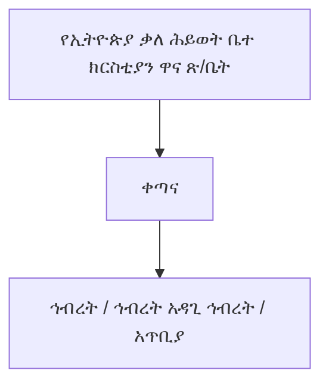
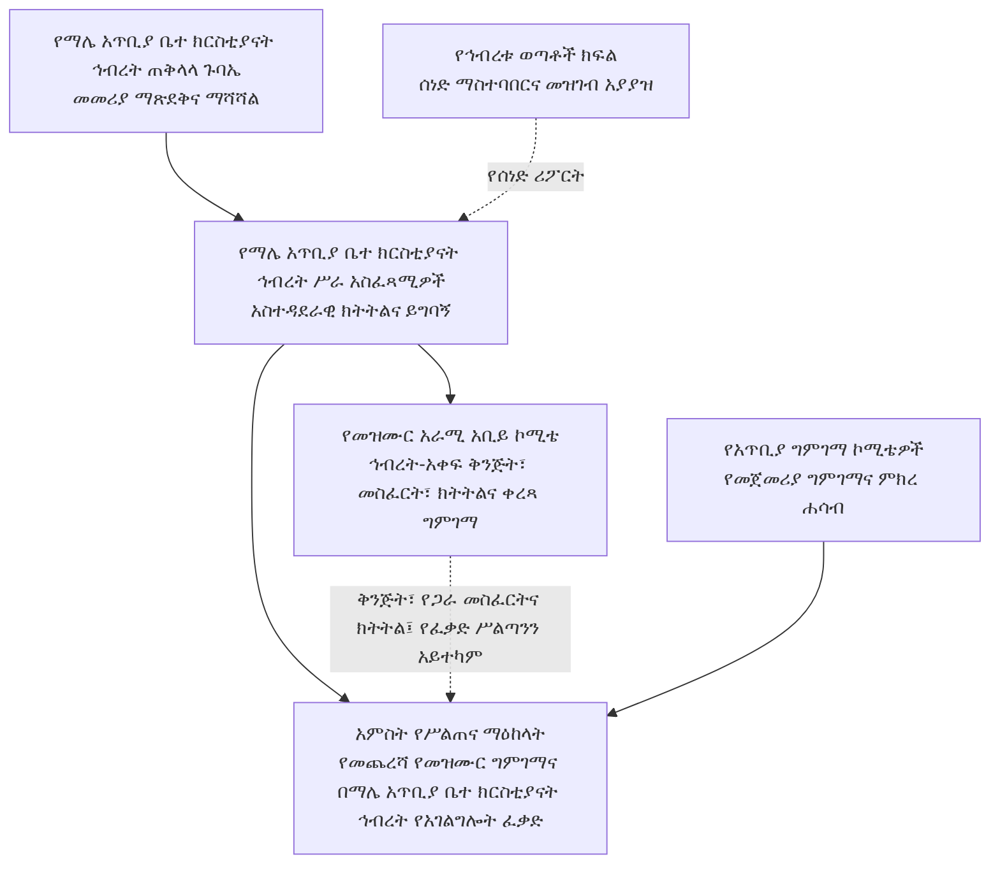
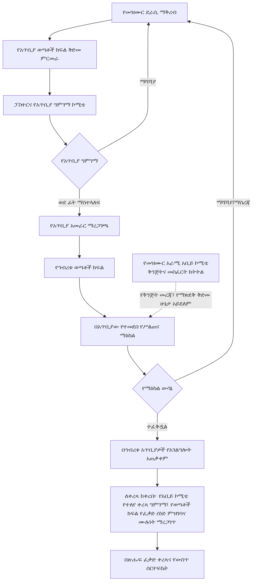

# የማሌ ቃለ ሕይወት አጥቢያ ቤተ ክርስቲያናት ኅብረት የመዝሙር ደራሲነት፣ የግጥምና የዜማ ዝግጅት፣ የሙዚቃ አቀናበር፣ የቅጂ መብት፣ ቀረጻ፣ ሕትመት፣ ስርጭትና የአገልግሎት አጠቃቀም መመሪያ

**የሰነዱ ሁኔታ፦ ለማሌ አጥቢያ ቤተ ክርስቲያናት ኅብረት ሥራ አስፈጻሚዎች ምርመራ፣ አስተያየትና ምክረ ሐሳብ የቀረበ ረቂቅ (NOT APPROVED)**  
**ስሪት፦ 1.0 (ቋሚ መለያ፤ ያለ ባለቤቱ ግልጽ ፈቃድ አይቀየርም) | የሰነድ ቁጥር፦ ማቃሕ/መዝ/001**  
**የሥራ ቋንቋዎች፦ ማሌኛና አማርኛ**  
**የዚህ ረቂቅ ቀጣይ ሂደት፦ ለኅብረቱ ሥራ አስፈጻሚዎች ቀርቦ አስተያየት እንዲሰጡበት፤ የመጨረሻ ማጽደቅና ማሻሻል ሥልጣን፦ የማሌ ቃለ ሕይወት አጥቢያ ቤተ ክርስቲያናት ኅብረት ጠቅላላ ጉባኤ**

> **የሥልጣን ወሰን፦** ይህ ለማሌ ቃለ ሕይወት አጥቢያ ቤተ ክርስቲያናት ኅብረት የተዘጋጀ የኅብረቱ መመሪያ ነው። የኢትዮጵያ ቃለ ሕይወት ቤተ ክርስቲያን መተዳደሪያ ደንብ፣ የእምነት አቋም ወይም ስርዓተ መጽሐፍ አይደለም፤ እነዚህንም አይተካም። ከእነሱ ጋር የሚጋጭ ነገር ካለ በኢትዮጵያ ቃለ ሕይወት ቤተ ክርስቲያን መተዳደሪያ ደንብ የተወሰነው ተቋማዊ ሥርዓትና ተገቢው ሥልጣን ያለው አካል ውሳኔ ይበልጣል።

---

## ምዕራፍ 1፡ አጠቃላይ ድንጋጌዎች

### አንቀጽ 1፡ መግቢያና ዓላማ
መዝሙር የእምነት ምስክርነት፣ የመንፈሳዊ ሕንጸት፣ የምስጋናና የአምልኮ አገልግሎት አካል ነው። ስለዚህ በማሌ ቃለ ሕይወት አጥቢያዎች የሚጠቀሙባቸው መዝሙሮች በመጽሐፍ ቅዱሳዊ ትምህርት፣ በቋንቋ፣ በሙዚቃ፣ በአምልኮ ተገቢነትና በደራሲዎችና በሌሎች መብት ባለቤቶች መብት መሠረት እንዲገመገሙ ይህ መመሪያ ተዘጋጅቷል። ዓላማው ግልጽና ፍትሐዊ ሂደት ማቋቋም፣ የመዝሙር ጥራትን ማረጋገጥ፣ የማሌኛና የአማርኛን እኩል ክብር መጠበቅ፣ የደራሲዎችንና የሌሎች መብት ባለቤቶችን መብት ማስጠበቅና የተፈቀዱ መዝሙሮችን በኅብረቱ አጥቢያዎች ማስተባበር ነው።

### አንቀጽ 2፡ የመሠረታዊ ሰነዶች ሥልጣን፣ ተግባርና ተዋረድ
1. **መጽሐፍ ቅዱስ፦** የእምነት፣ የትምህርት፣ የአምልኮና የክርስቲያናዊ ኑሮ ከፍተኛ መንፈሳዊ መሠረት ነው። የመዝሙር ግጥምና መልዕክት ከመጽሐፍ ቅዱስ ጋር መጣጣም አለበት።
2. **የኢትዮጵያ ቃለ ሕይወት ቤተ ክርስቲያን መተዳደሪያ ደንብ፦** የቤተ ክርስቲያኑን ሕጋዊ/ተቋማዊ መዋቅር፣ የሥልጣን ምንጮችን፣ የጉባኤዎችን፣ የአመራሮችንና የአስተዳደር አካላትን ሥልጣንና ኃላፊነት ይወስናል። ይህ መመሪያ እነዚህን ሥልጣኖች አይቀይርም፣ አይጨምርም፣ አይተካምም።
3. **የኢትዮጵያ ቃለ ሕይወት ቤተ ክርስቲያን የእምነት አቋም፦** የቤተ ክርስቲያኑን የተቀበሉ የእምነት አስተምህሮዎችና የሥነ መለኮት መርሆዎች ይገልጻል። የመዝሙር መልዕክት ከመጽሐፍ ቅዱስና ከዚህ የእምነት አቋም ጋር መጣጣም አለበት።
4. **የኢትዮጵያ ቃለ ሕይወት ቤተ ክርስቲያን ስርዓተ መጽሐፍ፦** የቤተ ክርስቲያን አምልኮና አገልግሎት ሥርዓት፣ አቀራረብና ተግባራዊ አፈጻጸም ይመራል። የመዝሙር አጠቃቀም ከስርዓተ መጽሐፉና ከተፈቀደው የአምልኮ ሥርዓት ጋር መጣጣም አለበት።
5. **ይህ የኅብረቱ መመሪያ፦** ከላይ የተጠቀሱትን መሠረታዊ ሰነዶችና የበላይ አካላት ሥልጣን በመጠበቅ፣ በማሌ ቃለ ሕይወት አጥቢያ ቤተ ክርስቲያናት ኅብረት ውስጥ የመዝሙር ማቅረብ፣ ግምገማ፣ የአገልግሎት ፈቃድ፣ ቀረጻ ማስተባበርና መዝገብ አያያዝ ሂደቶችን ብቻ ይደነግጋል።
6. እነዚህ ሰነዶች ተለያዩ ተግባራትና የሥልጣን ምንጮች አሏቸው፤ በአንድ የተቀላቀለ የሕግ ዝርዝር አይተረጎሙም። የመጽሐፍ ቅዱስ መንፈሳዊ ቀዳሚነትና በኢትዮጵያ ቃለ ሕይወት ቤተ ክርስቲያን መተዳደሪያ ደንብ የተወሰነው ተቋማዊ ሥልጣን በየተግባራቸው ይከበራሉ። ግጭት ወይም ጥርጣሬ ሲኖር ኮሚቴ በራሱ የበላይ ውሳኔ አይሰጥም፤ ጉዳዩን ለተገቢው የኢትዮጵያ ቃለ ሕይወት ቤተ ክርስቲያን ሥልጣን ያለው አካል ያቀርባል።
7. የማሌ አጥቢያ ቤተ ክርስቲያናት ኅብረት ጠቅላላ ጉባኤ ይህን የኅብረቱ መመሪያ በኅብረቱ የሥልጣን ወሰን ውስጥ ያጸድቃል፤ ይህ ማጽደቅ የኢትዮጵያ ቃለ ሕይወት ቤተ ክርስቲያን የበላይ ሰነዶችን ወይም የበላይ አካላትን ሥልጣን አይተካም።

### አንቀጽ 3፡ ተፈጻሚነት
1. ይህ መመሪያ በማሌ አጥቢያ ቤተ ክርስቲያናት ኅብረት ሥር ባሉ አጥቢያዎች፣ በአጥቢያና በኅብረቱ ወጣቶች ክፍል፣ በመዝሙር ቡድኖች፣ በዘማሪዎች፣ በግጥምና ዜማ ደራሲዎች፣ በሙዚቃ ተሳታፊዎች እና በዚህ መመሪያ መሠረት በተሰየሙ የአጥቢያና የሥልጠና ማዕከል ገምጋሚ ኮሚቴዎች ላይ ይፈጸማል።
2. መመሪያው በኅብረቱ አጥቢያዎች ውስጥ ለአምልኮና ለሌሎች የቤተ ክርስቲያን አገልግሎቶች የሚቀርቡ መዝሙሮችን፣ የመዝሙር ግጥምን፣ ዜማን፣ የሙዚቃ ዝግጅትን፣ ቀረጻን፣ ቅጂን፣ ማባዛትን፣ ሕትመትን፣ ዲጂታልና ሌሎች የስርጭት ዘዴዎችን እና የአገልግሎት አጠቃቀምን ይመለከታል።
3. ይህ መመሪያ ከማሌ አጥቢያ ቤተ ክርስቲያናት ኅብረት ውጭ ያሉ ቤተ ክርስቲያናትን፣ ድርጅቶችን ወይም ግለሰቦችን አያስገድድም፤ የእነርሱን የተለየ ሥልጣን ወይም መብት አይገድብም።
4. መመሪያው በማሌ አጥቢያ ቤተ ክርስቲያናት ኅብረት ጠቅላላ ጉባኤ ከጸደቀበት ቀን ጀምሮ ይፈጸማል። ከዚያ በፊት ያሉ ድርጊቶችን በኋላ ተመልሶ ለመቅጣት ወይም የተሰጡ ፈቃዶችን በራስ-ሰር ለመሻር አይጠቀምም፤ ነገር ግን ከሕግ፣ ከመብት ጥበቃና ከቀጣይ አጠቃቀም ግዴታዎች የሚመነጩ ጉዳዮች በተገቢው ሥልጣን ይመረመራሉ።
5. “ማሌ አጥቢያ ቤተ ክርስቲያናት ኅብረት ጠቅላላ ጉባኤ” በዚህ መመሪያ ውስጥ ሲጠቀስ በሙሉ ስሙ “የማሌ ቃለ ሕይወት አጥቢያ ቤተ ክርስቲያናት ኅብረት ጠቅላላ ጉባኤ” የሚባለውን የማሌ አጥቢያ ቤተ ክርስቲያናት ኅብረት ጠቅላላ ጉባኤ ያመለክታል፤ የኢትዮጵያ ቃለ ሕይወት ቤተ ክርስቲያን ብሔራዊ ጠቅላላ ጉባኤን አያመለክትም።
6. የሥልጠና ማዕከላት/የሥልጠና ማዕከላት የሥልጠናና የግምገማ ሥራ ማስተባበሪያ ክፍሎች ናቸው፤ በመተዳደሪያ ደንቡ የተወሰኑ የአስተዳደር ቀጣናዎች አይደሉም።

### አንቀጽ 4፡ የድንጋጌዎች አተረጓጎም መርሆዎች
1. የዚህ መመሪያ ድንጋጌ ሲተረጎም ቃሉ በተለመደው የአማርኛ ወይም የማሌኛ ቋንቋ ትርጉም፣ በአንቀጹ አውድ፣ በመመሪያው ዓላማና በሌሎች ተዛማጅ ድንጋጌዎች በጋራ ይተረጎማል።
2. ትርጓሜው ከመጽሐፍ ቅዱስ፣ ከኢትዮጵያ ቃለ ሕይወት ቤተ ክርስቲያን መተዳደሪያ ደንብ፣ የእምነት አቋምና ስርዓተ መጽሐፍ ጋር ተስማሚ መሆን አለበት።
3. የትርጉም ጥርጣሬ በኮሚቴ ላይ ሲነሳ ኮሚቴው በራሱ ትርጓሜ አዲስ ሥልጣን አይፈጥርም፤ ጉዳዩን በምክንያት ለማሌ አጥቢያ ቤተ ክርስቲያናት ኅብረት ሥራ አስፈጻሚዎች ያቀርባል። የመተዳደሪያ ደንብ፣ የእምነት አስተምህሮ ወይም የአምልኮ ሥርዓት ጉዳይ ከሆነ ለተገቢው የኢትዮጵያ ቃለ ሕይወት ቤተ ክርስቲያን ሥልጣን ያለው አካል ይተላለፋል።
4. የትርጓሜ ሥልጣን የመመሪያውን የጸደቀ ይዘት ለመተግበር እንጂ አንቀጽን ለመሻር፣ ለመጨመር፣ የሥልጣን ወሰንን ለማስፋት ወይም የማሌ አጥቢያ ቤተ ክርስቲያናት ኅብረት ጠቅላላ ጉባኤን ውሳኔ ለመተካት አይውልም።
5. በአማርኛና በማሌኛ ጽሑፎች መካከል የትርጉም ልዩነት ከተፈጠረ ሁለቱም ጽሑፎች በጋራ ይመረመራሉ፤ ለጊዜያዊ አፈጻጸም ጉዳዩ ወደ ሥራ አስፈጻሚዎች ይቀርባል፣ የመመሪያውን ይዘት የሚቀይር ማሻሻያ ግን በማሌ አጥቢያ ቤተ ክርስቲያናት ኅብረት ጠቅላላ ጉባኤ ብቻ ይጸድቃል።

### አንቀጽ 5፡ በመመሪያው ውስጥ የተጠቀሱ ቃላት ትርጓሜ
በዚህ መመሪያ ውስጥ ከዚህ በታች ያሉት ቃላት በሚከተለው ትርጉም ይጠቀማሉ። የመጽሐፍ ቅዱሳዊ ትርጉማቸው ከቴክኒካዊ/ሙዚቃዊ ትርጉማቸው ጋር ተያይዞ ይታያል፤ ቴክኒካዊ ትርጉሙ ግን የመጽሐፍ ቅዱስን ትምህርት አይተካም።

1. **መዝሙር፦** የምስጋና፣ የአምልኮ፣ የጸሎት፣ የእምነት እውነት ወይም የመንፈሳዊ ምላሽ መልዕክትን በቃልና በዜማ የሚገልጽ የመዘመር ሥራ ነው። በመጽሐፍ ቅዱስ የመዝሙርና የመንፈሳዊ ዝማሬ አጠቃቀም (መዝሙረ ዳዊት፤ ቆላስይስ 3፥16፤ ኤፌሶን 5፥19) የእምነት ማኅበረሰብን ለማነጽ የሚያገለግል መንፈሳዊ ዝማሬ ነው። በቴክኒክ ደረጃ ግጥም፣ ዜማ፣ ምትና የሙዚቃ አደረጃጀት ያለው ሥራ ነው።
2. **ዜማ፦** የድምፆች ከፍታና ዝቅታ፣ ቆይታና ቅደም ተከተል ተደራጅቶ የሚፈጥረው የሚታወቅ የድምፅ መስመር (melody) ነው። ዜማው የግጥሙን ትርጉም ለማጉላትና ለመዘመር ይረዳል።
3. **ሙዚቃ መሣሪያ፦** ድምፅን በመንቀጥቀጥ፣ በመንፋት፣ በመታ ወይም በኤሌክትሮኒክ መንገድ የሚያመነጭና የሙዚቃ ክፍልን የሚደግፍ መሣሪያ ነው፤ ለምሳሌ ኪቦርድ፣ ጊታርና ከበሮ።
4. **የሙዚቃ መሣሪያ ተጫዋች፦** መሣሪያን በብቃት የሚጫወት፣ የዜማና የምት አደረጃጀትን የሚጠብቅና የዘማሪዎችን ዝማሬ የሚደግፍ አገልጋይ ነው።
5. **ዘማሪ፦** በግል ወይም ከሌሎች ጋር በመሆን መዝሙርን በድምፅ የሚያቀርብ ሰው ነው። ዘማሪነት የአምልኮና የማኅበረሰብ አገልግሎት ነው።
6. **ሶሎ ዘማሪ፦** አንድ ዘማሪ ዋናውን የድምፅ መስመር ብቻውን የሚያቀርብበት አቀራረብ ነው፤ ሌሎች ድምፆች ወይም መሣሪያዎች ሊደግፉት ይችላሉ።
7. **ዱዌት፦** ሁለት ዘማሪዎች የድምፅ ክፍሎችን በመካፈል አንድን መዝሙር በጋራ የሚያቀርቡበት አቀራረብ ነው።
8. **ትሪዮ፦** ሦስት ዘማሪዎች የድምፅ ክፍሎችን በመካፈል በጋራ የሚዘምሩበት አቀራረብ ነው።
9. **ኳይር/መዘምራን ቡድን፦** ብዙ ዘማሪዎች በተደራጀ የድምፅ ክፍል፣ በአንድነትና በመሪነት የሚዘምሩበት ቡድን ነው። አንድ ድምፅ ወይም ብዙ የድምፅ ክፍሎች ሊኖሩት ይችላሉ።
10. **የግጥም ደራሲ፦** የመዝሙሩን ግጥም የጻፈና የግጥሙን የደራሲነት መብት የያዘ ወይም በሕጋዊ ሁኔታ የተላለፈለት ሰው ነው።
11. **የዜማ ደራሲ፦** የመዝሙሩን ዜማ የደረሰ ወይም የፈጠረ ሰው ነው።
12. **አቀናባሪ፦** የሙዚቃ ክፍሎችን፣ የድምፅ ክፍፍልን፣ የመሣሪያ አጠቃቀምንና የሙዚቃ አደረጃጀትን ያዘጋጀ ሰው ነው። አቀናባሪው የዜማ ደራሲው ሊሆን ይችላል፤ ካልሆነ የየራሳቸው አስተዋጽኦና መብት በተለይ ይመዘገባል።
13. **የመዝሙር አራሚ/ገምጋሚ ኮሚቴ፦** በተሰጠው ሥልጣን መሠረት የመዝሙሩን መጽሐፍ ቅዱሳዊ፣ ቋንቋዊ፣ ሙዚቃዊና የመብት ጉዳዮች የሚመረምር አካል ነው። “አራሚ” ማለት የደራሲውን ሥራ የሚወስድ ሳይሆን ግምገማና ምክር የሚሰጥ ማለት ነው።
14. **የመዝሙር ስሪት፦** በተወሰነ ቀን የተዘጋጀ የግጥም፣ ዜማ ወይም ቅጂ የተለየ ሁኔታ ነው፤ እያንዳንዱ ማሻሻያ ቀንና መለያ ይኖረዋል።
15. **የአገልግሎት ፈቃድ፦** መዝሙሩ በኅብረቱ አጥቢያዎች በአምልኮ ጊዜ እንዲዘመር የሚሰጥ የውስጥ ፈቃድ ነው፤ የቅጂ መብትን ወይም የቀረጻ ፈቃድን አይተካም።
16. **የግምገማ ውሳኔ፦** ኮሚቴው በማስረጃና በመመሪያው መስፈርት መሠረት የሚያወጣው የተመዘገበ ውጤት ነው።
17. **የጥቅም ግጭት፦** የኮሚቴ አባል የግል፣ የቤተሰብ፣ የገንዘብ፣ የዝምድና ወይም ሌላ ግንኙነት በገለልተኛ ውሳኔው ላይ ተጽዕኖ ሊያሳድር የሚችልበት ሁኔታ ነው።
18. **የደራሲና የመብት ባለቤት ፈቃድ፦** የግጥም ደራሲ፣ የዜማ ደራሲ፣ አቀናባሪ ወይም ሌላ መብት ባለቤት ሥራው ለተወሰነ ዓላማ፣ ጊዜና ወሰን እንዲጠቀምበት በጽሑፍ የሚሰጠው ፈቃድ ነው።
19. **አምልኮ፦** አማኞች ለእግዚአብሔር የሚያቀርቡት የምስጋና፣ የጸሎት፣ የክብርና የመታዘዝ መንፈሳዊ አገልግሎት ነው። በዚህ መመሪያ ውስጥ በቤተ ክርስቲያን የጋራ አምልኮ ውስጥ የሚቀርቡ መዝሙሮችንና ተያያዥ አገልግሎቶችን ያመለክታል።
20. **ስርዓተ መጽሐፍ፦** በዚህ መመሪያ ውስጥ የኢትዮጵያ ቃለ ሕይወት ቤተ ክርስቲያን የአምልኮና የቤተ ክርስቲያን አገልግሎት ሥርዓትን የሚመራውን ኦፊሴላዊ ሰነድ ያመለክታል። ትርጉሙ የሰነዱን ይፋዊ ስያሜና ይዘት አይቀይርም።
21. **አጥቢያ ቤተ ክርስቲያን (አጥቢያ)፦** በቤተ ክርስቲያኑ የተቋቋመና በተፈቀደው መዋቅር ውስጥ የሚሠራ የአካባቢ ጉባኤ ነው።
22. **አጥቢያ ቤተ ክርስቲያናት ኅብረት (ኅብረት)፦** በተፈቀደው የቤተ ክርስቲያን መዋቅር መሠረት በአንድ የአስተዳደር ወሰን የተደራጁ አጥቢያ ቤተ ክርስቲያናት ማኅበር ነው።
23. **ቀጣና፦** በኢትዮጵያ ቃለ ሕይወት ቤተ ክርስቲያን የተፈቀደ መዋቅር ውስጥ ያለ የአስተዳደር ደረጃ ነው። ቀጣና እና አጥቢያ ቤተ ክርስቲያናት ኅብረት የተለያዩ የመዋቅር ደረጃዎች ናቸው።
24. **የሥልጠና ማዕከል፦** በማሌ አጥቢያ ቤተ ክርስቲያናት ኅብረት ውስጥ ለሥልጠና፣ ለውይይት፣ ለአገልግሎት ቅንጅትና ለመዝሙር ግምገማ የተደራጀ የሥራ ማስተባበሪያ ክፍል ነው፤ ኦፊሴላዊ የአስተዳደር ቀጣና ወይም ከመተዳደሪያ ደንቡ የተገኘ አዲስ ተቋም አይደለም።
25. **ቀረጻ፦** የድምፅን ወይም የድምፅና ምስልን አፈጻጸም በመሣሪያ ወይም በዲጂታል መንገድ መመዝገብ ነው።
26. **ቅጂ/ማባዛት፦** የመዝሙር ግጥምን፣ ዜማን፣ የድምፅ ቅጂን ወይም ሌላ የተጠበቀ ሥራን በወረቀት፣ በድምፅ፣ በዲጂታል ወይም በሌላ መንገድ እንደገና ማምረት ነው።
27. **ሕትመትና ስርጭት፦** ሥራን ለሕዝብ ወይም ለተወሰነ ተጠቃሚ ቡድን በወረቀት፣ በድምፅ፣ በዲጂታል መድረክ ወይም በሌላ ዘዴ ማቅረብ፣ ማሰራጨት ወይም ተደራሽ ማድረግ ነው።
28. **የቅጂ መብት፦** በሕግ የሚጠበቁ የደራሲነትና ተያያዥ መብቶች ሲሆኑ፣ የሥራውን ማባዛት፣ ማሰራጨት፣ ማስተካከልና ሌሎች አጠቃቀሞችን ለመፍቀድ ወይም ለመከልከል የሚያስችሉ መብቶችን ያካትታል።
29. **የውስጥ ሰርተፍኬት፦** በኅብረቱ የሚሰጥ የማስረጃ ሰነድ ሲሆን የደራሲነት መግለጫን፣ የተገኘ ፈቃድንና የግምገማ ሁኔታን ያረጋግጣል፤ በመንግሥት የሚሰጥ ሕጋዊ የቅጂ መብት ምዝገባን አይተካም።
30. **ይግባኝ፦** በዚህ መመሪያ መሠረት የተሰጠ ውሳኔ በሥልጣን፣ በሂደት፣ በፍትሐዊነት ወይም በማስረጃ አያያዝ ላይ ጉድለት እንዳለበት በመግለጽ በተወሰነው ጊዜ የሚቀርብ የውሳኔ ክለሳ ጥያቄ ነው።
31. **የመዝሙር አራሚ አቢይ ኮሚቴ፦** በማሌ አጥቢያ ቤተ ክርስቲያናት ኅብረት የተሰየመ፣ የኅብረቱን የመዝሙር ግምገማ የሚያስተባብር፣ የየሥልጠና ማዕከል ኮሚቴዎችን የሚያቀናጅ፣ የጋራ መስፈርት የሚያዘጋጅና ለቀረጻ የሚቀርቡ መዝሙሮችን በተሰጠው ውክልና የሚመረምር ኮሚቴ ነው። ይግባኝ የሚወስን አካል አይደለም፤ ከራሱ ውሳኔ ጋር የተያያዘ ይግባኝ ላይ አይሳተፍም።

---

### አንቀጽ 6፡ መርሆዎች
የግምገማ ሥራ በመጽሐፍ ቅዱሳዊነት፣ በእውነተኛነት፣ በፍትሐዊነት፣ በግልጽነት፣ በተጠያቂነት፣ በአድልዎ አለማድረግ፣ በደራሲ መብት አክብሮትና በጥቅም ግጭት መከላከል ይመራል። ማሌኛና አማርኛ እኩል ክብርና የግምገማ ደረጃ ያላቸው ቋንቋዎች ናቸው።

### አንቀጽ 7፡ የአስተዳደር መዋቅርና የሥልጠና ማዕከላት
1. የኢትዮጵያ ቃለ ሕይወት ቤተ ክርስቲያን ተቋማዊ መዋቅርና የአስተዳደር ሥልጣን በመተዳደሪያ ደንቡና በተፈቀዱ ውሳኔዎች ይወሰናሉ። በዚህ መመሪያ ውስጥ የማሌ አጥቢያ ቤተ ክርስቲያናት ኅብረት፣ ቀጣና እና አጥቢያ ቤተ ክርስቲያን የተለያዩ የመዋቅር ስያሜዎች ናቸው፤ አንዱ የሌላውን ሥልጣን አይተካም። ይህ መመሪያ የተቋማዊ ተዋረድን ወይም በመተዳደሪያ ደንቡ የተሰጠ ሥልጣንን አይቀይርም።
2. በማሌ ቃለ ሕይወት ያሉት አምስት የሥልጠና ማዕከላት ለሥልጠናና ለመዝሙር ግምገማ ብቻ የተደራጁ ናቸው። የሥልጠና ማዕከላት ቀጣና አይደሉም፤ የተቋቋመውን የአስተዳደር ሥርዓት አይተኩም።
3. የእያንዳንዱ የሥልጠና ማዕከል የአጥቢያ ዝርዝርና የማዕከል ክፍፍል በኅብረቱ በጽሑፍ ይረጋገጣል፤ ያልተረጋገጠ የአጥቢያ ብዛት አይወሰንም።

---

## ምዕራፍ 2፡ የግምገማ ኮሚቴዎች

### አንቀጽ 8፡ የግምገማ ኮሚቴዎች ዓይነትና ብዛት
1. የአጥቢያ ግምገማ ኮሚቴ፦ አባልነቱ በአጥቢያው በተፈቀደ የሹመት ሰነድ ይወሰናል፤ የመጀመሪያ ግምገማና ምክረ ሐሳብ ይሰጣል።
2. የሥልጠና ማዕከል ግምገማ ኮሚቴ፦ አባልነቱ በማሌ አጥቢያ ቤተ ክርስቲያናት ኅብረት በተፈቀደ የሹመት ሰነድ ይወሰናል። ኮሚቴው የመዝሙሩን መጽሐፍ ቅዱሳዊ፣ ቋንቋዊ፣ ሙዚቃዊና የመብት ጉዳዮች በጥልቀት ይመረምራል፤ በተሰጠው ሥልጣን መሠረት መዝሙሩ በማሌ አጥቢያ ቤተ ክርስቲያናት ኅብረት ውስጥ ባሉ ሁሉም አጥቢያ ቤተ ክርስቲያናት ለአምልኮ እንዲውል የመጨረሻ የአገልግሎት ፈቃድ ይሰጣል።
3. **የመዝሙር አራሚ አቢይ ኮሚቴ፦** አባልነቱና የሥራ ዘመኑ በተገቢው የሹመት/ማጽደቅ ሰነድ ይወሰናል፤ የኅብረቱን የመዝሙር ግምገማ ያስተባብራል፣ የሥልጠና ማዕከላት ኮሚቴዎችን ያቀናጃል፣ የጋራ መስፈርትና የሥራ ሂደት ያዘጋጃል፣ አፈጻጸሙን ይከታተላል። የሥልጠና ማዕከል ኮሚቴ በሥልጣኑ መሠረት የሰጠውን የአገልግሎት ፈቃድ በራሱ ውሳኔ አይሽርም፤ የተለየ ዳግም ግምገማ ወይም እርምጃ የሚፈለግ ከሆነ በዚህ መመሪያ የተደነገገውን ሂደት ይከተላል።
4. በሶስቱም የግምገማ ደረጃዎች መንፈሳዊ፣ መጽሐፍ ቅዱሳዊ፣ ቋንቋዊ፣ ሙዚቃዊ፣ የደራሲነትና የቅጂ መብት እውቀት እንዲካተት ይደረጋል። አንድ አባል ሁሉንም ብቃቶች እንዲያሟላ አይጠበቅም፤ የጋራ ብቃት ይረጋገጣል።

### አንቀጽ 9፡ የኮሚቴ አባላት ብቃት፣ ምርጫና የሥራ ዘመን
1. የኮሚቴ አባል በአጥቢያው ወይም በኅብረቱ የታወቀ አባል፣ በመንፈሳዊ ብስለትና በሥነ ምግባር የታመነ፣ በመጽሐፍ ቅዱስ፣ በቋንቋ፣ በሥነ መለኮት፣ በሙዚቃ፣ በደራሲነት ወይም በአገልግሎት ልምድ የሚያበረክት፣ ጥቅም ግጭትን የሚገልጽና መመሪያውን ለመከተል ፈቃደኛ መሆን አለበት።
2. የአጥቢያ ግምገማ ኮሚቴ በአጥቢያው ፓስተር ይጠራል፤ ፓስተሩም ሰብሳቢ ይሆናል። አባላቱ በአጥቢያው የተፈቀደ ሂደት ይሰየማሉ።
3. የሥልጠና ማዕከል ግምገማ ኮሚቴዎች አባላት በኅብረቱ በተፈቀደ የምርጫ/ሹመት ሂደት ይመረጣሉ፤ የመሾምና የማጽደቅ ሥልጣኑ በአሁኑ ተፈጻሚ መተዳደሪያ ደንብና በኅብረቱ የተረጋገጠ ውሳኔ መሠረት ከማጽደቅ በፊት ይረጋገጣል።
4. የአቢይ ኮሚቴ አባላት፣ የሥራ መደቦችና የሥራ ዘመን በተገቢው የኅብረት ሥልጣን በጸደቀ የሹመት/ማጽደቅ ውሳኔ ይወሰናሉ፤ የማጽደቅ ሥልጣኑ በኦፊሴላዊ ሰነድ ይረጋገጣል። የመንፈሳዊ/ሥነ መለኮት፣ የማሌኛና የአማርኛ ቋንቋ፣ የሙዚቃ/ዜማ፣ የባህል/ሥነ ጽሑፍና የወጣቶች አገልግሎት ብቃት በጋራ እንዲካተት ይመከራል፤ የቅጂ መብት/ሕግና የቀረጻ/ምርት ባለሙያዎች በአማካሪነት ሊጋበዙ ይችላሉ።
5. የአጥቢያ፣ የሥልጠና ማዕከልና የአቢይ ኮሚቴ የሥራ ዘመን፣ የመታደስ ሁኔታና የአባልነት መቋረጫ በተገቢው የሹመት/ማጽደቅ ውሳኔ ይወሰናሉ፤ ይህ መመሪያ ያልተረጋገጠ የዓመት ብዛት አይወስንም።

### የተቋማዊ መዋቅርና የመዝሙር ግምገማ ማሳያ
በኢትዮጵያ ቃለ ሕይወት ቤተ ክርስቲያን መተዳደሪያ ደንብ የተወሰነው መዋቅር ከማሌ አጥቢያ ቤተ ክርስቲያናት ኅብረት የመዝሙር ግምገማ አደረጃጀት የተለየ ነው።

**ሀ. በኢትዮጵያ ቃለ ሕይወት ቤተ ክርስቲያን መተዳደሪያ ደንብ የተወሰነው የአስተዳደር አደረጃጀት**

**ለ. የማሌ አጥቢያ ቤተ ክርስቲያናት ኅብረት የመዝሙር ግምገማ አደረጃጀት**

ይህ የሥራ ማስተባበሪያ አደረጃጀት በኢትዮጵያ ቃለ ሕይወት ቤተ ክርስቲያን መተዳደሪያ ደንብ የተወሰነውን የአስተዳደር ተዋረድ አይተካም። የሥልጠና ማዕከላት የሥልጠናና የግምገማ ማዕከላት ናቸው፤ ቀጣናዎች አይደሉም። ኮሚቴዎች በተሰጣቸው ውክልና ውስጥ ብቻ ይሠራሉ።

### አንቀጽ 10፡ የኮሚቴ ሥልጣንና ተግባር
1. **የአጥቢያ ግምገማ ኮሚቴ፦** የመጀመሪያ ግምገማ ያካሂዳል፤ መጽሐፍ ቅዱሳዊና ሥነ መለኮታዊ ይዘትን፣ ቋንቋን፣ ዜማን፣ ባህልንና መብትን ይመረምራል፤ ለደራሲው የማሻሻያ ምክር በጽሑፍ ይሰጣል፤ የደራሲውን ሥራ አይቀይርም።
2. **የሥልጠና ማዕከል ኮሚቴ፦** ሁለተኛ ደረጃ ግምገማ ያካሂዳል፤ በማሌ አጥቢያ ቤተ ክርስቲያናት ኅብረት ውስጥ ለአገልግሎት የሚያጸድቅ ፈቃድ ይሰጣል፤ ውሳኔውን በጽሑፍ ይመዘግባል፤ ከአቢይ ኮሚቴ የጋራ መስፈርት ጋር ይሠራል።
3. **የመዝሙር አራሚ አቢይ ኮሚቴ፦** አምስቱን የሥልጠና ማዕከል ኮሚቴዎች ያስተባብራልና ይቆጣጠራል፤ ከኅብረቱ ወጣቶች ክፍል፣ ከማሌ መጽሐፍ ቅዱስ ኮሌጅና ከተዛማጅ ባለድርሻዎች ጋር ይመክራል፤ የመንፈሳዊ፣ የሥነ መለኮት፣ የቋንቋ፣ የሙዚቃና የባህል መስፈርቶችን ያዘጋጃል፤ አስፈላጊ ሲሆን በግልጽ ውክልና መሠረት ገለልተኛ ዳግም ግምገማ ያስተባብራል፤ የማዕከል ኮሚቴን ውሳኔ በራሱ አይሽርም፤ ለቀረጻ የሚቀርቡ መዝሙሮችን በተለየ የቀረጻ ግምገማ ይመረምራል፤ በተረጋገጡ የመብት ፈቃዶችና በተመዘገበ ውሳኔ መሠረት የኅብረቱን የቀረጻ ማጽደቅ ይሰጣል፤ ይህ የቅጂ መብት ባለቤትነትን ወይም የሕግ ፈቃድን አይወስንም። የኮሚቴዎችን ሥልጠና፣ ጉዞ፣ ስብሰባና የበጀት ፍላጎት ያቀናጃል፤ የተፈቀዱ መዝሙሮችንና የግምገማ ማስረጃዎችን ከማዕከላዊ መዝገብ ጋር በቅንጅት ያስቀምጣል።
4. **የማሌ አጥቢያ ቤተ ክርስቲያናት ኅብረት ወጣቶች ክፍል፦** የማቅረቢያ ሰነዶችን ይቀበላል፣ ሙሉነታቸውን ይፈትሻል፣ የአጥቢያ፣ የየሥልጠና ማዕከልና የአቢይ ኮሚቴ ሂደቶችን በሰነድ አያያዝ ያስተባብራል፤ የደራሲነትና የመብት ማስረጃዎችን፣ የቀረጻና የስርጭት ፈቃዶችን ይመዘግባል።
5. **የማሌ አጥቢያ ቤተ ክርስቲያናት ኅብረት ሥራ አስፈጻሚዎች፦** የመመሪያውን አፈጻጸምና የአቢይ ኮሚቴን አስተዳደራዊ ሥራ በኅብረቱ የተሰጠ ሥልጣን ወሰን ይከታተላሉ፤ ሪፖርት ይቀበላሉና የበጀት/አስተዳደር ድጋፍ ያደርጋሉ።
6. **የኮሚቴ አባላት የጋራ ግዴታ፦** በገለልተኝነት መሥራት፣ ሰውን ሳይሆን ሥራን መገምገም፣ ጥቅም ግጭትን ማሳወቅ፣ ሚስጥርን መጠበቅ፣ የደራሲን መብት ማክበርና ውሳኔን በምክንያት ማቅረብ ነው።
7. **የኮሚቴዎች መብት፦** ለግምገማ የሚያስፈልጉ ሰነዶችንና ማብራሪያዎችን መጠየቅ፣ ባለሙያ ምክር ማግኘት፣ ስብሰባ ማደራጀትና በተሰጣቸው ሥልጣን ውስጥ ውሳኔ መስጠት ናቸው።
8. ሁሉም ኮሚቴዎች በተሰጣቸው ውክልና ውስጥ ብቻ ይሠራሉ፤ የኅብረቱን ወይም የኢትዮጵያ ቃለ ሕይወት ቤተ ክርስቲያንን ሌላ ሕጋዊ ሥልጣን አይወስዱም።

### አንቀጽ 11፡ ምልዓተ ጉባኤ፣ ውሳኔና ጥቅም ግጭት
1. የእያንዳንዱ ኮሚቴ ምልዓተ ጉባኤ፣ የድምፅ አሰጣጥና የውሳኔ ሥርዓት በተፈቀደው የሹመት/ማጽደቅ ውሳኔ ወይም በተለየ የሥራ ሥነ ሥርዓት ሰነድ መወሰን አለበት። ይህ መረጋገጫ እስኪኖር ድረስ ኮሚቴ የመጨረሻ የማጽደቅ፣ የማገድ ወይም የመብት የሚነካ ውሳኔ አይሰጥም፤ ማቅረቢያን መቀበልና ማስተላለፍ ግን ይችላል።
2. ውሳኔ በመጀመሪያ በመግባባት ይፈለጋል፤ ካልተቻለ በተፈቀደው የሹመት/ሥነ ሥርዓት ሰነድ መሠረት ይወሰናል። የድምፅ እኩልነት ወይም የምልዓተ ጉባኤ እጥረት ሲኖር ጉዳዩ ይተላለፋል፤ በዝምታ ወይም በነባሪነት ፈቃድ አይሰጥም።
3. በመዝሙሩ፣ በደራሲው፣ በቀረጻ አካል ወይም በውጤቱ ላይ ቀጥተኛ/ተዘዋዋሪ ጥቅም ያለው አባል ጥቅሙን ይገልጻልና ከውይይትና ከውሳኔ ይታቀባል።
4. የስብሰባ ቀን፣ ተሳታፊዎች፣ የተመረመሩ ማስረጃዎች፣ የጥቅም ግጭት መግለጫዎችና ውሳኔዎች በቃለ ጉባኤ ይመዘገባሉ።
5. **የመደበኛ ስብሰባ ብዛት፦** የመዝሙር አራሚ አቢይ ኮሚቴ በዓመት ቢያንስ አራት (4) መደበኛ ስብሰባዎችን ያካሂዳል። እያንዳንዱ የሥልጠና ማዕከል ኮሚቴም በዓመት ቢያንስ አራት (4) መደበኛ የስብሰባና የመዝሙር ግምገማ ዙሮችን ያካሂዳል።
6. **የጋራ ዓመታዊ ስብሰባ፦** በዚህ መመሪያ የተቋቋሙ ሁሉም ኮሚቴዎች—የአጥቢያ፣ የሥልጠና ማዕከልና የመዝሙር አራሚ አቢይ ኮሚቴ—ቢያንስ በዓመት አንድ (1) ጊዜ በጋራ ይሰበሰባሉ፤ የግምገማ ውጤቶችን፣ የመስፈርት አፈጻጸምን፣ የቋንቋ/ሥነ መለኮት/ሙዚቃ ጥራትን፣ የቅጂ መብት ሂደቶችንና የማሻሻያ ፍላጎቶችን በጋራ ይገመግማሉ። ይህ የጋራ ስብሰባ የማዕከል ኮሚቴዎችን የአገልግሎት ፈቃድ ሥልጣን አይተካም።
7. **ተጨማሪ ስብሰባዎች፦** ከላይ የተጠቀሱት መደበኛ ስብሰባዎች በተጨማሪ አስቸኳይ ጉዳይ፣ የሥራ ጫና፣ የጊዜ ገደብ ወይም የግምገማ ፍላጎት ሲኖር እያንዳንዱ ኮሚቴ እና ሁሉም ኮሚቴዎች በጋራ ተጨማሪ ስብሰባ ሊያካሂዱ ይችላሉ። ስብሰባዎች በተፈቀደው ምልዓተ ጉባኤና የውሳኔ ሥነ ሥርዓት መሠረት ይካሄዳሉ።

---

## ምዕራፍ 3፡ የመዝሙር ማቅረቢያና ግምገማ ሂደት

### አንቀጽ 12፡ የመዝሙር ደራሲ/ዘማሪ ብቁነትና ማቅረቢያ
1. መዝሙር የሚያቀርብ የመዝሙር ደራሲ/ዘማሪ ከአንድ አጥቢያ ጋር የተያያዘ፣ በአጥቢያው አገልግሎት በንቃት የሚሳተፍና ከአጥቢያው መዘምራን/የመዝሙር ቡድን ጋር የተቀናጀ መሆን አለበት።
2. ደራሲው የግጥም ጽሑፍ፣ ዜማ፣ የድምፅ ወይም የሙዚቃ ቅጂ፣ የደራሲዎችና አቀናባሪዎች ስምና የአስተዋጽኦ መግለጫ፣ የተጠቀሙባቸው ሌሎች ሥራዎች ፈቃድ/ምንጭ እና የመገኛ መረጃ ያቀርባል።
3. ደራሲው መዝሙሩን ለአጥቢያው ወጣቶች ክፍል ያቀርባል። ወጣቶች ክፍሉ ደራሲውን ያነጋግራል፣ ስለ መዝሙሩ መነሻና ዓላማ መረጃ ይሰበስባል፣ የመጀመሪያ ምርመራ አድርጎ ለፓስተሩ ያስተላልፋል።

### የመዝሙር ማቅረቢያና የግምገማ የሥራ ፍሰት
የመዝሙር ሂደት ከማቅረብ እስከ አገልግሎት ፈቃድ ድረስ በሚከተለው ቅደም ተከተል ይካሄዳል።

**የውሳኔ መንገድ፦** በእያንዳንዱ ደረጃ ውሳኔው ወደ ቀጣይ ደረጃ ማስተላለፍ፣ ማሻሻያ ጠይቆ መመለስ፣ ተጨማሪ ማስረጃ መጠየቅ፣ በምክንያት መከልከል ወይም ለተገቢው ሥልጣን ያለው አካል ማስተላለፍ ነው። የጊዜ ገደብ ወይም የስብሰባ መጠናቀቅ ብቻ ፈቃድ አያመጣም።

### አንቀጽ 13፡ የአጥቢያ ግምገማና ማስተላለፍ
1. ፓስተሩ የአጥቢያ ኮሚቴን ይጠራልና ስብሰባውን ይመራል።
2. ኮሚቴው ግጥም፣ ዜማ፣ የሙዚቃ ቅጂ፣ ትርጉም፣ የመጽሐፍ ቅዱስ መሠረትና የመብት ሁኔታ ይመረምራል። ማስተካከያ ካስፈለገ በጽሑፍ የተገለጸ ምክር ይሰጣል።
3. ገምጋሚዎች በደራሲው ፈንታ ግጥም ወይም ዜማ አይጽፉም፤ የደራሲነት መብት አይወስዱም። ማስተካከያውን የሚያደርገው ደራሲው ብቻ ነው፤ አዲሱን ስሪት እንደገና ያቀርባል።
4. የአጥቢያ ኮሚቴ ምክሩን ለአጥቢያው አመራር ያቀርባል። አመራሩ ከተስማማ የማስተላለፊያ ደብዳቤ/ሰርተፍኬት በማዘጋጀት ለኅብረቱ ወጣቶች ክፍል ይልካል።
5. የአጥቢያ ማረጋገጫ በማሌ አጥቢያ ቤተ ክርስቲያናት ኅብረት ውስጥ የአገልግሎት ፈቃድ እንደተሰጠ አይቆጠርም።

### አንቀጽ 14፡ የኅብረት ማስተላለፍና የማዕከል ግምገማ
1. የኅብረቱ ወጣቶች ክፍል የሰነድ ሙሉነትን፣ የአጥቢያ ማረጋገጫንና የስሪት መለያን ይፈትሻል፤ ማቅረቢያውን በአጥቢያው የተፈቀደ የሥልጠና ማዕከል ይመድባል። ለአቢይ ኮሚቴው የሚላኩ ሰነዶች የቅንጅትና የመስፈርት ክትትል ዓላማ ብቻ እንዲሆኑ ይለያሉ፤ የማዕከል ኮሚቴውን የመጀመሪያ የአገልግሎት ፈቃድ ውሳኔ አይቀድሙም። የመንፈሳዊ አመራሩ ትክክለኛ የመደብ ስምና የማስተላለፍ ሥልጣን ከማጽደቅ በፊት በኅብረቱ ኦፊሴላዊ መዋቅር ይረጋገጣል።
2. መዝሙሩ የሚቀርበው አጥቢያ በሚገኝበት የሥልጠና ማዕከል የማዕከል ኮሚቴ ይመራል።
3. የግምገማ ስብሰባ ከዓርብ ከሰዓት ጀምሮ እስከ እሁድ የአምልኮ ጊዜ ድረስ ይካሄዳል። የሚቀርቡ ዘማሪዎች ብዛትና ለእያንዳንዱ የሚሰጠው ጊዜ በኮሚቴውና በአቅራቢዎች በቅድሚያ ይስማማሉ።
4. እስከ እሁድ ያልተገመገመ መዝሙር ወደ ቀጣይ ስብሰባ ይተላለፋል። የጊዜ እጥረት ብቻ ምክንያት መዝሙር በራሱ ፈቃድ አይጸድቅም።
5. የማዕከል ኮሚቴ የግምገማ ውሳኔውን በጽሑፍ ይሰጣል። ውሳኔው “ተፈቅዷል”፣ “ከማስተካከያ በኋላ ይቅረብ”፣ “ተጨማሪ ማስረጃ ያስፈልጋል” ወይም “አልተፈቀደም” ከሚሉት አንዱ ይሆናል።
6. የማዕከል ኮሚቴ የሰጠው የአገልግሎት ፈቃድ በማሌ ቃለ ሕይወት አጥቢያ ቤተ ክርስቲያናት ኅብረት ውስጥ ባሉ ሁሉም አጥቢያዎች ተፈጻሚ ይሆናል። ይህ ፈቃድ የቅጂ፣ የቀረጻ፣ የህትመት፣ የስርጭት ወይም የትርጉም መብትን በራሱ አያስተላልፍም።

### አንቀጽ 15፡ የግምገማ መስፈርቶች
1. **መጽሐፍ ቅዱሳዊና ሥነ መለኮታዊ፦** መዝሙሩ ከመጽሐፍ ቅዱስና ከኢትዮጵያ ቃለ ሕይወት ቤተ ክርስቲያን የእምነት አቋም ጋር መጣጣሙ ይመረመራል። ገምጋሚዎች፦ (ሀ) የተጠቀሱ የመጽሐፍ ቅዱስ ክፍሎች ቃልና አውድ ትክክለኛነት፤ (ለ) የመልዕክቱ ዋና አስተምህሮና የሚያመለክተው የመጽሐፍ ቅዱስ ምክንያት፤ (ሐ) ስለ እግዚአብሔር፣ ሥላሴ፣ ክርስቶስ፣ መንፈስ ቅዱስ፣ ሰው፣ ኃጢአት፣ ድነት፣ ጸጋ፣ ንስሐ፣ ቅድስና፣ ትንሣኤና ተስፋ የሚቀርበው ትርጉም፤ (መ) የተስፋ፣ የምስጋና፣ የጸሎት፣ የንስሐና የምስክርነት መልዕክት ግልጽነት፤ (ሠ) ከተፈቀደው የእምነት አቋም ጋር የሚታይ ግጭት ወይም አሻሚነት መኖሩን ይመዘግባሉ። የግጥም ምሳሌያዊ አነጋገር በቀጥታ የአስተምህሮ አባባል እንደሆነ በስህተት አይተረጎምም፤ የሚታይ የአስተምህሮ ጥርጣሬ ሲኖር በማስረጃ ይገለጻልና ለተገቢው መንፈሳዊ/ሥነ መለኮታዊ ሥልጣን ይተላለፋል፤ ኮሚቴ አዲስ የእምነት አቋም አይፈጥርም።
2. **ቋንቋ፦** ግጥሙ ግልጽ፣ ተፈጥሯዊ፣ ሰዋሰዋዊና ለአምልኮ ተገቢ መሆኑ፤ ትርጉም ከሆነ ከዋናው ጽሑፍ ጋር ታማኝነቱ። የአካባቢ አጠራርና የቃላት ልዩነት በባለሙያ ምክር ይመረመራል።
3. **ሙዚቃ፦** ዜማው ከግጥሙ መልዕክት ጋር መጣጣሙ፣ የድምፅ ክልሉ፣ የመዘመር ቀላልነት፣ ለጉባኤ ዝማሬ ተገቢነቱና የሙዚቃ ጥራቱ።
4. **መብትና ሥነ ምግባር፦** የደራሲነት መግለጫ ትክክለኛነት፣ የሌሎች ሥራ ያለፈቃድ አለመጠቀም፣ የሰውን ክብር የሚጎዳ ወይም አድልዎ የሚያስፋፋ ይዘት አለመኖሩ።
5. የግምገማ ውጤት በእነዚህ መስፈርቶች ላይ የተመሠረተና በጽሑፍ የተነገረ መሆን አለበት።

---

## ምዕራፍ 4፡ የዘማሪ ሥነ ምግባር፣ እገዳና ይግባኝ

### አንቀጽ 16፡ የዘማሪ፣ የመዝሙር ደራሲና የሙዚቃ ተሳታፊዎች መብትና ግዴታ
1. **የዘማሪ ባህርይ፦** ዘማሪ በመንፈሳዊ ብስለት፣ በትሕትና፣ በታማኝነት፣ በተግባቦት፣ በቡድን መንፈስና በአክብሮት የሚያገለግል መሆን ይጠበቅበታል። የመድረክ ታይነትን ከአምልኮ ዓላማ በላይ አያደርግም።
2. **የዘማሪ ተግባርና ኃላፊነት፦** መዝሙሩን በትክክለኛ ግጥምና ዜማ ማቅረብ፤ ለልምምድና ለአገልግሎት በሰዓቱ መገኘት፤ የአምልኮ መሪንና የኮሚቴ ውሳኔን ማክበር፤ የሌሎችን ድምፅና አስተዋጽኦ ማክበር፤ የተፈቀደውን ስሪት ብቻ መጠቀም፤ ያልተፈቀደ ለውጥ ካደረገ ለኮሚቴው ማሳወቅ።
3. **የዘማሪ መብት፦** በአክብሮት መያዝ፤ የተሰጠውን የግምገማ ውሳኔና ምክንያት በጽሑፍ ማግኘት፤ ስለ ክስ ወይም ጥያቄ ምላሽ መስጠት፤ ትክክለኛ የስም አጠራርና የአስተዋጽኦ ክሬዲት ማግኘት፤ በውሳኔ ላይ በተወሰነው ጊዜ ይግባኝ ማቅረብ፤ የግል መረጃው በሕጋዊና በተገቢ ዓላማ ብቻ እንዲጠቀምበት መጠየቅ ናቸው።
4. **የመዝሙር ደራሲና የዜማ ደራሲ ግዴታ፦** የራሳቸውንና የሌሎችን አስተዋጽኦ በትክክል መግለጽ፤ የተጠቀሙበትን ምንጭ ማሳወቅ፤ የሌላ ሰው ሥራ ሲጠቀሙ ፈቃድ ማቅረብ፤ የተለያዩ የግጥምና የዜማ መብቶችን መለየት።
5. **የሙዚቃ መሣሪያ ተጫዋች ኃላፊነት፦** መሣሪያውን በደህንነት መጠቀምና መጠበቅ፤ ከዘማሪዎች ጋር በልምምድ መስማማት፤ የዜማን፣ የምትንና የድምፅ መጠንን መጠበቅ፤ የዘማሪውን ድምፅ በማይሸፍን መልኩ ማገዝ፤ ያልተፈቀደ የሙዚቃ ለውጥ አለማድረግ።
6. **የኳይር አባልና መሪ ኃላፊነት፦** በተመደበው የድምፅ ክፍል መዘመር፤ በልምምድ መሳተፍ፤ የቡድን አንድነትንና ሥነ ሥርዓትን መጠበቅ። መሪው የድምፅ ክፍፍል፣ የልምምድ መርሐ ግብርና የአቀራረብ ቅንጅት ያደርጋል፤ የአጥቢያውን አመራር የአምልኮ መመሪያ ያከብራል።
7. ሁሉም ዘማሪዎችና የሙዚቃ ተሳታፊዎች በግምገማ ሂደት በአክብሮት ይሳተፋሉ፤ ማስተካከያን በደራሲው ፈቃድና ውሳኔ ብቻ ያደርጋሉ፤ የአገልግሎት ፈቃድን ከቀረጻና ከቅጂ መብት ፈቃድ ጋር አያምታቱም።

### አንቀጽ 17፡ የዘማሪ አገልግሎት እገዳ
1. በከባድ የሥነ ምግባር ጥሰት፣ በተደጋጋሚ የመመሪያ መጣስ፣ በሌላ ሰው ሥራ ላይ ያለፈቃድ የደራሲነት ጥያቄ ወይም በግምገማ ላይ ጫና/ማስፈራራት ሲኖር የማዕከል ኮሚቴ በማሌ አጥቢያ ቤተ ክርስቲያናት ኅብረት ጠቅላላ ጉባኤ በጸደቀ ግልጽ ውክልናና በኢትዮጵያ ቃለ ሕይወት ቤተ ክርስቲያን የበላይ ሰነዶች የተፈቀደው ወሰን ውስጥ ብቻ ዘማሪን ከመዝሙር አገልግሎት ለጊዜው ሊያግድ ይችላል። ይህ ውክልና ካልተረጋገጠ ኮሚቴው እገዳ አይወስንም፤ ምክረ ሐሳብ ብቻ ለሥልጣን ያለው አካል ያቀርባል።
2. እገዳ ከመወሰኑ በፊት ዘማሪው ክሱን እንዲያውቅና ምላሽ እንዲሰጥ ተመጣጣኝ ዕድል ይሰጠዋል። አስቸኳይ የጥበቃ ሁኔታ ካለ ጊዜያዊ እርምጃ ሊወሰድ ይችላል፤ ከዚያም በኋላ ፈጣን ምርመራ ይደረጋል።
3. የእገዳ ውሳኔ ምክንያት፣ ወሰን፣ በማንኛውም የኅብረቱ አጥቢያ ላይ ያለው ተፈጻሚነት፣ የጀማሪና የማብቂያ ቀን፣ የመመለሻ ሁኔታና የይግባኝ መብት በጽሑፍ ይገልጻል።
4. የማዕከል ኮሚቴ በማሌ አጥቢያ ቤተ ክርስቲያናት ኅብረት ጠቅላላ ጉባኤ በጸደቀው ውክልናና በኢትዮጵያ ቃለ ሕይወት ቤተ ክርስቲያን መተዳደሪያ ደንብ የተፈቀደው ወሰን ውስጥ ብቻ የሰጠው እገዳ በኅብረቱ ሥር ባሉ ሁሉም አጥቢያዎች የዘማሪውን የመዝሙር አገልግሎት ይመለከታል። እገዳው በራሱ የአባልነትን ወይም ሌላ የአገልግሎት ሚናን አያቋርጥም።
5. እገዳ ተመጣጣኝ፣ ጊዜያዊና በየጊዜው የሚገመገም መሆን አለበት።

### አንቀጽ 18፡ ይግባኝና ገለልተኛ ዳግም ግምገማ
1. በአጥቢያ፣ በሥልጠና ማዕከል/የሥልጠና ማዕከል ወይም በየመዝሙር አራሚ አቢይ ኮሚቴ ውሳኔ የተጎዳ የመዝሙር ደራሲ፣ ዘማሪ ወይም ሌላ በቀጥታ የተነካ ሰው የጽሑፍ ውሳኔውን ከተቀበለ በ30 ቀናት ውስጥ ለማሌ አጥቢያ ቤተ ክርስቲያናት ኅብረት ሥራ አስፈጻሚዎች ይግባኝ ማቅረብ ይችላል።
2. ይግባኙ የተቃውሞ ምክንያትን፣ የተጠየቀውን መፍትሔ፣ የተከሰተ የሥልጣን/ሂደት/ፍትሐዊነት/ማስረጃ ጉድለትንና የሚደግፉ ሰነዶችን ይይዛል። የጊዜ ገደቡን ማለፍ በማይቻል ምክንያት ከሆነ ምክንያቱ በጽሑፍ ተገልጾ ሊታይ ይችላል።
3. የማሌ አጥቢያ ቤተ ክርስቲያናት ኅብረት ሥራ አስፈጻሚዎች ይግባኙን በአስተዳደራዊና በሂደታዊ ወሰን ይመረምራሉ፤ የውክልና ሕጋዊነትን፣ የጥቅም ግጭትን፣ የማስረጃ ሙሉነትን፣ የተመዘገበ ምክንያትንና የተደረገውን ሂደት ይፈትሻሉ። የመጀመሪያውን መጽሐፍ ቅዱሳዊ/ሥነ መለኮታዊ ግምገማ በራሳቸው አይተኩም።
4. የሂደት ጉድለት ወይም የዳግም ግምገማ ግዴታ ካለ ሥራ አስፈጻሚዎች ጉዳዩን ከመጀመሪያው ውሳኔ ያልተሳተፈና ጥቅም ግጭት የሌለበት ሌላ የሥልጠና ማዕከል ኮሚቴ ወይም ገለልተኛ ባለሙያ ቡድን እንዲመረምር ይመራሉ።
5. ይግባኙ በአቢይ ኮሚቴ ውሳኔ ላይ ከሆነ በዚያ ውሳኔ የተሳተፉ የአቢይ ኮሚቴ አባላት በይግባኙ የአስተዳደር ግምገማ ወይም በተመረጠው ገለልተኛ ዳግም ግምገማ ላይ አይሳተፉም።
6. የእምነት ወይም የሥነ መለኮት ከባድ ክርክር ካለ ጉዳዩ በሥራ አስፈጻሚዎች በኩል ለተገቢው የኢትዮጵያ ቃለ ሕይወት ቤተ ክርስቲያን መንፈሳዊ/ሥነ መለኮታዊ ሥልጣን ያለው አካል ሊቀርብ ይችላል።
7. የይግባኝ ውሳኔ በጽሑፍ ይሰጣል፤ የተመረመሩ ጉዳዮችን፣ ውሳኔውን፣ ምክንያቱንና የሚቀጥለውን እርምጃ ይገልጻል።
---

## ምዕራፍ 5፡ ቀረጻ፣ የቅጂ መብትና ሰነድ አያያዝ

### አንቀጽ 19፡ ለቀረጻ የሚቀርቡ መዝሙሮች
1. **የኅብረቱ የፖሊሲ ሐሳብ፦** ለአገልግሎት ብቁ የሆነ እያንዳንዱ መዝሙር በተደራጀ መዝገብ እንዲጠበቅና ለቀረጻ ተገቢነቱ እንዲመረመር ይመከራል። ሁሉንም መዝሙሮች መቅረጽ እንደ ግዴታ የሚወስነው የማሌ ቃለ ሕይወት አጥቢያ ቤተ ክርስቲያናት ኅብረት ጠቅላላ ጉባኤ በግልጽ ማጽደቅ ብቻ ነው።
2. ለቀረጻ የሚቀርብ መዝሙር በየመዝሙር አራሚ አቢይ ኮሚቴ የመጨረሻ ግምገማ ይካሄድበታል፤ የመብት ሰነዶች በኅብረቱ ወጣቶች ክፍል ይረጋገጣሉ። የግጥምና የዜማ ባለቤትነት፣ የተሳታፊዎች ፈቃድ፣ የቀረጻ ዝግጅት፣ የሙዚቃ ጥራትና የስርጭት ዕቅድ ይመረመራሉ።
3. የቅጂ መብት ፈቃድና የቀረጻ ፈቃድ በጽሑፍ ከተገኙ በፊት ቀረጻ አይጀመርም።
4. የኅብረቱ ወጣቶች ክፍል ከተፈቀደው የቀረጻ ስሪት ጋር የጽሑፍ ፈቃድ፣ የደራሲ መግለጫና የስሪት መለያ ይመዘግባል።

### አንቀጽ 20፡ የደራሲና የመብት ባለቤት መብትና ፈቃድ
1. የግጥም ደራሲ በግጥሙ ላይ ያለውን መብት ይጠብቃል፤ የዜማ ደራሲም በዜማው ላይ ያለውን መብት ይጠብቃል። በጋራ የተፈጠረ ሥራ የእያንዳንዱ አስተዋጽኦ በግልጽ ይመዘገባል።
2. የኮሚቴ ማጽደቅ የባለቤትነት መብትን ወደ ኅብረቱ አያስተላልፍም።
3. ቀረጻ፣ ማተም፣ ማባዛት፣ ማሰራጨት፣ በዲጂታል መድረክ ማቅረብ፣ መተርጎም፣ ማስተካከል፣ ማዋሃድ ወይም አዲስ ስሪት ማዘጋጀት ከሚመለከታቸው የግጥም፣ የዜማ፣ የአቀናበር፣ የትርጉምና የቅጂ/ተያያዥ መብት ባለቤቶች በጽሑፍ ፈቃድ ይፈጸማል። ፈቃዱ ቢያንስ የሚከተሉትን በግልጽ ይወስናል፦ (ሀ) ፈቃድ ሰጪውና የመብት ማስረጃ፤ (ለ) የሥራው ስምና ስሪት፤ (ሐ) የተፈቀዱ ድርጊቶችና መድረኮች፤ (መ) የጊዜና የክልል ወሰን፤ (ሠ) ነፃ/ንግድ አጠቃቀምና ገቢ አያያዝ፤ (ረ) የክሬዲት አቀራረብ፤ (ሰ) የማሻሻያ፣ የትርጉምና የተዋጽኦ ሥራ ፈቃድ፤ (ሸ) የፈቃድ ጊዜ፣ ማቋረጫና ከማቋረጥ በኋላ የቀረ ቅጂ አያያዝ። የቀጥታ አፈጻጸም፣ የድምፅ ቅጂ፣ የድምፅ/ምስል ቅጂና የተዋጽኦ ሥራ ፈቃዶች እርስ በርሳቸው አይተኩም።
4. በቀረጻ ወይም በሕትመት ላይ የደራሲዎችና አቀናባሪዎች ስምና የተስማሙበት የምስጋና መግለጫ በትክክል ይጠቀሳል።
5. የቅጂ መብትና ተያያዥ መብት ጉዳዮች በአዋጅ ቁጥር 410/2004፣ በማሻሻያ አዋጅ 872/2014 እና በሚመለከተው ደንብ መሠረት ይመረመራሉ፤ ይህ መመሪያ የሕግ ጽሑፎቹን ትርጓሜ አይተካም።
6. ኅብረቱ የውስጥ የመብትና የፈቃድ ማረጋገጫ ሊሰጥ ይችላል። ይህ ሰነድ የመንግሥት ወይም የሕግ የቅጂ መብት ምዝገባን አይተካም፤ ምዝገባ ሕጋዊ ግዴታ መሆኑንም በራሱ አያውጅም።

### አንቀጽ 21፡ የውስጥ ሰርተፍኬቶችና የአገልግሎት ፈቃድ
1. የአገልግሎት ፈቃድን የሚያወጣው በአንቀጽ 14 መሠረት ሥልጣን ያለው የሥልጠና ማዕከል ኮሚቴ ነው። የኅብረቱ ወጣቶች ክፍል የመብት ሰነዶችን ይመዘግባል፤ የተለየ የውስጥ የመብት ማረጋገጫ ሰነድ ከሰጠ ይህ የሕጋዊ ባለቤትነት ውሳኔ ወይም የአገልግሎት ፈቃድ አይሆንም። የቀረጻ ማጽደቅን የሚሰጠው አቢይ ኮሚቴ በተለየ የቀረጻ ውሳኔ ነው።
2. ሰርተፍኬቱ የመዝሙሩን ርዕስ፣ የደራሲዎችና አቀናባሪዎች ስም፣ የግጥም/ዜማ ስሪት፣ የፈቃድ ወሰን፣ የተፈቀዱ አጠቃቀሞች፣ ቀን፣ የውሳኔ ቁጥርና የፈረመውን ሥልጣን ያሳያል። የቀረጻ ማጽደቂያ ውሳኔ የአቢይ ኮሚቴ የውሳኔ ቁጥርና የፈቃድ ወሰን ይጠቅሳል።
3. የውስጥ ሰርተፍኬት ከሕጋዊ የደራሲነት መብት ወይም ከሌላ የመንግሥት ምዝገባ ጋር አይተካከልም። ሰርተፍኬቱ የተረጋገጡ ሰነዶችን፣ የፈቃድ ወሰንን፣ የውሳኔ ቁጥርንና የሚያወጣውን አካል ብቻ ይመዘግባል፤ የመብት ባለቤትነትን አይፈጥርም።

### አንቀጽ 22፡ መዝገብ፣ ግላዊነትና የመረጃ ደህንነት
1. የኅብረቱ ወጣቶች ክፍል የተቀበሉ መዝሙሮችን፣ የተከለከሉ/የተመለሱ ማቅረቢያዎችን፣ የግምገማ ውሳኔዎችን፣ የፈቃድ ሰነዶችን፣ የቀረጻ ስሪቶችንና የይግባኝ ውጤቶችን በማዕከላዊ መዝገብ ይይዛል።
2. የዘማሪዎች ስም፣ የግንኙነት መረጃ፣ የሕይወት ታሪክ፣ ፎቶ፣ ድምፅና ቪዲዮ በሥራው ዓላማ ብቻ ይሰበሰባሉ፤ ያልተፈለገ መረጃ አይሰበሰብም።
3. መረጃው በሥራው የሚያስፈልጋቸው ሥልጣን ያላቸው ሰዎች ብቻ ያገኙታል፤ በደህንነት ይጠበቃል፤ የማቆያ ጊዜው ይወሰናል።
4. የግል መረጃ ለሌላ ዓላማ ከመጠቀም ወይም ከማሰራጨት በፊት ተገቢ ፈቃድና ሕጋዊ መሠረት ይኖራል።
5. የዘማሪው ድምፅ፣ ምስል፣ ቪዲዮና የሕይወት ታሪክ ለቀረጻ፣ ለማስታወቂያ ወይም ለሕትመት ከመጠቀም በፊት የተለየ ግልጽ ፈቃድ ይገኛል።
6. ከ18 ዓመት በታች የሆኑ ተሳታፊዎች ሲኖሩ የሕፃናት ጥበቃና የግል መረጃ ሕግ መርሆዎች ይተገበራሉ፤ ከወላጅ/ሕጋዊ አሳዳጊ ፈቃድ ይገኛል።
7. የመረጃ መጥፋት፣ ያልተፈቀደ መዳረሻ ወይም መፍሰስ ሲጠረጠር ለተመደበው ኃላፊ ይመዘገባል፤ የምርመራና የማሳወቂያ እርምጃ በሚመለከተው ሕግ መሠረት ይወሰዳል።
8. የማቆያና የማጥፋት ጊዜ በተለየ የመዝገብ መርሐ ግብር ይጸድቃል፤ የሕግ ጥበቃ ሲኖር ሰነድ አይጠፋም።
9. የግል መረጃ ማቀናበር በአዋጅ ቁጥር 1321/2024 እና በሌሎች ተፈጻሚ የሕግ መርሆዎች መሠረት ይከናወናል።

---

## ምዕራፍ 6፡ የገንዘብ ድጋፍና የወጪ አያያዝ

### አንቀጽ 23፡ የወጪ ኃላፊነት
1. የማዕከል ግምገማና የኅብረቱ ወጣቶች ክፍል መደበኛ ሥራዎች ወጪ በኅብረቱ/በኅብረቱ የተፈቀደ በጀት ይሸፈናል።
2. ለቀረጻ የሚቀርብ መዝሙር የልዩ የሙዚቃ ዝግጅትና የመብት ማረጋገጫ ወጪ በደራሲው/ዘማሪውና በስፖንሰር ሊሸፈን ይችላል፤ ይህ ክፍያ በውሳኔ ላይ ተጽዕኖ አያሳድርም።
3. የማዕከል ግምገማ ወጪ ላይ የሚቀርብ የአጥቢያ መዋጮ በኅብረቱ በግልጽ ማጽደቅ ይወሰናል፤ አጥቢያው ለሚታዩት የአባላቱ ግምገማ ወጪ የሚያበረክተው መዋጮ የሚመለከተው የጉባኤ ውሳኔ ከተሰጠ በኋላ ብቻ ነው።
4. የአጥቢያ ኮሚቴ መጀመሪያ የሥራ ማስጀመሪያና የሻይ/ቡና ወጪ በአጥቢያው ይሸፈናል።
5. በዚህ መመሪያ ቋሚ የክፍያ መጠን፣ የቀን አበል ወይም የግዴታ ክፍያ አይወሰንም። ማንኛውም የወጪ መጠን በተለየ በጀት/ውሳኔ ይጸድቃል።
6. ሁሉም ገቢና ወጪ በደረሰኝ ይመዘገባል፤ የገንዘብ ክፍያ ለመዝሙር ማጽደቅ፣ ለእገዳ ማንሳት ወይም ለውሳኔ መግዛት አይፈቀድም።

---

## ምዕራፍ 7፡ አፈጻጸም፣ ክትትልና ማሻሻያ

### አንቀጽ 24፡ ክትትልና ሪፖርት
1. የማሌ አጥቢያ ቤተ ክርስቲያናት ኅብረት ሥራ አስፈጻሚዎች የዚህን መመሪያ አፈጻጸም በተሰጣቸው ሥልጣን ወሰን ውስጥ ይከታተላሉ፣ የኮሚቴዎችን ሪፖርት ይቀበላሉና አስፈላጊውን የአስተዳደር ድጋፍ ያደርጋሉ።
2. ክትትሉ የግምገማ ጊዜ፣ የተቀበሉና የተወሰኑ ማቅረቢያዎች፣ የተፈቀዱ መዝሙሮች፣ የመብት ፈቃድ ሰነዶች፣ የቀረጻ ሂደት፣ የይግባኝና የእገዳ ጉዳዮች፣ የጥቅም ግጭት፣ የግል መረጃ ጥበቃና የገንዘብ አያያዝ ያካትታል።
3. የኮሚቴዎች ዓመታዊ ሪፖርትና የኅብረቱ ወጣቶች ክፍል የተጠቃለለ ሪፖርት በSOP-12 መሠረት ይዘጋጃሉ፤ የሥራ አስፈጻሚዎችም በሥልጣናቸው ውስጥ ክትትል ያደርጋሉ።

### አንቀጽ 25፡ የመመሪያው ማጽደቅና ማሻሻያ
1. ይህን መመሪያ የሚያጸድቀውና የሚያሻሽለው **የማሌ ቃለ ሕይወት አጥቢያ ቤተ ክርስቲያናት ኅብረት ጠቅላላ ጉባኤ** ብቻ ነው።
2. የማሌ አጥቢያ ቤተ ክርስቲያናት ኅብረት ሥራ አስፈጻሚዎች አፈጻጸሙን ይከታተላሉ፤ በሥልጣናቸው ውስጥ የሚያስፈልጉ የአፈጻጸም ማብራሪያዎችን ሊያወጡ ይችላሉ፤ የጉባኤውን ማጽደቅ ወይም ማሻሻል ግን አይተኩም።
3. ኮሚቴዎች በማሌ አጥቢያ ቤተ ክርስቲያናት ኅብረት ጠቅላላ ጉባኤ በጸደቀውና ከኢትዮጵያ ቃለ ሕይወት ቤተ ክርስቲያን የበላይ ሰነዶች ጋር በሚጣጣም ውክልና ውስጥ ብቻ ይሠራሉ።
4. ከኢትዮጵያ ቃለ ሕይወት ቤተ ክርስቲያን መተዳደሪያ ደንብ ጋር የሚጋጭ ነገር ከተገኘ ለተገቢው የኢትዮጵያ ቃለ ሕይወት ቤተ ክርስቲያን ሥልጣን ያለው አካል ማብራሪያ ይጠየቃል፤ ይህ መመሪያ በራሱ የብሔራዊ ሥርዓት ማሻሻያ አያደርግም።

### አንቀጽ 26፡ የሥራ መጀመሪያ
ይህ መመሪያ በማሌ አጥቢያ ቤተ ክርስቲያናት ኅብረት ጠቅላላ ጉባኤ ከጸደቀበት ቀን ጀምሮ ተፈጻሚ ይሆናል። ከማጽደቁ በፊት የረቂቅ ሰነድ ብቻ ነው፤ ለአገልግሎት ፈቃድ ወይም ለዘማሪ እገዳ ብቻውን መሠረት አይሆንም።

---

## አባሪ ሀ፡ አምስቱ የሥልጠና ማዕከላት

በማሌ ቃለ ሕይወት አጥቢያ ቤተ ክርስቲያናት ኅብረት የሚከተሉት አምስት የሥልጠና ማዕከላት አሉ። እነዚህ ለሥልጠናና ለመዝሙር ግምገማ የተደራጁ የሥልጠና ማዕከላት ናቸው፤ ቀጣና ወይም በመተዳደሪያ ደንቡ የተወሰነ የተለየ የአስተዳደር ደረጃ አይደሉም። የእያንዳንዱ ማዕከል አጥቢያ ዝርዝር በኅብረቱ ይረጋገጣል።

| ተ.ቁ | የማዕከሉ ስም | የሚያካትታቸው አጥቢያዎች | የኮሚቴ አባላት |
|---|---|---|---|
| 1 | በኔታ አካባቢ ስልጠና ማዕከል | በኅብረቱ የሚረጋገጥ | በሹመት ውሳኔ ይወሰናል |
| 2 | ኮይቤ አካባቢ ስልጠና ማዕከል | በኅብረቱ የሚረጋገጥ | በሹመት ውሳኔ ይወሰናል |
| 3 | ባላ አካባቢ ስልጠና ማዕከል | በኅብረቱ የሚረጋገጥ | በሹመት ውሳኔ ይወሰናል |
| 4 | ዶይሶ አካባቢ ስልጠና ማዕከል | በኅብረቱ የሚረጋገጥ | በሹመት ውሳኔ ይወሰናል |
| 5 | ካርዞ አካባቢ ስልጠና ማዕከል | በኅብረቱ የሚረጋገጥ | በሹመት ውሳኔ ይወሰናል |

## አባሪ ለ፡ የመዝሙር ማቅረቢያ ቅጽ

- የመዝሙሩ ርዕስ፦ ____________________
- የግጥም ደራሲ፦ ____________________
- የዜማ ደራሲ፦ ____________________
- ሌሎች አስተዋጽኦ አድራጊዎች፦ ____________________
- የሚቀርብበት ቋንቋ፦ ማሌኛ / አማርኛ / ሌላ፦ ______
- የአጥቢያ ስም፦ ____________________
- የሥልጠና ማዕከል፦ ____________________
- የመዝሙሩ መነሻና ዓላማ፦ ____________________
- የመጽሐፍ ቅዱስ ማጣቀሻዎች፦ ____________________
- የሌላ ሰው ሥራ/ዜማ ተጠቅሟል? አዎ / አይ / ዝርዝር፦ ______
- የቀረጻ/ስርጭት ፈቃድ ሁኔታ፦ ____________________
- የደራሲ ፊርማና ቀን፦ ____________________

## አባሪ ሐ፡ የግምገማ ውሳኔ ቅጽ

- የመዝሙሩ ርዕስና የስሪት ቁጥር፦ ____________________
- የገምጋሚ ኮሚቴ፦ አጥቢያ / ሥልጠና ማዕከል
- የስብሰባ ቀን፦ ____________________
- ምልዓተ ጉባኤ ተሟልቷል? አዎ / አይ
- የመጽሐፍ ቅዱስና ሥነ መለኮት ግምገማ፦ ____________________
- የቋንቋ ግምገማ፦ ____________________
- የሙዚቃ ግምገማ፦ ____________________
- የመብት ማስረጃ ግምገማ፦ ____________________
- የጥቅም ግጭት መግለጫ፦ ____________________
- ውሳኔ፦ ተፈቅዷል / ከማስተካከያ በኋላ / ተጨማሪ ማስረጃ / አልተፈቀደም
- የውሳኔ ምክንያትና የሚፈለጉ ማስተካከያዎች፦ ____________________
- የይግባኝ መብት፦ በ30 ቀናት ውስጥ ለማሌ አጥቢያ ቤተ ክርስቲያናት ኅብረት ሥራ አስፈጻሚዎች
- የሰብሳቢ ስም/ፊርማ፦ ____________________

## አባሪ መ፡ የዘማሪ እገዳ ውሳኔ ቅጽ

- የዘማሪ ስም፦ ____________________
- የተነሳው ጉዳይ፦ ____________________
- ለዘማሪው የተሰጠ የምላሽ ዕድልና ምላሽ፦ ____________________
- የተረጋገጡ እውነታዎችና ማስረጃዎች፦ ____________________
- የውክልና ውሳኔ ቁጥር/ድንጋጌ ማጣቀሻ፦ ____________________
- የውሳኔ ምክንያት፦ ____________________
- የእገዳ ወሰን፦ በውክልናው የተፈቀደው ብቻ፤ ኅብረት-አቀፍ ከሆነ ማስረጃውን ያያይዙ፦ ______
- የጀማሪ ቀን፦ ______ የማብቂያ/የግምገማ ቀን፦ ______
- የመመለሻ ሁኔታ፦ ____________________
- የይግባኝ መብት፦ በ30 ቀናት ውስጥ ለማሌ አጥቢያ ቤተ ክርስቲያናት ኅብረት ሥራ አስፈጻሚዎች
- የኮሚቴ ውሳኔ ቁጥርና ፊርማ፦ ____________________

## አባሪ ሠ፡ የማሌ አጥቢያ ቤተ ክርስቲያናት ኅብረት ጠቅላላ ጉባኤ ማጽደቂያ መዝገብ

- የጉባኤ ቀን፦ ____________________
- የስብሰባ ቁጥር፦ ____________________
- የማጽደቅ ውሳኔ ቁጥር፦ ____________________
- የተደረጉ ማሻሻያዎች፦ ____________________
- የሥራ መጀመሪያ ቀን፦ ____________________
- የጉባኤ ሰብሳቢ ስምና ፊርማ፦ ____________________
- የጉባኤ ጸሐፊ ስምና ፊርማ፦ ____________________
- የኅብረቱ ማህተም፦ ____________________

---

## ከማጽደቅ በፊት የግድ የሚረጋገጡ ነጥቦች

1. የኢትዮጵያ ቃለ ሕይወት ቤተ ክርስቲያን መተዳደሪያ ደንብና የማሌ አጥቢያ ቤተ ክርስቲያናት ኅብረት የተፈቀደ መዋቅር ጋር የሥልጣን ተስማሚነት።
2. የመዝሙር አራሚ አቢይ ኮሚቴ ሹመት፣ የሥራ ዘመን፣ የአባላት ብዛትና የውክልና ወሰን ከኅብረቱ ኦፊሴላዊ መዋቅር ጋር ማረጋገጥ።
3. የሥልጠና ማዕከል ኮሚቴዎች ምርጫ፣ የሥራ ዘመንና የውክልና ወሰን ከኅብረቱ ኦፊሴላዊ መዋቅር ጋር ማረጋገጥ።
3. የመንፈሳዊ አመራር ክፍል ትክክለኛ ስያሜና የማስተላለፍ ሥልጣን።
4. አምስቱ የሥልጠና ማዕከላት ስሞችና የአጥቢያ ዝርዝሮቻቸው።
5. ለማዕከል ግምገማ የአጥቢያ መዋጮና ለቀረጻ የሚደረግ የወጪ ድጋፍ የገንዘብ ሥርዓት።
6. ሁሉም ብቁ መዝሙሮች መቅረጽ ግዴታ እንዲሆን የታሰበው ፖሊሲ በማሌ አጥቢያ ቤተ ክርስቲያናት ኅብረት ጠቅላላ ጉባኤ በግልጽ መጽደቅ።
7. የቅጂ መብት፣ የግል መረጃና የቀረጻ ፈቃድ አንቀጾች ከሚመለከተው የኢትዮጵያ ሕግ ጋር መጣጣማቸው።

## የአፈጻጸም መጀመሪያ ሰነዶችና የቁጥጥር መዝገቦች
መመሪያው ከጸደቀ በኋላ የማሌ አጥቢያ ቤተ ክርስቲያናት ኅብረት ወጣቶች ክፍል ወይም በሥራ አስፈጻሚዎች የተመደበ ኃላፊ ቢያንስ የሚከተሉትን የቁጥጥር መዝገቦች ያዘጋጃል፦
1. የአጥቢያዎችና የሥልጠና ማዕከላት የተፈቀደ ዝርዝር፤
2. የአጥቢያና የሥልጠና ማዕከል ኮሚቴ አባላት፣ የምርጫና የጉባኤ ማጽደቅ ማስረጃ፤
3. የመዝሙር ማቅረቢያ፣ የግምገማ፣ የውሳኔ፣ የይግባኝና የእገዳ መዝገብ፤
4. የደራሲነት፣ የመብት ባለቤትነት፣ የቀረጻና የስርጭት ፈቃድ መዝገብ፤
5. የተፈቀዱ መዝሙሮች ዝርዝር፣ የስሪት ቁጥርና የአገልግሎት ፈቃድ ማረጋገጫ፤
6. የገንዘብ ገቢና ወጪ መዝገብ፣ በጀትና ደረሰኞች።

 ይህ ሰነድ በመጀመሪያ ለማሌ አጥቢያ ቤተ ክርስቲያናት ኅብረት ሥራ አስፈጻሚዎች ምርመራ፣ አስተያየትና ምክረ ሐሳብ እንዲሰጡበት የቀረበ ነው፤ ለማሌ አጥቢያ ቤተ ክርስቲያናት ኅብረት ጠቅላላ ጉባኤ በቀጥታ የቀረበ አይደለም። ከሥራ አስፈጻሚዎች ግምገማ በኋላ በተገቢው ሂደት ለማሌ አጥቢያ ቤተ ክርስቲያናት ኅብረት ጠቅላላ ጉባኤ ሊቀርብ ይችላል። ይህ ረቂቅ እስኪጸድቅ ድረስ የሥራ መመሪያ አይደለም። የማሌ አጥቢያ ቤተ ክርስቲያናት ኅብረት ሥራ አስፈጻሚዎች አፈጻጸሙን ይከታተላሉ፤ ኮሚቴዎችም በተሰጣቸው ውክልና ውስጥ ብቻ ይሠራሉ።

---

## አባሪ ረ፡ የአፈጻጸም መደበኛ ሥራ ሂደቶች (SOPs)

### SOP-01፡ የመዝሙር ማቅረብና መቀበል
1. ደራሲው የማቅረቢያ ቅጹን፣ የግጥም ጽሑፍን፣ የዜማ/ድምፅ ማሳያን፣ የአስተዋጽኦ ዝርዝርንና የሌሎች ሥራዎች ምንጭ/ፈቃድ ማስረጃን ለአጥቢያ ወጣቶች ክፍል ያቀርባል።
2. ተቀባዩ ቀን፣ የማቅረቢያ መለያና የተቀበሉ ሰነዶችን ይመዘግባል። የጎደለ ሰነድ ካለ በጽሑፍ ይጠይቃል፤ ማቅረብ ራሱ የአገልግሎት፣ የቀረጻ ወይም የስርጭት ፈቃድ አይደለም።

### SOP-02፡ የአጥቢያ ግምገማ
1. የአጥቢያ ወጣቶች ክፍል ደራሲውን ያነጋግራል፤ የመዝሙሩን መነሻ፣ ዓላማ፣ ቋንቋና ምንጮች ይመዘግባል።
2. ፓስተሩ የአጥቢያ ግምገማ ኮሚቴን ይጠራልና ይመራል። ኮሚቴው በአንቀጽ 15 መሠረት ይገመግማል፤ የጽሑፍ ምክር ይሰጣል።
3. ማሻሻያ ካስፈለገ ደራሲው በራሱ ይዘትና ውሳኔ ያደርጋል፤ ገምጋሚዎች የደራሲነት መብት አይወስዱም።
4. አጥቢያው ለማስተላለፍ ከወሰነ የአመራር ማረጋገጫና የማስተላለፊያ ደብዳቤ ያያይዛል።

### SOP-03፡ በኅብረት ደረጃ ማስተላለፍና የማዕከል መድብ
1. የኅብረቱ ወጣቶች ክፍል የሰነድ ሙሉነትን፣ የአጥቢያ ማረጋገጫንና የስሪት መለያን ይፈትሻል።
2. ማቅረቢያውን በአጥቢያው የተፈቀደ የሥልጠና ማዕከል ይመድባል። ክፍፍሉ ካልተረጋገጠ ለሥራ አስፈጻሚዎች ማረጋገጫ ይጠይቃል።
3. የመንፈሳዊ አመራር አካል ስያሜና ሥልጣን ከተረጋገጠ በኋላ ብቻ ወደዚያ ያስተላልፋል።

### SOP-04፡ የሥልጠና ማዕከል ግምገማና ፈቃድ
1. ኮሚቴው የስብሰባ ቀን፣ የሚቀርቡ መዝሙሮች ብዛትና ለእያንዳንዱ የሚሰጥ ጊዜ አስቀድሞ ያስታውቃል።
2. ግምገማው ከዓርብ ከሰዓት እስከ እሁድ የአምልኮ ጊዜ ድረስ ሊካሄድ ይችላል፤ የጊዜ ገደብ ብቻ የማጽደቅ ምክንያት አይሆንም።
3. ውሳኔው፦ ተፈቅዷል፤ ከማስተካከያ በኋላ ይቅረብ፤ ተጨማሪ ማስረጃ ያስፈልጋል፤ አልተፈቀደም፤ ወይም ለተገቢው ሥልጣን ተላልፏል ከሚሉት አንዱ ይሆናል።
4. የአገልግሎት ፈቃዱ የመዝሙሩን ርዕስ፣ የግጥም/ዜማ ስሪት፣ የውሳኔ ቁጥርና ቀን ይገልጻል፤ በማሌ አጥቢያ ቤተ ክርስቲያናት ኅብረት ሁሉም አጥቢያዎች ተፈጻሚ ነው።

### SOP-05፡ የመዝሙር አራሚ አቢይ ኮሚቴ ቅንጅትና ቀረጻ
1. አቢይ ኮሚቴው የጋራ መስፈርት፣ ቅጾች፣ የስሪት መለያና የማዕከላት ሪፖርት ቅርጸት ያቀናጃል፤ የማዕከላትን ሥራ ይከታተላል።
2. ለቀረጻ የቀረበ መዝሙር በተለየ የቀረጻ ግምገማ ይመረመራል። አቢይ ኮሚቴው የባለቤትነት መብትን በራሱ አይወስንም፤ የኅብረቱ ወጣቶች ክፍል የፈቃድ ሰነዶች መኖራቸውን፣ መፈረማቸውን፣ የሚመለከተውን ሥራና የተፈቀደውን አጠቃቀም መጥቀሳቸውን በሰነድ ይፈትሻል፤ የሕጋዊ ባለቤትነት ክርክርን ግን አይወስንም። የአቢይ ኮሚቴ የቀረጻ ማጽደቅ የቴክኒክ/ጥራትና የኅብረት ፖሊሲ ምርመራ ነው፤ የመብት ባለቤትነትን አያረጋግጥም።
3. የቀረጻ ውሳኔ የተፈቀደውን የግጥም/ዜማ ስሪት፣ የቀረጻ ዝግጅት፣ የተፈቀዱ መድረኮችና የማስተር ፋይል መለያ ይጠቅሳል። የቅጂ መብት ወይም የተያያዥ መብት ፈቃድ በተለየ የጽሑፍ ሰነድ ይረጋገጣል።
4. አቢይ ኮሚቴው በመጀመሪያው ውሳኔ የተሳተፈ ከሆነ በዚያ ውሳኔ ላይ የቀረበ ይግባኝ አይወስንም።

### SOP-06፡ የተፈቀደ ስሪት ቁጥጥር
1. የተፈቀደው የግጥምና የዜማ ስሪት በመዝገብ ይለያል።
2. በተፈቀደው ስሪት ላይ የቃል፣ የዜማ፣ የትርጉም ወይም የአቀናበር ለውጥ ከተደረገ አዲስ ስሪት ተብሎ ይመዘገባል፤ እንደ ለውጡ ባህሪ ዳግም ግምገማ ይፈለጋል።
3. የአገልግሎት ፈቃድ የቀረጻ፣ የሕትመት፣ የዲጂታል ስርጭት ወይም የትርጉም ፈቃድ አይደለም።

### SOP-07፡ የቅጂ መብትና የተሳታፊ ፈቃድ
1. ከቀረጻ በፊት የግጥም፣ የዜማ፣ የአቀናበር፣ የትርጉምና የሶስተኛ ወገን ሥራ/ናሙና/ቤትራክ ፈቃዶች ይረጋገጣሉ።
2. የዘማሪዎች፣ የሙዚቀኞችና ሌሎች ተሳታፊዎች የአፈጻጸም፣ የድምፅና የምስል ፈቃድ በተለየ ሰነድ ይሰበሰባል።
3. ፈቃዱ ዓላማ፣ መድረክ፣ ጊዜ፣ ክልል፣ የንግድ/ነጻ አጠቃቀም፣ ክሬዲትና የተፈቀዱ ማሻሻያዎችን ይገልጻል።
4. ፈቃዶች ከተረጋገጡና የቀረጻ ውሳኔ ከተመዘገበ በኋላ ብቻ ቀረጻ ይጀምራል።

### SOP-08፡ ይግባኝ
1. ይግባኝ በውሳኔው የተነካ ሰው የጽሑፍ ውሳኔውን ከተቀበለ በ30 ቀናት ውስጥ ለማሌ አጥቢያ ቤተ ክርስቲያናት ኅብረት ሥራ አስፈጻሚዎች ይቀርባል። የጊዜ ገደቡ በማይቻል ምክንያት ከተሻገረ የምክንያቱ ማስረጃ ተያይዞ የዘገየ ይግባኝ እንዲታይ ሊጠየቅ ይችላል።
2. ይግባኙ የተቃውሞ ምክንያትን፣ የተጠየቀውን መፍትሔ፣ የተነሳውን የሥልጣን/ሂደት/ጥቅም ግጭት/ማስረጃ ጉድለትና የሚደግፉ ሰነዶችን ይይዛል።
3. የሥራ አስፈጻሚዎች የሥልጣን፣ የሂደት፣ የጥቅም ግጭትና የማስረጃ አያያዝ ጉዳዮችን ይመረምራሉ፤ የመጀመሪያውን መጽሐፍ ቅዱሳዊ/ሥነ መለኮታዊ ግምገማ በራሳቸው አይተኩም።
4. የሥነ መለኮት ይዘት ዳግም ግምገማ ካስፈለገ ከመጀመሪያው ውሳኔ ያልተሳተፈና ጥቅም ግጭት የሌለበት ሌላ የሥልጠና ማዕከል ኮሚቴ ወይም ገለልተኛ ባለሙያ ቡድን ይመደባል።
5. ይግባኙ በአቢይ ኮሚቴ ውሳኔ ላይ ከሆነ በዚያ ውሳኔ የተሳተፉ አባላት በይግባኙ አይሳተፉም።
6. የይግባኝ አካሉ በተገቢው ውክልና ውስጥ ውሳኔውን ሊያጸና፣ ሊሽር፣ ሊያሻሽል ወይም ለገለልተኛ ዳግም ግምገማ ሊመልስ ይችላል። የይግባኝ ውሳኔ በተቻለ መጠን በ30 ቀናት ውስጥ ይሰጣል፤ መዘግየት ካለ ምክንያቱና የሚጠበቀው ቀን በጽሑፍ ይገለጻል።

### SOP-09፡ የዘማሪ እገዳና መመለሻ
1. እገዳ የሚጀመረው በጽሑፍ የቀረበ ክስ፣ የማስረጃ ማጠቃለያና ለምላሽ ተመጣጣኝ ጊዜ ከተሰጠ በኋላ ብቻ ነው፤ ምላሹ በመዝገብ ይያዛል።
2. አስቸኳይና ተጨባጭ የጥበቃ አደጋ ሲኖር ጊዜያዊ፣ በትንሹ የሚያስፈልግ እርምጃ ሊወሰድ ይችላል፤ ምክንያቱ፣ የቆይታ ገደቡና የመጨረሻ ግምገማ ቀኑ በጽሑፍ ይመዘገባሉ።
3. እገዳ የሚወስነው በኅብረት ጠቅላላ ጉባኤ በጸደቀ ግልጽ ውክልና ውስጥ የተጠቀሰው አካል ብቻ ነው። ውክልናው ካልተረጋገጠ እገዳ አይወሰንም፤ ምክረ ሐሳብ ብቻ ይቀርባል።
4. ውሳኔው የተረጋገጡ እውነታዎችን፣ ምክንያትን፣ ወሰንን፣ የጀማሪ/ማብቂያ ቀንን፣ የመመለሻ መስፈርትን፣ የይግባኝ መብትንና የውክልና ማጣቀሻን ይይዛል።
5. የኅብረት አጠቃላይ እገዳ በግልጽ ውክልና ካልተፈቀደ እገዳው ከውክልና ወሰኑ አይወጣም፤ ኮሚቴው በራሱ የሌሎችን አጥቢያ ወይም የአባልነት ሥልጣን አይወስድም።
6. እገዳ ተመጣጣኝ፣ ጊዜያዊና በየጊዜው የሚገመገም መሆን አለበት፤ ያልተወሰነ ጊዜ የሚቆይ እገዳ አይፈቀድም።
7. የእገዳ ውሳኔ ይግባኝ በ30 ቀናት ውስጥ ሊቀርብ ይችላል፤ የይግባኝ አካሉ እገዳውን በጊዜያዊነት ማገድ ካስፈለገ በተለየ የጽሑፍ ውሳኔ ያደርጋል።
8. መመለስ በተገለጹት መስፈርቶች መሠረት በጽሑፍ ይወሰናል፤ እገዳው ከተነሳ የተያያዙ መዝገቦች ይዘምናሉ።

### SOP-10፡ ማኅደርና የመረጃ ጥበቃ
1. ለእያንዳንዱ መዝሙር ልዩ መለያ ይሰጣል፤ ሰነዶች የመዝሙር መለያና የስሪት ቁጥር ይይዛሉ።
2. የማቅረቢያ፣ የግምገማ፣ የውሳኔ፣ የይግባኝ፣ የፈቃድና የቀረጻ ሰነዶች በተደራጀ ማኅደር ይጠበቃሉ።
3. የመዳረሻ መብት በሥራ ኃላፊነት መሠረት ይገደባል፤ ማውጣት፣ ማስተካከል፣ ማጥፋትና ማስተላለፍ ይመዘገባል።
4. የማቆያና የማጥፋት ጊዜ በተለየ የመዝገብ መርሐ ግብር ይጸድቃል፤ የሕግ ጥበቃ ሲኖር ሰነድ አይጠፋም።

### SOP-11፡ የገንዘብ አያያዝ
1. የሚጠበቀው ወጪ፣ የሚከፍለው አካልና የማጽደቅ ሥልጣን ከሥራው በፊት ይገለጻሉ።
2. የወጪ መጠን በተፈቀደ በጀት/ውሳኔ ይወሰናል፤ በመመሪያው ውስጥ ቋሚ ያልተፈቀደ ክፍያ አይጨመርም።
3. ክፍያ በግምገማ ውጤት ላይ ተጽዕኖ አያሳድርም፤ ገቢና ወጪ በደረሰኝ ይመዘገባሉ።

### SOP-12፡ ዓመታዊ ሪፖርትና ማሻሻያ
1. እያንዳንዱ የአጥቢያና የሥልጠና ማዕከል ኮሚቴ እንዲሁም አቢይ ኮሚቴ በየዓመቱ የሥራ ሪፖርት ያዘጋጃሉ፤ የኅብረቱ ወጣቶች ክፍል ሪፖርቶቹን ያጠቃልላል፣ አቢይ ኮሚቴው የጋራ የጥራትና የቅንጅት ግምገማ ያቀርባል፣ ለማሌ አጥቢያ ቤተ ክርስቲያናት ኅብረት ሥራ አስፈጻሚዎችም ያቀርባል።
2. ሪፖርቱ በቁጥር የተቀበሉ፣ የገመገሙ፣ የፈቀዱ፣ የመለሱና የከለከሉ ማቅረቢያዎችን፤ የግምገማ የመጠበቂያ ጊዜን፤ የማሌኛ/አማርኛ ቋንቋ ስርጭትን፤ የይግባኝና የእገዳ ቁጥርና ውጤትን፤ የመብት ፈቃድና የቀረጻ ሁኔታን፤ የወጪ አፈጻጸምን፤ የጥቅም ግጭትና የማሻሻያ ምክሮችን ይይዛል።
3. ሪፖርት የግል መረጃን በማያሳይ መልኩ ይዘጋጃል፤ ማንነት የሚለይ መረጃ ለሥራ አስፈላጊ ከሆነ በተለየ የተገደበ ማያያዣ ይቀመጣል።
4. የዓመታዊ የጋራ ስብሰባ ውጤት፣ የተስማሙ የማሻሻያ እርምጃዎች፣ ኃላፊዎችና የጊዜ ገደቦች በቃለ ጉባኤ ይመዘገባሉ።
5. የመመሪያ ማሻሻያ ሐሳብ በኅብረቱ ሥራ አስፈጻሚዎች በኩል በተገቢው ሂደት ለማሌ አጥቢያ ቤተ ክርስቲያናት ኅብረት ጠቅላላ ጉባኤ ይቀርባል፤ እስኪጸድቅ ድረስ አዲስ ማሻሻያ እንደ ፖሊሲ አይተገበርም።

---

## አባሪ ሰ፡ ተጨማሪ የቁጥጥር ቅጾች

### ቅጽ 1፡ የደራሲነትና የአስተዋጽኦ መግለጫ
- የመዝሙር መለያ/ርዕስ፦ ______
- የግጥም ደራሲ፦ ______  የዜማ ደራሲ፦ ______  አቀናባሪ፦ ______
- ተርጓሚ/አስተካካይ/ሌሎች አስተዋጽኦ አድራጊዎች፦ ______
- የተጠቀሙ የሌሎች ሥራዎች፣ ናሙናዎች፣ ቤትራኮች ወይም የAI መሣሪያዎች፦ ______
- የምንጭ/ፈቃድ ማስረጃ፦ ______  ፊርማና ቀን፦ ______

### ቅጽ 2፡ የግምገማ መፈተሻ ዝርዝር
- [ ] የመዝሙር መለያና ስሪት ተመዝግቧል።
- [ ] የግጥምና የዜማ ደራሲዎች ተለይተዋል።
- [ ] የመጽሐፍ ቅዱስ ጥቅሶች፣ ትክክለኛ ቃላትና የአውድ ትርጉም ተረጋግጠዋል።
- [ ] የመዝሙሩ ዋና አስተምህሮ በግልጽ ተለይቷል።
- [ ] ከእምነት አቋም ጋር ተስማሚነትና ሊኖር የሚችል አሻሚነት ተመርምሯል።
- [ ] ምሳሌያዊ አነጋገር ከቀጥተኛ አስተምህሮ ተለይቷል።
- [ ] አስተምህሮዊ ጥርጣሬ ካለ ለተገቢው ሥልጣን ተላልፏል።
- [ ] የማሌኛ/አማርኛ ቋንቋና ትርጉም ተመርምሯል።
- [ ] ዜማና ለጉባኤ ዝማሬ ተገቢነት ተመርምሯል።
- [ ] የሶስተኛ ወገን ሥራ/ናሙና/ቤትራክ ፈቃድ ተረጋግጧል።
- [ ] የጥቅም ግጭት መግለጫ ተሰጥቷል።
- [ ] ውሳኔው በማስረጃና በምክንያት ተመዝግቧል።

### ቅጽ 3፡ የተሳታፊ ድምፅና ምስል ፈቃድ
- የተሳታፊ ስም፦ ______  የቀረጻ ሥራ፦ ______
- የሚፈቀደው አጠቃቀም/መድረክ፦ ______
- የፈቃድ ጊዜና ወሰን፦ ______  የክሬዲት ስም፦ ______
- የተሳታፊ ፊርማና ቀን፦ ______
- ለታዳጊ፦ የወላጅ/ሕጋዊ አሳዳጊ ስምና ፊርማ፦ ______

### ቅጽ 4፡ የጥቅም ግጭት መግለጫ
- የኮሚቴ አባል፦ ______  የሚመረመረው መዝሙር፦ ______
- የግል/ቤተሰብ/ገንዘብ/ሙያ ግንኙነት፦ ______
- የተወሰደ እርምጃ፦ መታቀብ / ከውይይት መታቀብ / ከድምፅ መታቀብ
- የሰብሳቢ ውሳኔ፣ ፊርማና ቀን፦ ______

### ቅጽ 5፡ የቀረጻ ልቀትና የመብት ማረጋገጫ
- የመዝሙር መለያ/ስሪት፦ ______
- የግጥም/ዜማ/አቀናበር/ትርጉም ባለመብቶችና የመብት ማስረጃ፦ ______
- የፈቃድ ሰጪ ስም፣ የፈቃድ ሰነድ ቀንና መለያ፦ ______
- የተፈቀዱ ድርጊቶች፦ ቀረጻ / ማባዛት / ሕትመት / ዲጂታል ስርጭት / ትርጉም / ማስተካከያ / ንግድ አጠቃቀም
- የፈቃድ ጊዜ፣ ክልል፣ መድረክና የገቢ ሁኔታ፦ ______
- የክሬዲት አቀራረብና የተፈቀዱ ማሻሻያዎች፦ ______
- የዘማሪ/ሙዚቀኛ አፈጻጸምና ድምፅ/ምስል ፈቃዶች፦ ______
- የተፈቀዱ መድረኮች፦ ______  የአቢይ ኮሚቴ የቀረጻ ውሳኔ፦ ______
- የመጨረሻ ማስተር ፋይል መለያና ቦታ፦ ______

### ቅጽ 6፡ የግምገማ ማስረጃና ውሳኔ ሪፖርት
- የማቅረቢያ መለያ፣ የመዝሙር ርዕስና የስሪት ቁጥር፦ ______
- የገምጋሚ ኮሚቴና የማዕከሉ ስም፦ ______
- የግምገማ ቀን፣ ምልዓተ ጉባኤና የተሳተፉ አባላት፦ ______
- የተመረመረው የመጽሐፍ ቅዱስ ማጣቀሻ/አውድ፦ ______
- የተነሳው አስተምህሮዊ ጥያቄ፣ ማስረጃና ማብራሪያ፦ ______
- የቋንቋ/ትርጉም ምርመራና የተጠቀሰ ምሳሌ፦ ______
- የሙዚቃ/ዜማ ምርመራና የተጠቀሰ ምሳሌ፦ ______
- የመብት/ምንጭ ጉዳይና የሰነድ መለያ፦ ______
- የጥቅም ግጭት፣ መታቀብና የተወሰደ እርምጃ፦ ______
- የውሳኔ ምድብ፦ ተፈቅዷል / ከማሻሻያ በኋላ ይቅረብ / ማስረጃ ይጠየቅ / አልተፈቀደም / ለሥልጣን ተላልፏል
- የውሳኔ ምክንያትና የተጠቀሱ ድንጋጌዎች፦ ______
- የደራሲው ምላሽ/ማብራሪያና የቀጣይ እርምጃ ቀን፦ ______
- የውሳኔ ቁጥር፣ የሰብሳቢ ፊርማና ቀን፦ ______

### ቅጽ 7፡ የቅጂ መብት ፈቃድ መዝገብ
- የሥራው ርዕስ፣ መለያና ስሪት፦ ______
- የግጥም ደራሲ/ባለመብት፦ ______  የዜማ ደራሲ/ባለመብት፦ ______
- አቀናባሪ፣ ተርጓሚና ሌሎች ባለመብቶች፦ ______
- የመብት ምንጭ/የባለቤትነት ማስረጃ፦ ______
- የፈቃድ ሰጪ ስምና የፈረመበት ሥልጣን፦ ______
- የተፈቀዱ አጠቃቀሞችና የተከለከሉ አጠቃቀሞች፦ ______
- የጊዜ፣ የክልል፣ የመድረክና የንግድ/ነፃ አጠቃቀም ወሰን፦ ______
- የትርጉም፣ የማሻሻያና የተዋጽኦ ሥራ ፈቃድ፦ ______
- የክሬዲት መስፈርት፣ ክፍያ/ሮያሊቲ ካለ፦ ______
- የፈቃድ መጀመሪያ/ማብቂያ ቀን፣ ማቋረጫና የቀረ ቅጂ ሁኔታ፦ ______
- የተፈቀዱ የሦስተኛ ወገን ሥራዎች/ናሙናዎች/ቤትራኮች ዝርዝር፦ ______
- የፈቃድ ሰነድ ቦታ/መለያ፣ የማረጋገጫ ፈራሚና ቀን፦ ______

### ቅጽ 8፡ የይግባኝ ማቅረቢያና የሂደት ምዝገባ
- የአመልካች ስምና የመገኛ መረጃ፦ ______
- የተቃወመው ውሳኔ ቁጥር፣ ቀንና የሰጠው ኮሚቴ፦ ______
- የውሳኔው የተቀበለበት ቀን፦ ______
- የይግባኝ ምክንያት፦ የሥልጣን / የሂደት / የጥቅም ግጭት / የማስረጃ / ሌላ
- የተጠየቀው መፍትሔና የሚደግፉ ማስረጃዎች፦ ______
- የጊዜ ገደብ ማለፍ ካለ ምክንያት፦ ______
- የጥቅም ግጭት ምርመራና የተወሰደ የመታቀብ እርምጃ፦ ______
- የአስተዳደር ግምገማ ውጤት/የገለልተኛ ዳግም ግምገማ ሪፈራል፦ ______
- የይግባኝ ውሳኔ፣ ምክንያት፣ ቀንና ፈራሚ፦ ______

---

## አባሪ ሸ፡ የምንጭ ማውጫና የማስረጃ ሁኔታ

**የምንጭ አጠቃቀም፦** ከታች ያሉት የሕዝብ ምንጮች የምርምር መሠረት ናቸው፤ ሁሉም አንድ የሥልጣን ደረጃ የላቸውም። ሁለተኛ ወገን ቅጂ እንደ ይፋዊ የተፈጻሚነት ማረጋገጫ አይወሰድም።

| ምንጭ | የተገኘ ማስረጃ | ሁኔታ |
|---|---|---|
| [የኢትዮጵያ ቃለ ሕይወት ቤተ ክርስቲያን ይፋዊ ድረ ገጽ](https://ekhc.et/amh/) | የቤተ ክርስቲያኑ ይፋዊ መግለጫና የወጣቶች፣ የሥነ መለኮት፣ የኮምኒኬሽንና ሥነ ጽሑፍ ክፍሎች | ይፋዊ ድረ ገጽ ተገኝቷል፤ ሙሉ መተዳደሪያ ደንብ/የእምነት አቋም/ስርዓተ መጽሐፍ አልተገኘም። |
| [የ2012 ዓ.ም. ስድስተኛ የተሻሻለ መተዳደሪያ ደንብ የሕዝብ ቅጂ](https://www.scribd.com/document/943135783/የቃለ-ህይወት-መተዳደሪያ-ደንብ) | የሰነዱ ርዕስና የ2012 ዓ.ም. ስድስተኛ እትም መሆኑ | ሁለተኛ ወገን ቅጂ፤ የአሁኑ ተፈጻሚ እትም መሆኑ አልተረጋገጠም። |
| [የ2017 ዓ.ም. ሰባተኛ ማሻሻያ ረቂቅ](https://www.scribd.com/document/1063644243/2017-የኢትዮጵያ-ቃለ-ሕይወት-መተዳደሪያ-ደንብ-ማሻሻያ-ረቂቅ) | ለሰባተኛ ጊዜ የቀረበ ማሻሻያ ረቂቅ | የተጸደቀ መሆኑ አልተረጋገጠም፤ እንደ ተፈጻሚ ደንብ አይወሰድም። |
| [የእምነት አቋምና ስርዓተ መጽሐፍ ማጣቀሻ የያዘ አካባቢያዊ ሰነድ](https://www.scribd.com/document/846907547/Wuste-Demb-Ketena) | የ2011 ዓ.ም. ሦስተኛ የተሻሻለ የእምነት አቋምና የ2012 ዓ.ም. ስርዓተ መጽሐፍ ማጣቀሻ | የሙሉ ይፋዊ ሰነዶች አይደሉም፤ ለእትም ማረጋገጫ መጠቆሚያ ብቻ ናቸው። |
| [የቅጂና ተያያዥ መብቶች ጥበቃ አዋጅ 410/2004 — WIPO Lex](https://www.wipo.int/wipolex/en/legislation/details/5306) | የቅጂና ተያያዥ መብቶች የሕግ መሠረት | በአዋጅ 872/2014 ተሻሽሏል፤ ከማሻሻያው ጋር አብሮ መነበብ አለበት። |
| [የቅጂና ተያያዥ መብቶች ማሻሻያ አዋጅ 872/2014 — WIPO Lex](https://www.wipo.int/wipolex/en/legislation/details/17814) | የአዋጅ 410/2004 ማሻሻያ | ከመጀመሪያው አዋጅ ጋር በጋራ መነበብ አለበት። |
| [የሥራዎች የቅጂ መብት ምዝገባ ደንብ 305/2014 — WIPO Lex](https://www.wipo.int/wipolex/en/legislation/details/21135) | በቅጂ መብት ሥራዎች ምዝገባ ላይ የሚመለከት ደንብ | የምዝገባ ጥቅም/ግዴታ በሕጋዊ ምክር ይረጋገጥ፤ የውስጥ ሰርተፍኬት የመንግሥት ምዝገባ አይደለም። |
| [የግል ዳታ ጥበቃ አዋጅ 1321/2024 — የፍትሕ ሚኒስቴር](https://justice.gov.et/en/law/personal-data-protection-proclamation/) | የግል መረጃ ጥበቃ አዋጅ፣ በሥራ ላይ | የዘማሪና የተሳታፊ መረጃ ማቀናበር ከአዋጁ ጋር መጣጣም ይፈልጋል። |

### የምንጭ ክፍተቶችና የማጽደቅ ቅድመ ሁኔታዎች
1. የአሁኑ ተፈጻሚ የቤተ ክርስቲያን መተዳደሪያ ደንብ፣ ሙሉ የእምነት አቋምና ስርዓተ መጽሐፍ ቅጂ ከተፈቀደው የቤተ ክርስቲያን አካል ማረጋገጥ ይፈልጋል።
2. የማሌ አጥቢያ ቤተ ክርስቲያናት ኅብረት የተፈቀደ የመዋቅር ሰነድ፣ የአቢይ ኮሚቴ ሹመት፣ የአምስቱ ማዕከላት የአጥቢያ ዝርዝርና የኮሚቴዎች ምልዓተ ጉባኤ ውሳኔ ከኅብረቱ መዝገብ ማረጋገጥ ይፈልጋሉ።
3. የቅጂ መብት፣ የተያያዥ መብት፣ የቀረጻ ፈቃድና የግል ዳታ አንቀጾች በሕግ ባለሙያ የመጨረሻ ምርመራ ይፈልጋሉ።
4. የምንጭ ማውጫው የሕዝብ ምርምርን ይመዘግባል፤ የተቋማዊ ማጽደቅ ወይም የውስጥ ሰነድ ማረጋገጫ አይተካም።

## የአሁኑ ረቂቅ የአጠቃቀም ገደብ
ይህ የተሻሻለ የሥራ ረቂቅ ነው፤ በማሌ አጥቢያ ቤተ ክርስቲያናት ኅብረት ጠቅላላ ጉባኤ እስካሁን አልጸደቀም። የአባልነት ብዛት፣ የሥራ ዘመን፣ ምልዓተ ጉባኤ፣ የሹመት ሥልጣንና የአስተዳደር ወሰን በማስረጃ ካልተረጋገጡ እስኪጸድቁ ድረስ እንደ ተወሰኑ አይተገበሩም። ይህ ረቂቅ ብቻውን የዘማሪ እገዳ፣ የቅጂ መብት ማስተላለፍ፣ የገንዘብ ግዴታ ወይም የቀረጻ ፈቃድ መሠረት አይሆንም።
